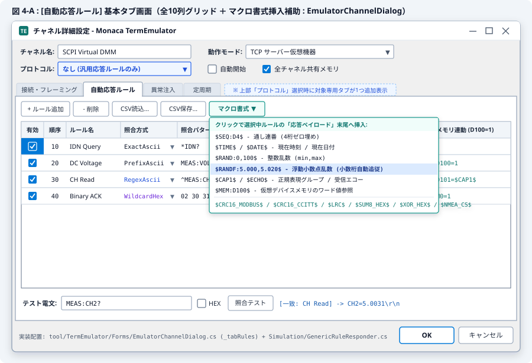
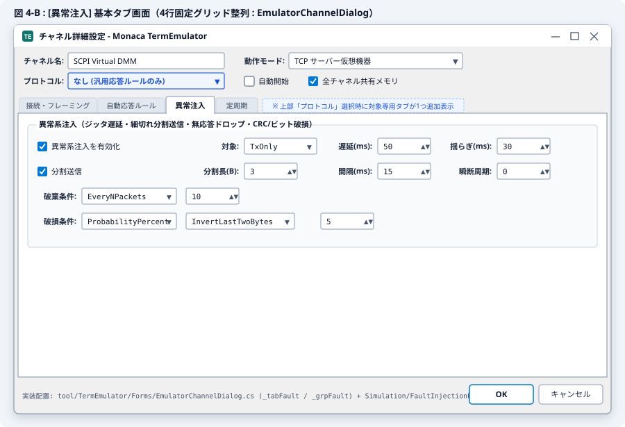
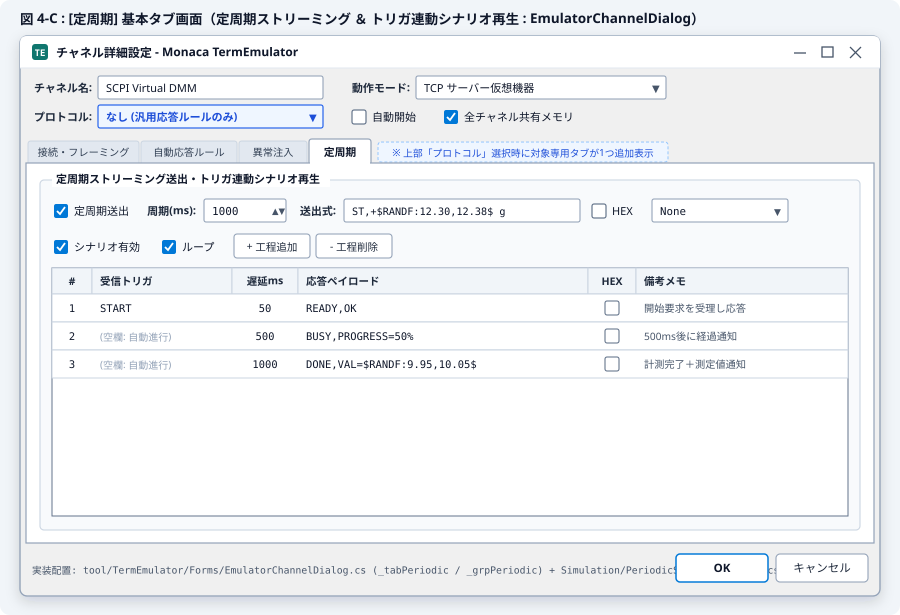
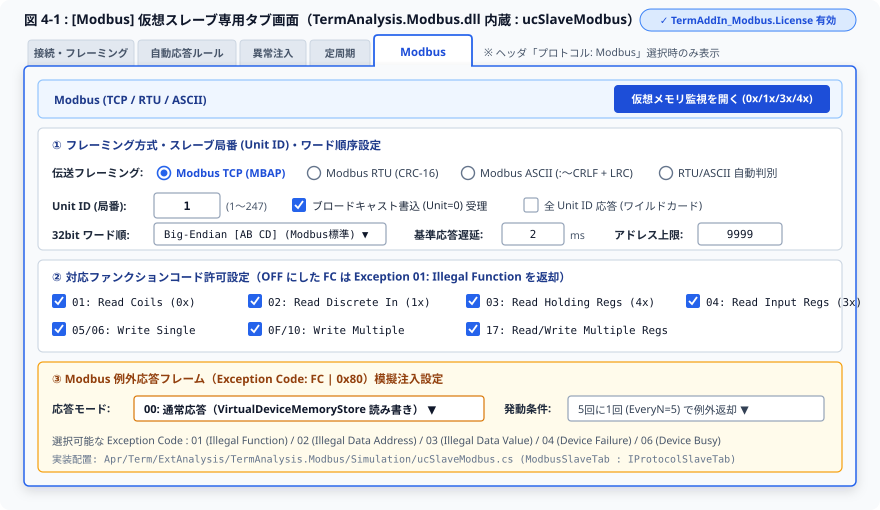
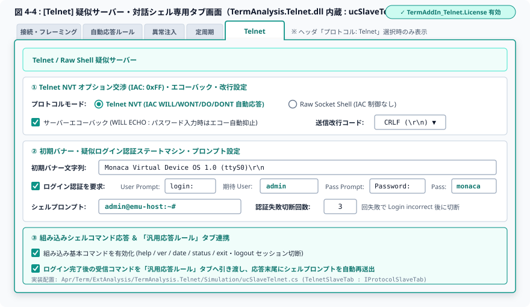
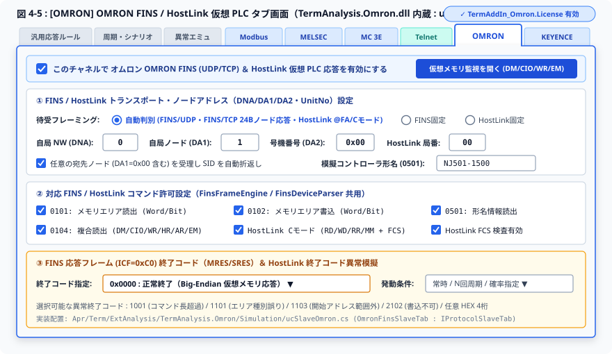
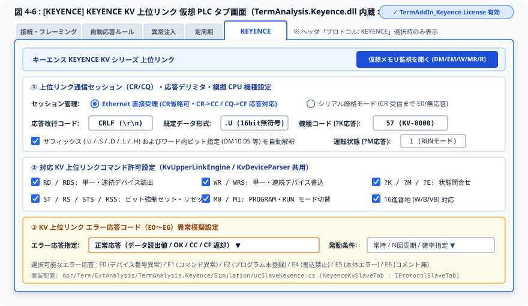
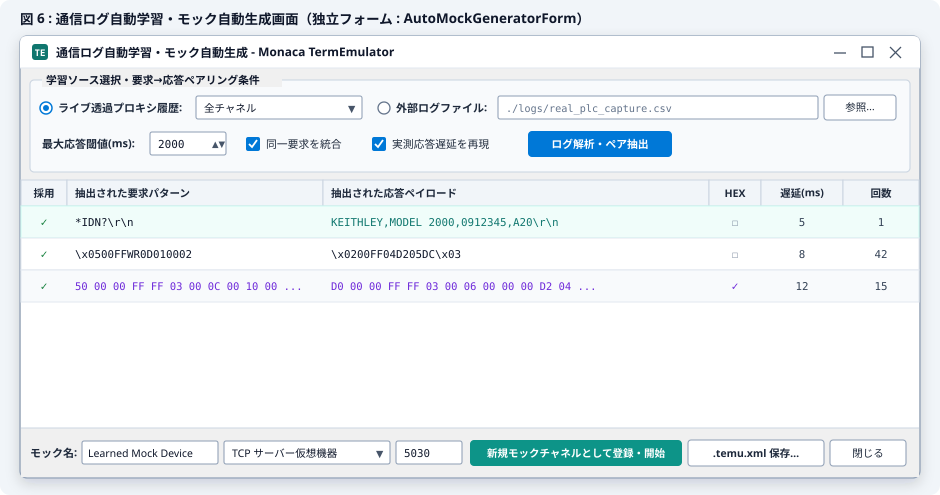

# TermEmulator 操作説明書 (User Operation Manual)

👉 [← TermEmulator 製品トップに戻る](../README.md)  
👉 [← TermAddIn 統合本体に戻る](https://github.com/Monaca-App/TermAddIn)

---

本書は、実機の計測器・PLC・組込基板・ネットワーク機器が手元にない環境でも、Windows PC 1 台で **仮想 COM ポート・物理シリアル・TCP / UDP・名前付きパイプの全 10 モード待受および透過インラインプロキシ中継 ** 、 ** 自動応答ルール・標準 5 プリセット・通信異常注入（遅延・無応答・分割・破損・強制瞬断） ** 、 ** 定周期ストリーミングおよびトリガ連動シナリオ送信 ** 、 ** 通信ログからの 1 クリック自動モック生成 ** 、ならびに ** 産業用 PLC 全 6 プロトコルの仮想スレーブおよび共有仮想デバイスメモリ監視 ** を実現する独立型ソフトウェア ** 「Monaca TermEmulator」** の総合操作説明書です。

画面構成・全メニューおよびボタンの動作・各設定項目の意味と入力例・産業用 6 プロトコル仮想スレーブの設定手順・コマンドライン（CLI）操作・目的別の実践チュートリアル・トラブルシューティングまで、本書 1 冊で完結して参照できます。

---

# 目次

- [第 1 章 はじめに（概要・用語解説・ライセンス・起動と終了）](#第-1-章-はじめに概要用語解説ライセンス起動と終了)
  - [1.1 本ツールの目的と 4 つの代表的な活用シーン](#11-本ツールの目的と-4-つの代表的な活用シーン)
  - [1.2 接続できる外部ソフトウェア・プログラミング言語・実機](#12-接続できる外部ソフトウェアプログラミング言語実機)
  - [1.3 はじめて使う方向け・基本用語の解説](#13-はじめて使う方向け基本用語の解説)
  - [1.4 ライセンスの仕組み・配置場所と 3 分間期間限定版](#14-ライセンスの仕組み配置場所と-3-分間期間限定版)
  - [1.5 起動・終了手順とウィンドウ位置の自動記憶・初期化](#15-起動終了手順とウィンドウ位置の自動記憶初期化)
- [第 2 章 メイン画面の操作（チャネルダッシュボード＆ランチャー）](#第-2-章-メイン画面の操作チャネルダッシュボードランチャー)
  - [2.1 メイン画面の全体構成](#21-メイン画面の全体構成)
  - [2.2 上部メニューバーの機能と操作](#22-上部メニューバーの機能と操作)
  - [2.3 上部ツールバーの機能と操作](#23-上部ツールバーの機能と操作)
  - [2.4 チャネル一覧グリッド（全 9 列）の見方と操作](#24-チャネル一覧グリッド全-9-列の見方と操作)
  - [2.5 下部ステータスバーの見方](#25-下部ステータスバーの見方)
- [第 3 章 チャネルの作成と詳細設定（チャネル設定ダイアログ）](#第-3-章-チャネルの作成と詳細設定チャネル設定ダイアログ)
  - [3.1 ダイアログの開き方と上部共通ヘッダの設定](#31-ダイアログの開き方と上部共通ヘッダの設定)
  - [3.2 基本タブ① `[接続・フレーミング]` の詳細設定](#32-基本タブ接続フレーミング-の詳細設定)
  - [3.3 全 10 種類の動作モードの解説と使い分け](#33-全-10-種類の動作モードの解説と使い分け)
  - [3.4 基本タブ② `[自動応答ルール]`・動的マクロ・標準 5 プリセット](#34-基本タブ自動応答ルール動的マクロ標準-5-プリセット)
  - [3.5 基本タブ③ `[異常注入]`（通信異常・回線品質エミュレーション）](#35-基本タブ異常注入通信異常回線品質エミュレーション)
  - [3.6 基本タブ④ `[定周期]`（定周期ストリーミング＆トリガ連動シナリオ）](#36-基本タブ定周期定周期ストリーミングトリガ連動シナリオ)
- [第 4 章 産業用プロトコル仮想スレーブの詳細設定（全 6 種）](#第-4-章-産業用プロトコル仮想スレーブの詳細設定全-6-種)
  - [4.1 産業用プロトコル仮想スレーブの共通操作と非破壊保存](#41-産業用プロトコル仮想スレーブの共通操作と非破壊保存)
  - [4.2 Modbus（TCP / RTU / ASCII）仮想スレーブ（`[Modbus]` タブ）](#42-modbustcp--rtu--ascii仮想スレーブmodbus-タブ)
  - [4.3 三菱電機 MELSEC 計算機リンク（1C〜4C / 形式 5）仮想スレーブ（`[MELSEC]` タブ）](#43-三菱電機-melsec-計算機リンク1c4c--形式-5仮想スレーブmelsec-タブ)
  - [4.4 三菱電機 MELSEC MC プロトコル（QnA 互換 3E）仮想スレーブ（`[MC 3E]` タブ）](#44-三菱電機-melsec-mc-プロトコルqna-互換-3e仮想スレーブmc-3e-タブ)
  - [4.5 Telnet / Raw Shell 仮想サーバー（`[Telnet]` タブ）](#45-telnet--raw-shell-仮想サーバーtelnet-タブ)
  - [4.6 オムロン FINS / HostLink 仮想スレーブ（`[OMRON]` タブ）](#46-オムロン-fins--hostlink-仮想スレーブomron-タブ)
  - [4.7 キーエンス KV 上位リンク仮想スレーブ（`[KEYENCE]` タブ）](#47-キーエンス-kv-上位リンク仮想スレーブkeyence-タブ)
- [第 5 章 専用ツールウィンドウの操作（通信モニター・対話コンソール・仮想メモリ・自動モック）](#第-5-章-専用ツールウィンドウの操作通信モニター対話コンソール仮想メモリ自動モック)
  - [5.1 リアルタイム通信モニター画面](#51-リアルタイム通信モニター画面)
  - [5.2 手動対話コンソール画面](#52-手動対話コンソール画面)
  - [5.3 共有仮想デバイスメモリ・インスペクタ画面（複数ウィンドウ並列監視対応）](#53-共有仮想デバイスメモリインスペクタ画面複数ウィンドウ並列監視対応)
  - [5.4 ログ学習・自動モック生成画面](#54-ログ学習自動モック生成画面)
- [第 6 章 実践チュートリアル（目的別 4 つの操作手順）](#第-6-章-実践チュートリアル目的別-4-つの操作手順)
  - [6.1 シナリオ A：実機なしで SCPI 計測器を 3 分で動かしてみる](#61-シナリオ-a実機なしで-scpi-計測器を-3-分で動かしてみる)
  - [6.2 シナリオ B：仮想 PLC（Modbus / MELSEC MC）と共有メモリを複数画面で監視する](#62-シナリオ-b仮想-plcmodbus--melsec-mcと共有メモリを複数画面で監視する)
  - [6.3 シナリオ C：異常注入でタイムアウト・再送リトライ処理を検証する](#63-シナリオ-c異常注入でタイムアウト再送リトライ処理を検証する)
  - [6.4 シナリオ D：実機の通信ログから 1 クリックで仮想モック機器を作る](#64-シナリオ-d実機の通信ログから-1-クリックで仮想モック機器を作る)
- [第 7 章 コマンドライン（CLI）モードのリファレンス](#第-7-章-コマンドラインcliモードのリファレンス)
  - [7.1 GUI モードと CLI モードの切り替え・終了コード](#71-gui-モードと-cli-モードの切り替え終了コード)
  - [7.2 CLI サブコマンド・オプション一覧](#72-cli-サブコマンドオプション一覧)
  - [7.3 バッチ処理・CI 自動テストでの実践例](#73-バッチ処理ci-自動テストでの実践例)
- [第 8 章 設定ファイルの管理・バックアップとトラブルシューティング（FAQ）](#第-8-章-設定ファイルの管理バックアップとトラブルシューティングfaq)
  - [8.1 設定ファイル・プロファイル・監査ログの保存場所](#81-設定ファイルプロファイル監査ログの保存場所)
  - [8.2 よくある質問とトラブルシューティング（FAQ）](#82-よくある質問とトラブルシューティングfaq)

---

# 第 1 章 はじめに（概要・用語解説・ライセンス・起動と終了）

## 1.1 本ツールの目的と 4 つの代表的な活用シーン

**Monaca TermEmulator** は、本物の計測器・PLC・組込基板・ネットワーク機器の代わりとなって通信応答を返す「仮想機器シミュレータ」兼「透過プロキシ・通信異常注入ツール」です。管理者権限や専用カーネルドライバのインストール、OS 再起動を一切必要とせず、標準ユーザー権限の Windows PC 1 台で動作します。

主に以下の 4 つの場面で活用できます。

1. **実機が届く前の先行開発・机上デバッグ**:
   PC 内にドライバレス仮想 COM ポート（例: `COM20`）やローカル TCP / UDP ポート（例: `127.0.0.1:5025`、`127.0.0.1:502`）を立ち上げ、本物の計測器や PLC と同じ形式で応答を返せます。実機の手配待ちや取り合いを解消し、通信プログラムや Excel シーケンスの開発を前倒しできます。
2. **実機では再現しにくい異常系・エラー耐性テスト**:
   実機は通常、正常な応答しか返さないため、上位アプリ側のタイムアウト処理やリトライ復旧処理を確認するのが困難です。本ツールでは、「5 回に 1 回だけ返事を返さない（無応答ドロップ）」「わざと 200 ms ± 100 ms 遅らせる」「1 バイトずつ細切れに分割して送る」「末尾のチェックサムを壊す」「通信途中で強制切断する」といった異常系テストを画面操作だけで安全に再現できます。
3. **現地の実機通信ログからの 1 クリック自動モック作成**:
   現地やテストベンチで採取した通信ログ（CSV またはテキスト形式）を読み込ませるだけで、「何が送られてきたら何を返すか」の要求・応答ペアと実測応答遅延を自動学習し、手作業でルールを書かずに仮想モック機器を生成できます。
4. **マルチベンダ PLC の共有デバイスメモリ連動シミュレーション**:
   Modbus・三菱電機 MELSEC（計算機リンク / MC 3E）・オムロン FINS / HostLink・キーエンス KV 上位リンクの各仮想スレーブが、同一の **仮想デバイスメモリ** を共有できます。たとえば「チャネル 0 の Modbus クライアントが書き込んだ数値を、チャネル 1 の MELSEC MC 3E クライアントが読み出す」といった、異なるメーカー機器間の連動確認も PC 1 台で完結します。

---

## 1.2 接続できる外部ソフトウェア・プログラミング言語・実機

本ツールは、当工房の **[TermAddIn](https://github.com/Monaca-App/TermAddIn)** や **Term** ・ **[c2c](https://github.com/Monaca-App/c2c)** だけでなく、OS 標準のシリアルポート・TCP / UDP ソケット・名前付きパイプを介して、あらゆる外部ツールや自作プログラムと接続できます。

| 接続相手のカテゴリ | 主な対応ソフトウェア・ハードウェア例 | 使用する通信方式 |
| :--- | :--- | :--- |
| **当工房製品群** | `TermAddIn`（Excel アドイン）、`Term.exe`、`c2c.exe` | ドライバレス仮想 COM、TCP / UDP、物理 COM |
| **汎用ターミナル・通信ツール** | Tera Term、PuTTY、RealTerm、Docklight、Hercules | 物理 COM / `com0com`、TCP、名前付きパイプ（`\\.\pipe\...`） |
| **プログラミング言語・自動化** | Python（`pyserial` / `socket` / `pymodbus` / `pymcprotocol`）、C# / .NET、C / C++、Node-RED、LabVIEW、MATLAB | TCP / UDP、COM ポート、名前付きパイプ |
| **FA・PLC ツール / SCADA** | Modbus Poll、ModScan、GX Works / MX Component、KV STUDIO、CX-Compolet、各種 SCADA・HMI | TCP（`502` / `5000` / `8501` / `9600`）、UDP（`9600` / `5001`）、COM |
| **仮想マシン（VM）** | Hyper-V / VMware / VirtualBox のゲスト OS 仮想シリアルポート | 名前付きパイプ（`\\.\pipe\<パイプ名>`）、TCP |
| **実機ハードウェア（透過プロキシ時）** | 実機 PLC、温調計、電子天秤、計測器、マイコン基板（Arduino / STM32 等） | 物理 COM ⇔ 物理/仮想 COM、TCP ⇔ TCP、UDP ⇔ UDP、COM ⇔ TCP |

---

## 1.3 はじめて使う方向け・基本用語の解説

操作画面や本書の中で頻出する専門用語の意味を整理しています。

* **チャネル（Channel）**:
  仮想機器 1 台分（または透過プロキシ 1 系統分）の設定セットのことです。チャネルごとに `E0`、`E1`、`E2` … という識別子（ID）が割り当てられます。たとえば「`E0` ＝ 仮想デジタルマルチメータ」「`E1` ＝ 仮想 Modbus 温調計」のように、複数台の仮想機器を同時に稼働させられます。
* **エンドポイント A / エンドポイント B**:
  通信の出入口（ポートやアドレス）のことです。
  * **エンドポイント A（上位側・待受側）**: Excel（TermAddIn）や Python などの上位アプリケーションが接続してくる窓口です。
  * **エンドポイント B（下位側・転送先側）**: 透過プロキシモード時に「奥にある本物の実機」へ接続する出口、または TCP クライアントモード時の接続先サーバーを指定する欄です。単独の待受仮想機器として使うときは使用しません。
* **インライン透過プロキシ（透過中継）**:
  上位アプリと本物の実機の間に TermEmulator を割り込ませる接続方式です。通常は上位アプリからの要求をそのまま実機へ転送し、実機の応答をそのまま上位アプリへ返します（素通し）。その途中で通信ログを採取したり、特定のコマンドだけエミュレータ側で応答を差し替えたり、遅延やエラーを混ぜたりできます。
* **フレーミング（フレーム区切り）**:
  シリアルや TCP のように連続して流れてくるデータから、「どこまでが 1 つの電文（コマンド）の区切りか」を判断するルールです。たとえば、末尾に改行（`CrLf`）が来たら 1 電文とみなす方式や、20 ms 以上データが途絶えたら 1 電文とみなす方式（`IdleTimeout`）などがあります。
* **動的マクロ（`$...$`）**:
  自動応答ルールや定周期送信の文字列の中に埋め込んでおくと、送信する瞬間に実際の値へ自動変換される記号です。たとえば `+$RANDF:5.000,5.020$` と書くと、送信のたびに `+5.004`、`+5.018` のように少しずつ揺らいだ測定値を返せます。
* **チェックサム（誤り検出符号）**:
  通信途中でデータが壊れていないか検証するため、電文の末尾に付加する計算値（CRC-16、LRC、SUM、XOR、NMEA チェックサム等）です。本ツールでは送信時に自動計算して末尾へ付与できます。
* **仮想デバイスメモリ**:
  PLC 内部のメモリ領域（`D100`、`DM0`、`4x0001`、`M0` など）を PC のメモリ上に再現した領域です。産業用プロトコル仮想スレーブからの読み書き対象になるほか、「共有仮想デバイスメモリ・インスペクタ画面」から手動で数値を直接書き換えることもできます。

---

## 1.4 ライセンスの仕組み・配置場所と 3 分間期間限定版

本ツールは、用途に応じて無駄なく導入できる **2 段階のライセンス認証方式** を採用しています。

### 1. 2 段階ライセンスの構成

| 段階 | ライセンスファイル名 | 有効化される機能範囲 |
| :---: | :--- | :--- |
| **第 1 段階（必須・本体） ** | **`TermEmulator.License`** | ** アプリ本体の起動および基本機能一式** ：全 10 通信／透過プロキシモード、汎用自動応答ルール、動的マクロ、7 種チェックサム、標準 5 プリセット、異常注入、定周期・トリガ連動シナリオ、リアルタイム通信モニター、手動対話コンソール、自動モック生成、CLI モード |
| **第 2 段階（任意・拡張） ** | **`TermAddIn_Modbus.License`**<br>**`TermAddIn_Melco.License`**<br>**`TermAddIn_MelcoMC.License`**<br>**`TermAddIn_Telnet.License`**<br>**`TermAddIn_Omron.License`**<br>**`TermAddIn_Keyence.License`** | 対応する ** 産業用プロトコル仮想スレーブ機能 ** 、チャネル設定画面上部ヘッダの **`プロトコル:`** 選択肢、および専用設定タブ画面が自動解放されます。<br>※すでに `TermAddIn` 用に保有しているライセンスファイルをそのまま共用できます（追加購入不要）。 |

### 2. ライセンスファイルの配置場所（探索優先順位）

取得した `.License` ファイルは、以下のいずれかのフォルダへ配置してください（上位のフォルダから順に探索されます）。

1. 起動時のカレントディレクトリ
2. **`%USERPROFILE%\Desktop\Monaca\`** （既定のデスクトップ `Monaca` フォルダ — ** 推奨** ）
3. 環境設定で変更した共通設定フォルダ（`Setting.xml` の保存先）
4. **`TermEmulator.exe`** と同じフォルダ

> [!NOTE]
> `Documents\Monaca\` フォルダは探索対象外です。必ず上記 1〜4 のいずれか（通常はデスクトップの `Monaca` フォルダ）へ配置してください。

### 3. ライセンス未配置・無効時の動作（3 分間の期間限定版）

ライセンスファイルが配置されていない、または無効な状態で起動した場合は、 **「3 分間の期間限定版」** として動作します。

* 起動から 3 分間は、本体機能および配置済み DLL に対応する産業用プロトコル 6 種を含む全機能を制限なく試用できます。
* 3 分が経過すると期限満了の通知が表示され、稼働中の全チャネルの通信を安全に停止したうえでメイン画面および開いている全子画面の操作をロックします。
* CLI の `run` コマンド実行時は、最大稼働時間が 3 分間（`180,000` ms）に制限されます。
* 正規のライセンスファイルを所定フォルダへ配置してアプリを再起動すると、時間制限が解除されて下部ステータスバーに `ライセンス認証済` と表示されます。

---

## 1.5 起動・終了手順とウィンドウ位置の自動記憶・初期化

### 1. 起動方法
* スタートメニューまたはインストールフォルダ内の **`TermEmulator.exe`** をダブルクリック（引数なしで実行）すると、GUI モードでメイン画面が起動します。
* 起動時に、チャネル一覧で **`有効`** チェックが ON になっているチャネルは自動的に待受・接続が開始されます。
* 前回終了時に開いていた各ツールウィンドウ（通信モニター・対話コンソール等）の位置・サイズ・モニター拡大率（DPI）が自動的に復元されます。

### 2. 終了方法
* メイン画面右上の **`[×]`** ボタン、またはメニューの **`[ファイル(F)] ➔ [終了(X)]`** をクリックします。
* 稼働中のすべてのポート・仮想 COM・TCP / UDP ソケット・名前付きパイプ・透過プロキシが安全に停止・解放され、開いている各ウィンドウの座標・サイズが `Setting.xml` へ自動保存されて終了します。

### 3. サブウィンドウが見えなくなった場合の初期化手順
マルチモニター構成の変更やサブモニターの取り外しなどにより、ウィンドウが画面外へ移動して見えなくなった場合は、以下のいずれかの方法で全 6 画面の位置とサイズを初期状態（プライマリモニター中央）へ戻せます。

* **メニューから初期化 **: メイン画面の **`[ヘルプ(H)] ➔ [ウィンドウ位置を初期化(W)]`** をクリックします。
* **コマンドラインから初期化 **: コマンドプロンプトまたは PowerShell で **`TermEmulator.exe --window-init`** を実行して起動します。

---

# 第 2 章 メイン画面の操作（チャネルダッシュボード＆ランチャー）

本ツールは、1 つの画面に全機能を詰め込まず、役割ごとに独立した **6 つの専用ウィンドウ ** で構成されています。必要なウィンドウだけを開き、デスクトップやマルチモニター上に自由に並べて作業できます。その中心となる司令塔が ** メイン画面** です。

## 2.1 メイン画面の全体構成

メイン画面は、上から **① メニューバー ** 、 **② ツールバー ** 、 **③ チャネル一覧グリッド（全 9 列） ** 、 **④ 下部ステータスバー** の 4 つのエリアで構成されています。


---

## 2.2 上部メニューバーの機能と操作

上部メニューバーには 5 つのメニュー分類があり、ファイル入出力・チャネル管理・専用ウィンドウの呼び出し・環境設定・ヘルプへアクセスできます。

### 1. `ファイル(F)` メニュー
設定プロファイル（`.temu.xml`）の外部ファイル入出力とアプリケーション終了を行います。

| メニュー項目 | 機能と操作の詳細 |
| :--- | :--- |
| **`プロファイル読込 (.temu.xml)`** | 他の PC で作成したプロファイルや、自動モック生成で保存した `.temu.xml` ファイルを選択して読み込みます。読み込まれた設定は新しいチャネルとして一覧末尾に追加登録されます（既存のチャネルは消えません）。 |
| **`プロファイル保存 (.temu.xml)`** | チャネル一覧で現在選択しているチャネルの接続条件・フレーミング・自動応答ルール・異常注入・定周期・産業用プロトコル設定を 1 つの XML ファイル（`*.temu.xml`）へ書き出します。チームメンバーへのテスト環境配布やバックアップに便利です。 |
| **`終了(X)`** | 現在表示中の各子ウィンドウの位置・サイズを保存し、稼働中の全チャネルを安全に停止してアプリケーションを終了します。 |

### 2. `チャネル(C)` メニュー
仮想機器・透過プロキシチャネルの追加・編集・削除および一括稼働制御を行います。

| メニュー項目 | 機能と操作の詳細 |
| :--- | :--- |
| **`追加`** | 新しい仮想機器または透過プロキシチャネルを作成するため、「チャネル設定ダイアログ」（第 3 章）を新規作成モードで開きます。 |
| **`編集`** | 一覧で選択中のチャネルの「チャネル設定ダイアログ」を開きます。設定を変更して **`[OK]`** を押すと、稼働中のチャネルであっても新しい設定で自動的に再適用されます。 |
| **`削除`** | 確認ダイアログを表示し、 **`[はい]`** を選ぶと選択中のチャネルを停止して一覧および設定ファイルから削除します。削除操作を行っても、 ** 他の稼働中チャネルの通信は切断されません** 。 |
| **`全開始`** | 各チャネルの **`有効`** チェックボックス（起動時自動開始フラグ）の状態を変更することなく、一覧に登録されている全チャネルを一括で待受・接続開始します。 |
| **`全停止`** | 現在稼働しているすべてのチャネルを一括で停止し、使用中の COM ポート・TCP / UDP ポート・名前付きパイプを解放します。 |

### 3. `ツール(T)` メニュー
独立した専用ツールウィンドウを起動します（既に開いているウィンドウを選んだ場合は、最前面へアクティブ表示されます）。

| メニュー項目 | 機能と操作の詳細 |
| :--- | :--- |
| **`通信モニター`** | 送受信フレームや異常注入イベントを時系列監視する「リアルタイム通信モニター画面」（§5.1）を開きます。 |
| **`対話コンソール`** | 稼働中チャネルへ任意のテスト電文を手動送信できる「手動対話コンソール画面」（§5.2）を開きます。 |
| **`仮想メモリ監視`** | PLC 仮想スレーブのデバイス値をリアルタイム監視・編集する「共有仮想デバイスメモリ・インスペクタ画面」（§5.3）を開きます。 |
| **`別のメモリ監視ウィンドウを追加`** | 複数のデバイス領域（例: `D` レジスタと `M` リレー、`4x` と `0x` 等）を同時に並べて監視するため、新しいメモリ監視ウィンドウを追加起動します（何枚でも並列表示可能です）。 |
| **`自動モック生成`** | 透過プロキシの履歴や外部ログファイルから自動応答ルールを抽出する「ログ学習・自動モック生成画面」（§5.4）を開きます。 |

### 4. `設定(S)` メニュー
アプリケーション全体の言語・保存先・ログ設定を行います。

| メニュー項目 | 機能と操作の詳細 |
| :--- | :--- |
| **`環境設定(E)...`** | Monaca 共通の環境設定ダイアログを開きます。設定ファイル（`Setting.xml`）の保存先確認のほか、 **UI 表示言語（`自動` / `日本語` / `英語`）を通信継続中のままリアルタイムに切り替え** できます。 |
| **`エラー履歴(L)...`** | ログ保存先フォルダ、ログファイル名（既定 `info.log`）、出力ログレベルの確認・変更、および通信エラーやライセンス検証結果などの診断ログ履歴を確認できます。 |

### 5. `ヘルプ(H)` メニュー
マニュアル表示・ウィンドウ位置初期化・バージョン確認を行います。

| メニュー項目 | 機能と操作の詳細 |
| :--- | :--- |
| **`操作説明書(M)...`** | 本操作説明書（HTML 版）を既定のブラウザで開きます。 |
| **`ウィンドウ位置を初期化(W)`** | 全 6 画面の保存済み座標・サイズをリセットし、プライマリモニター中央の初期配置へ戻します。 |
| **`バージョン情報(A)...`** | アプリケーションのバージョン番号、著作権情報、本体ライセンス（`TermEmulator.License`）および有効な産業用プロトコル拡張ライセンスの認証状態を確認できます。 |

---

## 2.3 上部ツールバーの機能と操作

上部ツールバーには、日常的によく使う操作が左から **「チャネル編集」「稼働制御」「専用画面起動」** の 3 グループに分けて配置されています。

| グループ | ボタン名 | 操作方法と詳しい動作 |
| :--- | :--- | :--- |
| **チャネル編集 ** | **`+ 追加`** | 新しいチャネルを作成する「チャネル設定ダイアログ」を開きます。 |
| | **`プリセット ▼`** | クリックすると標準 5 種の機器プリセット（SCPI 計測器・電子天秤・バーコードリーダ・AT モデム・NMEA GPS）のドロップダウンメニューが開きます。項目を 1 つ選ぶだけで、接続設定と応答ルールが組み込まれた完成済みチャネルが即座に一覧へ追加されます。 |
| | **`設定編集`** | 一覧で選択中のチャネルの設定画面を開きます。一覧の行を ** ダブルクリック** しても同じ操作になります。 |
| | **`削除`** | 一覧で選択中のチャネルを確認ダイアログのうえで停止・削除します。 |
| **稼働制御 ** | **`開始`** | 選択中のチャネル 1 つだけを待受・接続開始します。<br>※個別 **`開始`** を実行すると、そのチャネルの **`有効`** （次回起動時の自動開始）チェックも自動的に ON になって保存されます。 |
| | **`停止`** | 選択中のチャネル 1 つだけを停止します。 |
| | **`全開始`** | 登録されている全チャネルを一括開始します（※個別の `有効` チェック状態は書き換えません）。 |
| | **`全停止`** | 稼働中の全チャネルを一括停止します。 |
| **専用画面起動 ** | **`通信モニター`** | 「リアルタイム通信モニター画面」を開きます（表示中なら前面化）。 |
| | **`対話コンソール`** | 「手動対話コンソール画面」を開きます（表示中なら前面化）。 |
| | **`仮想メモリ`** | 「共有仮想デバイスメモリ・インスペクタ画面」を開きます（すでに表示中の場合は、別のデバイス領域を並べて見られるよう追加ウィンドウを起動します）。 |
| | **`自動モック`** | 「ログ学習・自動モック生成画面」を開きます。 |

---

## 2.4 チャネル一覧グリッド（全 9 列）の見方と操作

メイン画面中央の表では、登録されている全チャネルの設定要約・リアルタイム稼働状態・通信統計を **全 9 列** で一覧表示します（統計数値は 500 ms 周期で自動更新されます）。

| 列順 | 列見出し | 表示内容と操作のポイント |
| :---: | :--- | :--- |
| **1** | **`有効`** | チェックボックス列です。ON にしておくと、次回 TermEmulator を起動したときにそのチャネルが自動で待受開始されます。表上で直接クリックして ON / OFF を切り替えられます。 |
| **2** | **`ID`** | チャネルの一意識別子（`E0`, `E1`, `E2`, ...）です。通信モニターや CLI 操作でチャネルを特定する際の目印になります。 |
| **3** | **`チャネル名`** | 利用者が設定したわかりやすい名前（例: `SCPI Virtual DMM`, `仮想Modbus温調計`）を表示します。 |
| **4** | **`動作モード`** | 選択されている通信モードの名称（例: `TCP サーバー仮想機器`, `Monaca 仮想COMホスト`, `TCP 透過プロキシ`）を表示します。 |
| **5** | **`接続先・待受設定`** | 待受ポートや転送先アドレスの要約を表示します（例: `TCP 127.0.0.1:5025`、`COM20:9600,8,N,1`、`1502 -> 192.168.1.10:502`）。 |
| **6** | **`プロトコル`** | 有効化されている産業用プロトコル仮想スレーブの識別名（`Modbus`, `MelsecLink`, `MelsecMc3E`, `TelnetServer`, `OmronFins`, `KeyenceKv` 等）を表示します。汎用応答ルールのみの場合は `-` と表示されます。 |
| **7** | **`稼働状態`** | 現在の状態を色分けでリアルタイム表示します。<br>・ **`接続中`** （濃緑）：クライアントが接続済みで通信可能な状態<br>・ **`待受中`** （青）：ポートを開いて接続・受信を待機している状態<br>・ **`停止中`** （灰）：チャネルが停止している状態 |
| **8** | **`受信 / 送信 (B)`** | そのチャネルで累計やり取りした「受信バイト数 / 送信バイト数」（例: `1,420 / 3,840`）を表示します。 |
| **9** | **`応答数`** | ルール応答・仮想スレーブ応答・透過プロキシ中継で処理した累計フレーム数を表示します。 |

* **クイック操作 **: 一覧の行を ** ダブルクリック** すると、そのチャネルの「チャネル設定ダイアログ」を直接開けます。

---

## 2.5 下部ステータスバーの見方

画面最下部のステータスバーには、システム全体の稼働サマリーが 1 行で常時表示されます。

```text
稼働: 3 / 4 チャネル | 累計TX: 18,190 B | 累計RX: 12,964 B | 有効拡張: Modbus, MELSEC, MC 3E, Telnet, OMRON, KEYENCE | ライセンス認証済
```

* **稼働**: `稼働中チャネル数 / 登録済み総チャネル数`
* **累計 TX / RX**: 全チャネル合算の送信・受信バイト数
* **有効拡張**: 現在ライセンス認証および DLL 検出により利用可能な産業用プロトコル一覧
* **ライセンス認証状態**: `ライセンス認証済 (<利用者名>)`、`3分間期間限定版`、または `未認証ロック` を表示します。

---

# 第 3 章 チャネルの作成と詳細設定（チャネル設定ダイアログ）

1 つの仮想機器（または透過プロキシ）に関するすべての通信条件・応答ルール・異常注入・定周期送信・産業用プロトコル設定は、 **「チャネル設定ダイアログ」** でまとめて設定します。

## 3.1 ダイアログの開き方と上部共通ヘッダの設定

メイン画面の **`+ 追加`** ボタン（新規作成）または **`設定編集`** ボタン（既存行のダブルクリックでも可）をクリックすると、チャネル設定ダイアログが開きます。


画面最上部には、どのタブを開いていても常に表示される **2 行構成の共通ヘッダ** があります。

| 行 | 項目名 | 機能・設定内容と使い方のポイント |
| :---: | :--- | :--- |
| **1 行目 ** | **`チャネル名`** | 仮想機器を識別しやすい任意の名前を入力します（例: `温度計シミュレータ`、`ライン1_仮想PLC`）。 |
| **1 行目 ** | **`動作モード`** | 単独仮想機器 6 種・透過プロキシ 4 種の全 10 モードから選択します（各モードの詳細は §3.3）。モードを切り替えると、下の `[接続・フレーミング]` タブで必要な入力欄だけが自動で有効になります。 |
| **2 行目 ** | **`プロトコル`** | **`なし (汎用応答ルールのみ)`** またはライセンス有効な産業用プロトコル（`Modbus` / `MELSEC` / `MC 3E` / `Telnet` / `OMRON` / `KEYENCE`）から 1 つを選択します。<br>※ **`Term.exe` の通信モード選択と同じ仕組み ** になっており、ここで選んだプロトコルの専用設定タブ 1 つだけが基本 4 タブの右側に表示され、 **`[OK]`** 確定時にそのプロトコルが有効化されます。 |
| **2 行目 ** | **`自動開始`** | チェックを ON にすると、次回 TermEmulator を起動したときにこのチャネルが自動で待受開始されます。 |
| **2 行目 ** | **`全チャネル共有メモリ`** | チェックを ON（既定）にすると、他チャネルと共通の仮想デバイスメモリ空間を使用します。OFF にすると、このチャネル専用の独立したメモリ空間を使用します。 |

* **画面下部の確定ボタン**:
  * **`[OK]`**: 入力内容を検証してチャネル設定へ反映し、ダイアログを閉じます（稼働中チャネルの場合は自動で再適用されます）。
  * **`[キャンセル]`**: 編集中の内容をすべて破棄し、ダイアログを開く前の設定をそのまま維持して閉じます。

---

## 3.2 基本タブ① `[接続・フレーミング]` の詳細設定

`[接続・フレーミング]` タブは、通信の出入口（エンドポイント A / B）と電文の区切り方（フレーミング）を設定するタブです。上から 3 つのグループ枠に分かれています。

### 1. エンドポイント A（仮想機器待受側 / プロキシ待受側）
上位アプリ（Excel / TermAddIn / Python / Tera Term 等）が接続してくる窓口を設定します。選択した `動作モード` に応じて、関係のない入力欄は自動的にグレーアウト（無効化）されます。

* **シリアル設定（`Monaca 仮想COMホスト` / `シリアルポート仮想機器` / `シリアル透過プロキシ` / `シリアル <-> TCP 変換プロキシ` 選択時）**:
  * **`COM`**: 使用する COM ポート名を指定します（例: ドライバレス仮想 COM なら `COM20`、物理 COM なら `COM3`）。
  * **`速度`（ボーレート）**: `1200`〜`460800` bps（一般的には `9600` または `115200`）。
  * **`ビット` / `パリティ` / `ストップ` / `制御`**: データ長（`7` / `8`）、パリティ（`None` / `Even` / `Odd` 等）、ストップビット（`1` / `2`）、フロー制御（`None` / `RTS/CTS` / `Xon/Xoff`）を接続相手の条件に合わせます。
* **TCP / UDP 設定（`TCP サーバー` / `UDP エンドポイント` / `TCP・UDP 透過プロキシ` 選択時）**:
  * **`待受IP`**: 同一 PC 内からのみ接続を許可する場合は **`127.0.0.1`** （推奨・ファイアウォール警告が出にくい）、LAN 上の別 PC からの接続も受け付ける場合は **`0.0.0.0`** を指定します。
  * **`ポート`**: 待受ポート番号（`1`〜`65535`）を指定します（例: SCPI `5025`、Modbus TCP `502`、MELSEC MC `5000`、OMRON FINS `9600`、KEYENCE KV `8501`）。
* **名前付きパイプ設定（`名前付きパイプ仮想機器` 選択時）**:
  * **`パイプ名`**: 任意のパイプ名（例: `MonacaMockPipe1`）を入力します。OS 上では `\\.\pipe\MonacaMockPipe1` として公開されます。

### 2. エンドポイント B（TCP クライアント接続先 / 透過プロキシ実機転送先）
`TCP クライアント仮想機器` または `透過プロキシ 4 モード` を選択したときだけ有効になるグループ枠です（単独のサーバー待受モード時は無効表示になります）。

* **`転送先ホスト` / `転送先ポート`**: 接続先のサーバーや実機 PLC の IP アドレス（またはホスト名）とポート番号を入力します（例: `192.168.1.10` / `502`）。
* **`対向COM` / `対向速度`**: `シリアル透過プロキシ` 選択時に、奥にある実機側の物理 COM ポート名（例: `COM4`）とボーレート（例: `9600`）を指定します。

### 3. フレーム区切り・文字コード・既定チェックサム
受信データをどのタイミングで「1 電文の完了」と判断するか、および応答時の文字コード・終端記号を設定します。

| 項目名 | 選択肢・入力範囲 | 機能と選び方の目安 |
| :--- | :--- | :--- |
| **`区切り`** | `CrLf` / `Cr` / `Lf` / `IdleTimeout` / `FixedLength` / `CustomHex` / `None` | ・ **`CrLf` / `Cr` / `Lf`**: 改行コードで 1 電文を区切ります（SCPI 計測器・電子天秤・AT コマンド・KV 上位リンク等のテキスト通信に最適）。<br>・ **`IdleTimeout`**: 指定したミリ秒数の間データ受信が途絶えたら 1 電文の完了とみなします（バイナリ通信や可変長フレームに便利）。<br>・ **`FixedLength`**: 指定バイト数に達するごとに 1 電文として切り出します。<br>・ **`CustomHex`**: 特定のバイト列（例: `03` ＝ ETX）が来たら 1 電文として切り出します。<br>・ **`None`**: 区切りを待たず、受信した塊をそのまま即時評価します。<br>※産業用プロトコル仮想スレーブを有効にしている場合は、プロトコル側が自動でフレーム長・終端を判別するため、通常は既定のままで動作します。 |
| **`無通信(ms)`** | 整数（例: `20`〜`100` ms） | `区切り` が `IdleTimeout` のときに使用する無通信判定時間です。 |
| **`固定長(B)`** | 整数（バイト数） | `区切り` が `FixedLength` のときに使用する 1 フレームのバイト長です。 |
| **`区切りHEX`** | 16 進バイト列（例: `03`、`0D 0A`） | `区切り` が `CustomHex` のときに終端とみなすバイト列です。 |
| **`文字コード`** | `UTF-8` / `ASCII` / `Shift_JIS` 等 | テキスト系ルールの照合および応答送出に使用する文字エンコーディングです。 |
| **`終端記号`** | `\r\n` / `\r` / `\n` / 空欄 等 | 自動応答ルールで `+Term` チェックが ON のときに応答末尾へ自動付加される終端文字列です。 |
| **`チェックサム`** | `None` / `Crc16Modbus` / `Crc16Ccitt` / `LrcAscii` / `Sum8AsciiHex` / `Sum8Binary` / `XorBcc` / `NmeaXor` | 応答電文の末尾へ既定で自動計算付加するチェックサム方式を指定します（通常は `None` とし、必要なルールだけ動的マクロで付与することもできます）。 |

---

## 3.3 全 10 種類の動作モードの解説と使い分け

本ツールは、 **単独仮想デバイス系（6 モード）** と ** インライン透過プロキシ系（4 モード）** の合計 10 モードを備えています。目的に合わせて選択してください。

### 1. 単独仮想デバイス系（全 6 モード：実機なしで PC 内に仮想機器を作る）

| UI 表示モード名（内部列挙名） | エンドポイント A | エンドポイント B | 詳しい動作と使い分け |
| :--- | :--- | :--- | :--- |
| **`Monaca 仮想COMホスト (ドライバレス)`**<br>(`MonacaVirtualComHost`) | 公開する仮想 COM 名<br>（例: `COM20`） | *(不要)* | カーネルドライバ不要で新規の仮想 COM ポートを公開します。 **同一 PC 内の `TermAddIn` / `Term.exe` と直結してシリアルテストする際の最推奨モード** です（`c2c` の併用は不要です）。 |
| **`シリアルポート仮想機器 (物理/仮想COM)`**<br>(`SerialPortDevice`) | 既存 COM 名<br>（例: `COM3`、`COM11`） | *(不要)* | PC にある物理 USB-シリアルポートや、`c2c` / `com0com` で作成した仮想 COM ペアの片側を開いて仮想機器として応答します。外部 PC や Tera Term / Python `pyserial` からシリアル接続したいときに使用します。 |
| **`TCP サーバー仮想機器`**<br>(`TcpServerDevice`) | 待受 IP・ポート<br>（例: `127.0.0.1:502`） | *(不要)* | 指定ポートで TCP 接続を待ち受けます（複数クライアントからの同時接続に対応）。SCPI 計測器、Modbus TCP、MELSEC MC 3E、FINS/TCP、KEYENCE KV TCP、Telnet サーバー等の模擬に最もよく使います。 |
| **`TCP クライアント仮想機器`**<br>(`TcpClientDevice`) | *(自動)* | 接続先 Host:Port<br>（例: `127.0.0.1:9000`） | 上位サーバーが待受側となっているシステムに対し、仮想機器側から能動的に TCP 接続しに行きます。回線が切断された場合も自動で再接続を試みます。 |
| **`UDP エンドポイント仮想機器`**<br>(`UdpEndpointDevice`) | ローカル待受ポート<br>（例: `127.0.0.1:9600`） | *(任意: 固定送信先)* | UDP データグラムを待ち受け、送信元へ応答を返します。OMRON FINS/UDP、KEYENCE KV UDP、NMEA ブロードキャスト配信等の検証に使用します。 |
| **`名前付きパイプ仮想機器`**<br>(`NamedPipeDevice`) | パイプ名<br>（例: `MonacaMockPipe1`） | *(不要)* | Windows 標準の名前付きパイプ（`\\.\pipe\<パイプ名>`）を作成します。ドライバ不要で PuTTY Serial や Hyper-V / VMware ゲスト OS の仮想 COM、自作アプリと高速通信できます。 |

### 2. インライン透過プロキシ系（全 4 モード：上位アプリと本物の実機の間に割り込む）

透過プロキシモードでは、上位アプリから届いた電文が **「自動応答ルールや仮想スレーブに一致した場合」はエミュレータ側で代理応答 ** し、 ** 「一致しなかった場合」はそのまま奥の実機（エンドポイント B）へ転送して実機の応答を返します** 。これにより、実機通信のログ採取・自動モック学習・特定コマンドだけの異常注入や値差し替えが可能になります。

| UI 表示モード名（内部列挙名） | エンドポイント A（上位側） | エンドポイント B（実機側） | 詳しい動作と使い分け |
| :--- | :--- | :--- | :--- |
| **`シリアル透過プロキシ (COM A <-> COM B)`**<br>(`SerialInlineProxy`) | 上位アプリ側 COM<br>（例: `COM11`） | 実機側物理 COM<br>（例: `COM4`） | 2 つのシリアルポート間を透過中継します。上位アプリを仮想 COM（`c2c` ペアの片側等）につなぎ、実機側の物理 COM と中継することで、分岐ケーブルなしで通信監視・異常注入を行えます。 |
| **`TCP 透過プロキシ (待受 <-> 実機転送先)`**<br>(`TcpInlineProxy`) | ローカル待受ポート<br>（例: `127.0.0.1:1502`） | 実機 IP:Port<br>（例: `192.168.1.10:502`） | LAN 上の実機 PLC や計測器の前にプロキシとして割り込みます。上位アプリの接続先を `127.0.0.1:1502` に向けるだけで、実機との往復電文をすべて記録・異常注入できます。 |
| **`UDP 透過プロキシ (ローカル <-> 実機転送先)`**<br>(`UdpInlineProxy`) | ローカル待受ポート<br>（例: `127.0.0.1:19600`） | 実機 IP:Port<br>（例: `192.168.250.1:9600`） | OMRON FINS/UDP や KEYENCE KV UDP などの UDP 実機との往復データグラムを透過中継・監視・異常注入します。 |
| **`シリアル <-> TCP 変換プロキシ`**<br>(`SerialTcpBridgeProxy`) | 上位側 COM または TCP 待受 | 実機側 TCP または物理 COM | シリアル通信と TCP ネットワーク通信を相互変換して中継します。物理シリアル機器を LAN 経由で公開（シリアルデバイスサーバー化）しながら、監視や異常注入も同時に行えます。 |

---

## 3.4 基本タブ② `[自動応答ルール]`・動的マクロ・標準 5 プリセット

`[自動応答ルール]` タブは、「どのような受信電文が来たら、どのような応答を返すか」を一覧表で自由に定義できる機能です。SCPI 計測器・バーコードリーダ・独自プロトコルのマイコン基板など、あらゆる機器を再現できます。



### 1. 上部操作バーの使い方
* **`+ ルール追加`** / **`- 削除`**: 一覧へ新しいルール行を追加、または選択中の行を削除します。
* **`CSV読込...`** / **`CSV保存...`**: 定義したルール一覧を CSV ファイルとして入出力します。大量のコマンド応答パターンを Excel で一括編集し、再度読み込む運用に便利です。
* **`マクロ書式 ▼`**: クリックすると、使用可能な動的マクロやチェックサム変数のメニュー一覧が表示されます。メニューから項目を選ぶだけで、 ** 現在選択している行の `応答ペイロード` 欄の末尾へ書式がワンクリック挿入** されるため、記号の綴りを暗記する必要がありません。

### 2. 自動応答ルール一覧グリッド（全 10 列）の詳細
受信電文が届くと、 **`有効` が ON のルールを `順序`（優先順位）の小さい順（上から順）に評価し、最初に一致したルール 1 件だけを実行** します。

| 列名 | 設定内容・入力例 | 詳しい動作説明 |
| :--- | :--- | :--- |
| **`有効`** | チェックボックス（ON / OFF） | OFF にするとルールを削除せずに一時無効化できます。 |
| **`順序`** | 数値（例: `10`, `20`, `30`） | ルールの評価優先順位です。数値が小さいほど先に判定されます。汎用的なフォールバック応答は大きい数値（例: `999`）にして最後に置きます。 |
| **`ルール名`** | 任意の名称（例: `IDN応答`, `電圧測定`） | 通信モニター画面の「解析詳細」欄に表示される識別名です。 |
| **`照合方式`** | 6 種のドロップダウン選択 | 受信電文と `照合パターン` をどう比較するか選びます（下記「全 6 種の照合方式」参照）。 |
| **`照合パターン`** | 文字列・正規表現・HEX 列 | 受信電文と照合する条件を入力します（例: `*IDN?`、`^VOLT\s+([0-9.]+)$`、`01 03 ?? ?? 00 02`）。 |
| **`応答ペイロード`** | 応答文字列・動的マクロ・HEX 列 | 一致したときに返信する内容を入力します（例: `+$RANDF:4.995,5.005$E+00`、`01 03 04 00 01 00 02 $CRC16_MODBUS$`）。 |
| **`HEX`** | チェックボックス（ON / OFF） | ON にすると、`応答ペイロード` を空白区切りの 16 進数バイト列（例: `06` や `01 03 02 12 34`）として送信します。 |
| **`遅延ms`** | 数値（既定 `0`） | このルール専用の応答待ち時間（ミリ秒）です。実機の測定時間（例: `150` ms）を再現したいときに指定します。 |
| **`+Term`** | チェックボックス（ON / OFF） | ON にすると、`[接続・フレーミング]` タブで設定した `終端記号`（例: `\r\n`）を応答末尾へ自動付加します。 |
| **`メモリ連動`** | 代入式（例: `D100=1`, `D200=$CAP1$`） | このルールがヒットした瞬間に、仮想デバイスメモリへ値を自動書き込みます。たとえば `OUTP ON` を受信したときに `M0=1` を書き込む、といった状態連動が可能です。 |

### 3. 全 6 種の照合方式と具体例

| 照合方式 | 判定の仕組み | 入力例と一致する受信データ |
| :--- | :--- | :--- |
| **`ExactAscii`** | 受信文字列がパターンと ** 完全一致** したときにヒットします（末尾の改行はフレーミングで除去済み）。 | パターン `*IDN?` ➔ `*IDN?` のみに一致 |
| **`PrefixAscii`** | 受信文字列がパターンで ** 始まっている（前方一致）** ときにヒットします。 | パターン `VOLT ` ➔ `VOLT 5.0`、`VOLT 12.0` に一致 |
| **`ContainsAscii`** | 受信文字列の途中にパターンが ** 含まれている（部分一致）** ときにヒットします。 | パターン `ERR` ➔ `SYST:ERR?`、`GET_ERR` に一致 |
| **`RegexAscii`** | .NET 正規表現で照合します。丸括弧 `(...)` で囲んだ部分は応答側で **`$CAP1$` 〜 `$CAP9$`** として取り出せます。 | パターン `^SET:(\d+)$` ➔ 受信 `SET:250` に対し、応答 `OK,$CAP1$` は `OK,250` を返送 |
| **`WildcardHex`** | バイナリ電文を 16 進数で照合します。 **`??`** は任意の 1 バイト、 **`*`** は残り任意バイトに一致します。 | パターン `01 03 ?? ?? 00 02 *` ➔ アドレス部が何であっても読出 2 点要求に一致 |
| **`FixedLength`** | 受信フレームの ** バイト長** が指定数値と一致したときにヒットします。 | パターン `8` ➔ ちょうど 8 バイトのフレームに一致 |

### 4. 動的マクロ変数とチェックサム自動計算マクロ一覧
応答ペイロード内では、以下の `$NAME$` / `$NAME:引数$` 形式の変数をいくつでも組み合わせて記述できます。

| マクロ書式 | 展開される内容 | 記述例 ➔ 実際の出力例 |
| :--- | :--- | :--- |
| **`$SEQ$`** / **`$SEQ:D4$`** | ルールが応答するたびに 1 ずつ増える連番（`D4` で 4 桁ゼロ埋め） | `LOT-$SEQ:D4$` ➔ `LOT-0001`, `LOT-0002` |
| **`$TIME$`** / **`$TIME:HHmmss$`** | 現在の時刻（書式省略時は `HH:mm:ss`） | `T=$TIME:HHmmss$` ➔ `T=143025` |
| **`$DATE$`** / **`$DATE:yyyyMMdd$`** | 現在の日付（書式省略時は `yyyy-MM-dd`） | `$DATE:yyyyMMdd$` ➔ `20261122` |
| **`$RAND:min,max$`** | 指定範囲の整数乱数 | `+CSQ: $RAND:18,31$,99` ➔ `+CSQ: 24,99` |
| **`$RANDF:min,max$`** | 指定範囲の小数乱数（引数の小数桁数に自動追従） | `+$RANDF:4.995,5.005$` ➔ `+5.002` |
| **`$CAP1$`** 〜 **`$CAP9$`** | `RegexAscii` の正規表現キャプチャグループ 1〜9 の値 | `ACK:$CAP1$` ➔ `ACK:250` |
| **`$ECHO$`** | 受信した電文テキストをそのまま折り返し出力 | `ECHO:$ECHO$` ➔ `ECHO:HELLO` |
| **`$MEM:<番地>$`** | 仮想デバイスメモリの現在値を読み出して埋め込み | `VAL=$MEM:D100$` ➔ `VAL=1234` |
| **`$CRC16_MODBUS$`** | 直前バイト列の Modbus CRC-16（リトルエンディアン 2 バイト） | HEX 応答末尾へ記述し CRC を自動計算付与 |
| **`$CRC16_CCITT$`** | 直前バイト列の CRC-16-CCITT（2 バイト） | HEX 応答末尾へ記述し CRC を自動計算付与 |
| **`$LRC$`** | 直前文字列の LRC（2 桁 16 進 ASCII） | Modbus ASCII フレーム末尾へ自動付与 |
| **`$SUM8_HEX$`** | 直前文字列の 8bit 加算サム（2 桁 16 進 ASCII） | MELSEC 計算機リンク等のサムチェック自動付与 |
| **`$XOR_HEX$`** | 直前文字列の 8bit XOR（BCC / HostLink FCS 用 2 桁 HEX） | OMRON HostLink FCS 等の自動付与 |
| **`$NMEA_CS$`** | `$` の次から `*` の直前までの XOR（2 桁 HEX） | `$GPGGA,...*$NMEA_CS$` ➔ `$GPGGA,...*47` |

### 5. 下部「照合テスト」バーでの事前検証手順
実通信を始める前に、ルールが正しくヒットするかをその場で確認できます。
1. 画面下部の **`テスト電文:`** 入力欄に、上位アプリから送られる予定の電文を入力します（バイナリを試す場合は **`HEX`** にチェックを入れ、`01 03 00 00 00 02` のように入力します）。
2. **`照合テスト`** ボタンをクリックします。
3. 右側の結果表示欄に、「一致したルール名」「動的マクロ展開後の実際に送信される文字列（または HEX 列）」が即座に表示されます。意図しないルールがヒットした場合は、`順序` 番号や `照合パターン` を調整します。

### 6. ワンクリックで使える標準デバイスプリセット（全 5 種）
メイン画面ツールバーの **`プリセット ▼`** から選ぶだけで、以下の 5 種の完成済み仮想機器をすぐに追加して試せます。追加後に `設定編集` を開けば、ルールの中身を参考にしたり独自にカスタマイズしたりすることも可能です。

| プリセット名 | 既定の待受先 | 組み込まれている主なコマンドと応答例 |
| :--- | :--- | :--- |
| **① SCPI 計測器（DMM・電源）** | TCP `127.0.0.1:5025` | `*IDN?` ➔ 機器識別名 / `*RST`・`*CLS`・`OUTP ON/OFF` / `*OPC?` ➔ `1` / `MEAS:VOLT:DC?` ➔ `+$RANDF:4.995,5.005$E+00` / `SYST:ERR?` ➔ `+0,"No error"` |
| **② 電子天秤（A&D / Sartorius 互換）** | 仮想 COM (`MonacaVirtualComHost`) | `Q`（計量値要求）➔ `ST,+$RANDF:12.30,12.36$ g` / `Z`（ゼロ点）・`T`（風袋引き）➔ `OK` / 連続計量出力対応 |
| **③ 2次元・バーコードリーダ** | TCP `127.0.0.1:9004` | `LON`（読取開始）➔ `LOT-2026-$SEQ:D4$`（毎回連番カウントアップ） / `LOFF` ➔ `OK` |
| **④ AT コマンドモデム** | 仮想 COM（`115200 bps`） | `AT` ➔ `OK` / `ATI` ➔ モデル情報 / `AT+CSQ` ➔ `+CSQ: $RAND:18,31$,99\r\nOK` / `ATD*99#` ➔ `CONNECT` |
| **⑤ NMEA-0183 GPS 受信機** | 仮想 COM（`4800 bps`） | 接続するだけで 1 秒（1000 ms）周期に `$GPGGA,...*$NMEA_CS$` 測位センテンスを自動連続ストリーミング送出 |

---

## 3.5 基本タブ③ `[異常注入]`（通信異常・回線品質エミュレーション）

`[異常注入]` タブは、実機では再現が難しい「応答遅延」「細切れ分割到着」「無応答タイムアウト」「チェックサム破損」「途中切断」を意図的に発生させ、上位アプリのエラー処理・リトライ復旧ロジックを検証するための機能です。



設定項目は、見やすい **4 行固定グリッド** で整理されています。

| 行 | 設定項目 | 設定値・範囲 | 機能とテストでの活用例 |
| :---: | :--- | :--- | :--- |
| **1 行目 ** | **`異常系注入を有効化`** | チェックボックス（ON / OFF） | 異常注入全体のマスタースイッチです。設定値を残したまま一時的に正常動作へ戻したいときは、このチェックを OFF にするだけで済みます。 |
| | **`対象`** | `TxOnly`（応答側のみ）<br>`RxOnly`（受信側のみ）<br>`Both`（双方向） | 異常を適用する方向を選びます。通常のタイムアウト・破損テストでは **`TxOnly`** （エミュレータから上位アプリへの応答側）を選びます。 |
| | **`遅延(ms)`** / **`揺らぎ(ms)`** | 遅延：`0`〜`60,000` ms<br>揺らぎ：`0`〜`10,000` ms | 応答を送出する前に `遅延 ± 揺らぎ` ミリ秒の待機を挿入します。例：遅延 `200`・揺らぎ `100` とすると、毎回 `100`〜`300` ms の間で応答時間がランダムに変動します。 |
| **2 行目 ** | **`分割送信`** | チェックボックス（ON / OFF） | ON にすると、1 つの応答フレームを複数回に分割して送信します。 |
| | **`分割長(B)`** / **`間隔(ms)`** | 分割長：最小 `1` バイト<br>間隔：`1`〜`5,000` ms | 例：分割長 `2` B・間隔 `15` ms とすると、10 バイトの応答が 2 バイトずつ 15 ms 間隔で 5 回に分かれて届きます。上位アプリ側で「1 回の `Read` で全文が揃わないときの受信バッファ結合バグ」を確実に炙り出せます。 |
| | **`瞬断周期`** | `0`（無効）または `1` 以上 | 指定したパケット数（例: `10` パケットごと）を処理した直後に TCP セッション等を強制切断します（再待受抑止ホールド時間：既定 `500` ms）。上位アプリの自動再接続処理の検証に使用します。 |
| **3 行目 ** | **`破棄条件`** （サイレントドロップ） | 方式：`Disabled` / `EveryNPackets` / `ProbabilityPercent`<br>値：回数 `N` または確率 `%` | 条件に合致したフレームを一切応答せず黙って破棄します（通信モニターには **`[DROP]`** と記録されます）。例：`EveryNPackets` / `5` にすると 5 回に 1 回タイムアウトが発生し、上位アプリのリトライ処理を安全に確認できます。 |
| **4 行目 ** | **`破損条件`** （データ破壊） | 方式：`Disabled` / `EveryNPackets` / `ProbabilityPercent`<br>破損種別（4 種）＋ 値 | 条件に合致した応答フレームを意図的に壊して送出します（通信モニターには **`[CORRUPT]`** と記録されます）。<br>・ **`InvertLastTwoBytes`**: 末尾 2 バイトを反転（CRC-16 / FCS エラーを確定発生）<br>・ **`FlipRandomBit`**: ペイロード内のランダムな 1 ビットを反転<br>・ **`TruncateTailByte`**: 末尾 1 バイトを欠落（フレーム長不足の再現）<br>・ **`AppendRandomNoise`**: 末尾にノイズバイト（`0xFF 0x55`）を付加 |

---

## 3.6 基本タブ④ `[定周期]`（定周期ストリーミング＆トリガ連動シナリオ）

`[定周期]` タブは、上位からの問い合わせを待たずに機器側から能動的にデータを送り続ける **「定周期ストリーミング送信」 ** と、装置の工程進行のように順番に通知を送る ** 「トリガ連動シナリオ再生」** の 2 つを設定するタブです。



### 1. 上段：定周期ストリーミング送信バー
電子天秤の連続計量出力、温度センサーの定期レポート、GPS 受信機の 1 Hz センテンス配信などを再現します。

* **`定周期送出`**: チェックを ON にすると、チャネル稼働中に一定間隔でデータを自動送出し続けます。
* **`周期(ms)`**: 送出間隔を `10`〜`3,600,000` ミリ秒（1 時間）の範囲で指定します（例: 1 秒ごとなら `1000`）。
* **`送出式`**: 送信する文字列または HEX 列を入力します。`$SEQ$`・`$RANDF:20.0,25.0$`・`$TIME$`・`$NMEA_CS$` などの動的マクロをそのまま使えます。
* **`HEX`**: チェックを ON にすると、`送出式` を 16 進数バイト列として送信します。
* **`チェックサム`**: 末尾へ自動計算付与するチェックサム方式（`None` / `Crc16Modbus` / `Crc16Ccitt` / `LrcAscii` / `Sum8AsciiHex` / `Sum8Binary` / `XorBcc`）を選択します。

### 2. 下段：トリガ連動・状態遷移シナリオ再生（全 6 列グリッド）
「開始コマンドを受け取ったら 100 ms 後に `BUSY` を返し、さらに 500 ms 後に `DONE,OK` を返す」といった、複数ステップからなる装置の状態遷移を直感的に再現できます。

* **制御バー**:
  * **`シナリオ有効`**: チェックを ON にすると、下段のステップ一覧が有効になります。
  * **`ループ`**: チェックを ON にすると、最終ステップの送信完了後にステップ 1 へ戻って繰り返し待機します。
  * **`+ 工程追加`** / **`- 工程削除`**: シナリオのステップ行を追加・削除します。
* **ステップ一覧グリッド（全 6 列）**:
  * **`#`**: ステップ番号（自動採番）。
  * **`受信トリガ`**: このステップを実行開始するきっかけとなる受信文字列を指定します。 ** 空欄にすると、直前ステップの完了から `遅延ms` 経過後に自動で次のステップへ進みます** 。
  * **`遅延ms`**: トリガ受信（または直前ステップ完了）から応答を送出するまでの待ち時間（ミリ秒）。
  * **`応答ペイロード`**: このステップで送信するデータ（動的マクロ対応）。
  * **`HEX`**: ON にすると `応答ペイロード` を 16 進数バイト列として送信します。
  * **`備考メモ`**: 工程の意味を残すための自由メモ欄（例: `測定開始受付`、`測定完了通知`）。

---

# 第 4 章 産業用プロトコル仮想スレーブの詳細設定（全 6 種）

対応する `TermAddIn_*.License` が配置されている環境（または 3 分間の期間限定版動作中）では、規格準拠の産業用 PLC・ネットワーク機器の仮想スレーブとして動作させられます。

## 4.1 産業用プロトコル仮想スレーブの共通操作と非破壊保存

1. **専用設定タブの表示方法**:
   チャネル設定ダイアログ上部の **`プロトコル:`** コンボボックスから対象プロトコル（例: `Modbus`、`MC 3E` 等）を選択すると、基本 4 タブの右側に ** 選択したプロトコルの専用タブ 1 つだけ** が自動表示されます。
2. **有効化と非破壊保存の安心設計**:
   * **`[OK]`** で確定したとき、上部 `プロトコル:` で選択されている 1 つのプロトコルだけが有効化されます。
   * 別のプロトコルや `なし (汎用応答ルールのみ)` へ切り替えて保存しても、 **以前に他のプロトコルタブへ入力した設定値は XML プロファイル内部にそのまま保持されます** 。後から元のプロトコルへ戻しても再入力は不要です。
3. **仮想メモリ監視へのワンクリック移動**:
   Modbus・MELSEC・MC 3E・OMRON・KEYENCE の各専用タブ右上には **`仮想メモリ監視を開く`** ボタンが配置されています。これをクリックすると、そのプロトコルの主要デバイス領域を選択した状態で「共有仮想デバイスメモリ・インスペクタ画面」（§5.3）が即座に開きます。

---

## 4.2 Modbus（TCP / RTU / ASCII）仮想スレーブ（`[Modbus]` タブ）

* **必須拡張ライセンス **: **`TermAddIn_Modbus.License`** （組み込み先: `TermAnalysis.Modbus.dll`）
* **主な用途**: Modbus TCP サーバー（標準ポート `502`）、Modbus RTU / ASCII シリアルスレーブ（仮想 COM / 物理 COM）の模擬。



| 設定区分 | 設定項目 | 設定値・範囲（既定値） | 詳しい動作と設定のポイント |
| :--- | :--- | :--- | :--- |
| **① フレーミング・局番 ** | ** 伝送形式** | `自動判別`（既定） / `Modbus TCP` / `Modbus RTU` / `Modbus ASCII` | `自動判別` を選んでおくと、TCP 接続時は MBAP ヘッダ（Transaction ID 自動引き継ぎ）、シリアル接続時は RTU（CRC-16 自動検証・付与）および ASCII（`:`〜`CRLF`・LRC 自動検証・付与）を自動で処理します。 |
| | **局番 (Unit ID)** | `1`〜`247`（既定 `1`） | 自局のスレーブアドレスを指定します。 |
| | **ブロードキャスト / 全局応答** | `Unit=0 書込受理` / `全 Unit ID 応答` | `Unit=0 書込受理` を ON にするとブロードキャスト書込を受け入れます。`全 Unit ID 応答`（ワイルドカード）を ON にすると、上位からどの局番で問い合わせが来ても応答します。 |
| | **32bit ワード順 / 遅延 / 番地上限** | `AB CD` / `CD AB` ・ 基準遅延(ms) ・ 番地上限（既定 `9999`） | 2 ワード（32bit 整数・Float32）のエンディアン順序、基準応答遅延、および許容アドレス上限（超過時は `Exception 02` を返却）を設定します。 |
| **② 許可 FC** | ** 対応ファンクションコード** | `FC01` / `FC02` / `FC03` / `FC04` / `FC05` / `FC06` / `FC0F` / `FC10` / `FC17` | コイル読出（`01`）、入力読出（`02`）、保持レジスタ読出（`03`）、入力レジスタ読出（`04`）、単一書込（`05`/`06`）、複数書込（`0F`/`10`）、読書き同時（`17`）を個別に ON / OFF できます。OFF にした FC を受信すると規格どおり `Exception 01 (Illegal Function)` を返します。 |
| **③ 例外応答模擬 ** | ** 応答種別 / 発動条件** | `00: 通常応答` / `01`〜`06` 例外<br>常時 / N 回に 1 回 / 確率 `%` | `01`（不正機能）、`02`（不正データアドレス）、`03`（不正データ値）、`04`（スレーブ故障）、`05`（Acknowledge）、`06`（スレーブビジー）の Modbus 例外フレーム（`FC | 0x80`）を意図的に返却して上位アプリの異常処理を確認できます。 |

> [!TIP]
> **はじめての設定例（Modbus TCP サーバー）**:
> 動作モードを **`TCP サーバー仮想機器`** （`127.0.0.1`・ポート `502`）、上部ヘッダ `プロトコル` を **`Modbus`** 、Unit ID を **`1`** にして開始します。仮想メモリ監視画面で `4x` 番地 `0` に `1234` を入力すれば、Modbus クライアントから `4x0000`（FC03）を読み出した瞬間に `1234` が返ります。

---

## 4.3 三菱電機 MELSEC 計算機リンク（1C〜4C / 形式 5）仮想スレーブ（`[MELSEC]` タブ）

* **必須拡張ライセンス **: **`TermAddIn_Melco.License`** （組み込み先: `TermAnalysis.Melco.dll`）
* **主な用途**: 三菱シーケンサのシリアル計算機リンク（形式 1〜4 の ASCII フレーム、および形式 5 のバイナリ `DLE STX`〜`DLE ETX` フレーム）の仮想 PLC 模擬。


| 設定区分 | 設定項目 | 設定値・範囲（既定値） | 詳しい動作と設定のポイント |
| :--- | :--- | :--- | :--- |
| **① 形式・局番 ** | ** プロトコル形式** | `自動判別`（既定） / `P1` / `P2` / `P3` / `P4` / `P5` | ASCII 交信の形式 1〜4（`ENQ` 要求、`STX...ETX` 読出応答、`ACK` 書込応答）およびバイナリ交信の形式 5（`DLE STX ... DLE ETX`）を選択します。 |
| | **局番号 / PC 番号** | 局番号 `0`〜`31`（既定 `0`）<br>PC 番号 `00`〜`FF`（既定 `FF`） | 相手マスタ側の設定と一致させます。 |
| | **サムチェック / P4 CRLF / 伝送待時間** | 各チェックボックス | サムチェックの検証・応答時付与、形式 4 の末尾 `CR+LF` 自動付与、および要求フレーム内の伝送待ち時間（`0H`〜`FH`）に応じた応答ディレイ反映を切り替えます。 |
| **② コマンド・デバイス ** | ** 対応コマンド許可** | 一括読出（`BR`/`WR`/`JR`/`QR`）、一括書込（`BW`/`WW`/`JW`/`QW`）、折返し（`BT`） | 許可する計算機リンクコマンドを個別に設定します。対象デバイスは `X`, `Y`, `M`, `L`, `B`, `D`, `W`, `R`, `TN`, `CN` です。 |
| | **X / Y 番地基数** | `16進` / `8進` | Q/L/iQ-R 系（16 進）または FX 系（8 進）に合わせて `X`/`Y` デバイスの番地解釈を切り替えます。 |
| **③ NAK 模擬 ** | **NAK 応答モード / エラーコード** | `通常` / `常時` / `N 回に 1 回`<br>エラーコード（例: `02`, `55`, `58`） | `NAK` フレームと指定エラーコード（`02` ＝ サムチェック異常、`55` ＝ RUN 中書込禁止、`58` ＝ デバイス範囲外 等）を返却し、上位アプリのエラー復旧処理を検証できます。 |

---

## 4.4 三菱電機 MELSEC MC プロトコル（QnA 互換 3E）仮想スレーブ（`[MC 3E]` タブ）

* **必須拡張ライセンス **: **`TermAddIn_MelcoMC.License`** （組み込み先: `TermAnalysis.MelcoMC.dll`）
* **主な用途**: 三菱電機 Q / L / iQ-R / iQ-F シリーズ PLC の Ethernet 通信（QnA 互換 3E フレーム、TCP / UDP、標準ポート `5000` 等）の仮想 PLC 模擬。


| 設定区分 | 設定項目 | 設定値・範囲（既定値） | 詳しい動作と設定のポイント |
| :--- | :--- | :--- | :--- |
| **① 交信コード・経路 ** | ** 交信データコード** | `自動判別`（既定） / `3E Binary 固定` / `3E ASCII 固定` | バイナリ形式（要求サブヘッダ `50 00` ➔ 応答 `D0 00`）と ASCII 形式（`"5000"` ➔ `"D000"`）を自動判別または固定指定します。 |
| | **NW / PC / ユニット I/O / 局番 ** | NW `0`〜`239`（`0`）、PC `FF`、ユニット I/O `03FF`、局番 `00` | アクセス経路を厳密照合するか、 **`任意経路受理`** チェックを ON にしてどの経路指定でも応答するかを選べます。 |
| | **模擬 CPU 形名** | 文字列（既定 `Q06UDVCPU`） | CPU 形名読出コマンド（`0101`）を受信したときに返す形名文字列を設定します。 |
| **② 許可コマンド ** | ** 対応コマンド許可** | `0401`（一括読出）、`1401`（一括書込）、`0403`（ランダム読出）、`0101`（CPU 形名読出）、`0619`（折返し）、`RUN 中書込許可` | ワード単位（サブコマンド `0000`）およびビット単位（`0001`）の読み書きに対応します。`RUN 中書込許可` を OFF にすると書込禁止エラーのテストが行えます。 |
| **③ 終了コード模擬 ** | ** 終了コード / 発動条件** | `0000`（正常） / `C051` / `C059` / `C05B` / `C05F` または任意 4 桁 HEX | `C051`（点数範囲外）、`C059`（コマンド誤り）、`C05B`（デバイス指定誤り）、`C05F`（実行不可）などの異常終了コードを常時・N 回周期・確率で返却できます。 |

---

## 4.5 Telnet / Raw Shell 仮想サーバー（`[Telnet]` タブ）

* **必須拡張ライセンス **: **`TermAddIn_Telnet.License`** （組み込み先: `TermAnalysis.Telnet.dll`）
* **主な用途**: ネットワーク機器（ルータ・スイッチ・Linux 組込ボード等）の Telnet ログイン認証および対話コマンドシェルの模擬。



| 設定区分 | 設定項目 | 設定値・範囲（既定値） | 詳しい動作と設定のポイント |
| :--- | :--- | :--- | :--- |
| **① NVT・エコー ** | ** モード** | `Telnet NVT (IAC 自動応答)` / `Raw Socket Shell (IAC なし)` | 標準 Telnet クライアントと接続する場合は `Telnet NVT` を選びます（`IAC 0xFF` の `WILL/WONT/DO/DONT` オプション交渉を自動応答します）。生ソケット対話の場合は `Raw Socket Shell` を選びます。 |
| | **サーバーエコー / 改行コード ** | エコー ON・OFF / `CRLF`・`CR`・`LF` | サーバーエコーを ON にすると入力文字をクライアントへエコーバックします（ ** パスワード入力中はセキュリティ保護のため自動的にエコーを抑止** します）。 |
| **② バナー・ログイン ** | ** 初期バナー / 認証要求** | ウェルカム文字列、`login:` / `Password:` 要求 ON・OFF | 接続直後に表示するバナー文字列と、ログイン認証を要求するかどうかを設定します。 |
| | **期待ユーザー名 / パスワード / 失敗回数** | ユーザー名（既定 `admin`）、パスワード（既定 `monaca`）、失敗切断回数（既定 `3`） | 認証失敗時の再入力および指定回数失敗後の自動切断挙動を再現できます。 |
| | **シェルプロンプト** | 文字列（例: `admin@emu-host:~# `） | ログイン成功後および各コマンド応答の末尾に表示するプロンプト文字列を指定します。`Telnet_WaitPrompt` のテストに最適です。 |
| **③ シェル・ルール連携 ** | ** 組み込みコマンド / ルール連携 ** | `help` / `ver` / `date` / `status` / `exit`、`自動応答ルール連携` | 組み込みコマンドの応答を有効化できます。さらに **`自動応答ルール連携`** を ON にすると、ログイン後に受信した任意の独自コマンドを基本タブ②「自動応答ルール」で評価し、応答の末尾へシェルプロンプトを自動再送出できます。 |

---

## 4.6 オムロン FINS / HostLink 仮想スレーブ（`[OMRON]` タブ）

* **必須拡張ライセンス **: **`TermAddIn_Omron.License`** （組み込み先: `TermAnalysis.Omron.dll`）
* **主な用途**: オムロン SYSMAC（NJ / NX / CJ / CS / CP シリーズ）の FINS/UDP（標準ポート `9600`）、FINS/TCP、およびシリアル HostLink（Sysmac Way）の仮想 PLC 模擬。



| 設定区分 | 設定項目 | 設定値・範囲（既定値） | 詳しい動作と設定のポイント |
| :--- | :--- | :--- | :--- |
| **① 経路・方式 ** | ** 待受フレーミング** | `自動判別`（既定） / `FINS 固定` / `HostLink 固定` | `自動判別` では、FINS/UDP、FINS/TCP（`FINS` マジックヘッダ `46 49 4E 53`・20 バイトノードアドレス通知に対する 24 バイト割当応答ハンドシェイク＋Command=2 データフレーム自動処理）、およびシリアル HostLink（`@00FA...`・C モード＋FCS 自動計算）をすべて自動処理します。 |
| | **DNA / DA1 / DA2 / 局番 / 形名 ** | `DNA`（`0`〜`127`、既定 `0`）、`DA1`（`0`〜`254`、既定 `1`）、`DA2`（`0x00`）、HostLink 局番（`0`〜`31`）、形名（既定 `NJ501-1500`） | **`任意宛先受理`** を ON にすると、要求元の `SNA/SA1/SA2` と宛先 `DNA/DA1/DA2` を自動で入れ替えて応答（`ICF=0x80` ➔ `0xC0`、`SID` 自動折返し）するため、経路設定ミスを気にせずすぐ検証できます。 |
| **② 許可コマンド ** | **FINS / C モードコマンド** | FINS `0101`（読出）・`0102`（書込）・`0104`（複合読出）・`0501`（機種読出）、HostLink C モード（`RD`/`WD`/`RR`/`RL` 等）、FCS 検証有無 | 対象エリアは `DM`、`CIO`、`WR`、`HR`、`AR`、`EM`（`E0_`〜`EC_` バンク対応）、`TIM`/`CNT` です。Word（Big-Endian）および Bit（1 Byte）の読み書きに対応します。 |
| **③ 終了コード模擬 ** | **MRES / SRES 異常模擬** | `0000`（正常） / `1001` / `1101` / `1103` / `2102` または任意 4 桁 HEX | `1001`（コマンド長超過）、`1101`（エリア種別誤り）、`1103`（開始アドレス範囲外）、`2102`（書込不可）等の終了コードを常時・N 回周期・確率で模擬返却できます。 |

---

## 4.7 キーエンス KV 上位リンク仮想スレーブ（`[KEYENCE]` タブ）

* **必須拡張ライセンス **: **`TermAddIn_Keyence.License`** （組み込み先: `TermAnalysis.Keyence.dll`）
* **主な用途**: キーエンス KV-8000 / KV-7500 / KV-5000 / KV-Nano シリーズの Ethernet 上位リンク（TCP / UDP 標準ポート `8501`）および RS-232C シリアル上位リンクの仮想 PLC 模擬。



| 設定区分 | 設定項目 | 設定値・範囲（既定値） | 詳しい動作と設定のポイント |
| :--- | :--- | :--- | :--- |
| **① セッション・機種 ** | ** セッション管理 ** | `Ethernet 直接受理`（既定） / `シリアル厳格モード` | ・ **`Ethernet 直接受理`**: `CR` 開始コマンドを省略した直接コマンド（`RD DM0` 等）も、明示的な `CR\r`（➔ `CC\r\n`）/ `CQ\r`（➔ `CF\r\n`）も両方受理します。<br>・ **`シリアル厳格モード`**: 実機シリアルと同様に、`CR\r` で通信開始する前のコマンドを拒否し、`CQ\r` でセッション終了する厳格な手順を再現します。 |
| | **改行 / 既定サフィックス** | `CRLF`（既定） / `.U`・`.S`・`.D`・`.L`・`.H` | 応答時の改行コードと、サフィックス省略時の既定データ形式（`.U` 16bit 無符号 / `.S` 16bit 符号付 / `.D` 32bit 無符号 / `.L` 32bit 符号付 / `.H` 16 進 4 桁）を設定します。 |
| | **模擬機種コード / 初期運転モード** | 機種コード（既定 `57` ＝ KV-8000、`55` ＝ KV-7500 等）<br>運転モード（`1: RUN` / `0: PROGRAM`） | `?K` 問合せに対する機種コード応答および `?M` 問合せに対する運転状態応答を設定します。 |
| **② 許可コマンド ** | ** 上位リンクコマンド** | `RD`/`RDS`（読出）、`WR`/`WRS`（書込）、`ST`/`RS`/`STS`/`RSS`（ビット操作）、`?K`・`?M`・`?E`（照会）、`M0`/`M1`（モード切替） | 対象デバイスは `DM`, `EM`, `FM`, `ZF`, `W`, `TM`, `Z`, `T`, `C`, `R`, `MR`, `LR`, `CR`, `B`, `VB`（ワード内ビット指定 `DM10.05` や 16 進番地デバイス含む）です。 |
| **③ エラーコード模擬 ** | ** エラー応答 / 発動条件** | 正常 / `E0`〜`E6`<br>常時 / N 回周期 / 確率 `%` | `E0`（デバイス番号異常）、`E1`（コマンド異常）、`E2`（プログラム未登録）、`E4`（書込禁止）、`E5`（本体エラー）、`E6`（コメントなし）のエラー応答を模擬返却できます。 |

---

# 第 5 章 専用ツールウィンドウの操作（通信モニター・対話コンソール・仮想メモリ・自動モック）

メイン画面のツールバーまたは `[ツール(T)]` メニューから起動できる 4 つの独立ツールウィンドウの詳しい使い方を解説します。いずれも独立したウィンドウ（モードレス）のため、メイン画面や他のウィンドウと並べて同時に操作できます。

---

## 5.1 リアルタイム通信モニター画面

稼働中の全チャネル（または特定チャネル）で送受信された生データ・仮想スレーブ応答・異常注入イベントを時系列に追跡・解析・保存するための画面です。


### 1. 上部フィルタツールバーの操作
| 項目名 | 機能と使い方のポイント |
| :--- | :--- |
| **対象チャネル** | `すべて` または特定のチャネル（`E0`, `E1`, ...）に絞り込んで表示します。複数チャネルを同時に動かしているときに便利です。 |
| **種別フィルタ（全 7 区分） ** | イベントの種類で絞り込みます。<br>・ **`すべて`** : 全イベントを表示<br>・ **`RX`** : 上位クライアントから受信した電文<br>・ **`TX`** : 仮想機器・仮想スレーブから返送した応答電文<br>・ **`FWD`** : 透過プロキシで実機側へ転送／実機から受信した電文<br>・ **`DROP`** : 異常注入のサイレントドロップで破棄されたイベント<br>・ **`CORRUPT`** : 異常注入でチェックサム反転・破損が行われたイベント<br>・ **`EMIT`** : 定周期送信・シナリオ送信・手動対話コンソールから送出した電文 |
| **キーワード検索** | ASCII 文字列（例: `IDN`、`DM100`）や 16 進バイト列（例: `03 00`）を入力すると、一致する行だけをリアルタイムに絞り込みます。 |
| **`一時停止`** | チェックを ON にすると画面の描画更新を一時停止します。高速で電文が流れている最中に特定の 1 行をじっくり調べたいときに使います。 |
| **`自動スクロール`** | チェックを ON（既定）にすると、新着イベントが届くたびに最下行へ自動追従します。 |
| **`保存`** （CSV 保存） | 現在記録されている通信履歴を CSV / テキスト形式で保存します。保存した CSV ファイルは、そのまま「自動モック生成画面」（§5.4）の入力ログとしても再利用できます。 |
| **`消去`** | モニター画面上の表示履歴をクリアします。 |

### 2. 上段：リアルタイム通信一覧グリッド（全 7 列）
* **`時刻`** （ミリ秒精度 `HH:mm:ss.fff`）・ **`Ch`** （チャネル ID）・ **`方向`** （種別ごとに色分け表示）・ **`長(B)`** （バイト数）・ **`HEX ペイロード`** （16 進要約）・ **`ASCII プレビュー`** （可視文字要約）・ **`一致ルール・プロトコル解析詳細`** （ヒットしたルール名、Modbus FC や MC 3E コマンドの解釈結果、異常注入内容）の 7 列で構成されます。

### 3. 下段：選択フレーム HEX / ASCII 詳細ダンプ
* 上段の一覧で任意の 1 行をクリックすると、下段の詳細ペインに **16 バイト幅の HEX（16 進数）と可視 ASCII 文字の並列ダンプ** 、およびプロトコル解析詳細・適用遅延・異常注入情報が全文表示されます。上下の境界線（スプリッタ）をドラッグして高さ比率を自由に調整でき、比率は終了時に自動保存されます。

---

## 5.2 手動対話コンソール画面

稼働中のチャネルから、任意のタイミングでテスト電文や自発通知（バーコード読取通知、異常アラーム通知等）を手動送信できる画面です。


### 1. 上部バーの操作
* **`対象チャネル`**: 送信元となる稼働中チャネルを選択します。
* **`送信宛先`**: 透過プロキシモードで稼働中のチャネルに対して、 **`クライアント側 (Endpoint A)`** （上位アプリ向き）へ送るか、 **`実機転送先側 (Endpoint B)`** （奥の実機向き）へ送るかを切り替えられます。
* **`ログ消去`**: 中央のリアルタイム対話履歴欄をクリアします。

### 2. 中央：リアルタイム対話履歴
選択中チャネルの送受信電文および手動送信履歴が等幅フォントで時系列表示されます。

### 3. 下部 3 段送信パネルの操作
1. **クイック送信ボタンバー（`F1`〜`F8`）**:
   よく使うテスト電文を最大 8 個まで登録しておき、ボタンクリックまたはキーボードの **`F1`〜`F8`** キーでワンタッチ送信できます。
2. **スロット登録バー**:
   下段の入力欄に電文・`HEX`・`チェックサム` を入力した状態で、スロット番号（`F1`〜`F8`）とわかりやすい表示名（例: `電圧正常値`、`アラーム発報`）を指定し、 **`入力内容をスロット登録`** ボタンを押すと、ボタンへ保存されます（`Setting.xml` へ保存されるため次回起動時も維持されます）。
3. **アドホック送信バー（`F9` / `Enter`）**:
   * **入力ボックス**: 任意の文字列を入力します（`\r`, `\n`, `\t`, `\x02` 等のエスケープ表記にも対応）。
   * **`HEX`**: ON にすると、入力内容を 16 進バイト列（例: `01 03 00 00 00 02`）として解釈します。
   * **`チェックサム`**: 選択した方式（`Crc16Modbus`, `Crc16Ccitt`, `LrcAscii`, `Sum8AsciiHex`, `Sum8Binary`, `XorBcc` 等）でチェックサムを自動計算し、送信データの末尾へ付加します。
   * **`改行付与`**: ON にすると、送信時にチャネル既定の終端改行コードを末尾へ付与します。
   * **`送信 (F9)`**: ボタンクリック、または入力欄で **`Enter`** ／ **`F9`** キーを押して即時送信します。

---

## 5.3 共有仮想デバイスメモリ・インスペクタ画面（複数ウィンドウ並列監視対応）

産業用プロトコル仮想スレーブ（Modbus / MELSEC / MC 3E / OMRON / KEYENCE）や汎用ルールの `$MEM:...$` マクロが読み書きする仮想デバイスメモリをリアルタイム監視し、セルから直接数値を書き換えられる画面です。


### 1. 複数ウィンドウの並列監視機能
「1 枚目の画面でワードレジスタ（`D` や `4x`）を見ながら、2 枚目の画面でビット接点（`M` や `0x`）を同時に監視・操作したい」という現場の要望に応えるため、 **何枚でも同時にメモリ監視ウィンドウを開けます** 。

* **追加起動方法 **: メイン画面の **`仮想メモリ`** ボタン（既に開いている場合）、メニュー **`[ツール(T)] ➔ [別のメモリ監視ウィンドウを追加]`** 、またはメモリ監視画面ツールバー右端の **`+ 別ウィンドウ`** ボタンをクリックします。
* **自動領域割り当てとタイトル表示 **: 新しく開いたウィンドウは、既に開いているウィンドウと重ならない次のデバイス領域（`D` ➔ `M` ➔ `X` ➔ `Y` ➔ `R` ➔ `W` ➔ `B` ➔ `CIO` ➔ `HR` ➔ `EM`）を自動選択してカスケード配置され、タイトルバーに **`[D0100..0163 | 全チャネル共有メモリ]`** のように表示範囲と空間名が明示されます。

### 2. 上部ツールバー（2 行整列）の操作
| 行 | 項目 / ボタン名 | 機能と使い方のポイント |
| :---: | :--- | :--- |
| **1 行目 ** | **`メモリ空間`** | **`全チャネル共有メモリ`** または個別のチャネル専用メモリを選択します。個別チャネルを選んだ場合は、そのチャネルに設定されているプロトコルへ右隣の `プロトコル` 欄が自動連動します。 |
| **1 行目 ** | **`プロトコル`** | **`すべて (共通・全プロトコル)`** またはライセンス有効な産業用プロトコルを選択します。プロトコルを選ぶと、右隣の **`デバイス領域`** の選択肢がそのプロトコルで使う領域だけに絞り込まれます。 |
| **1 行目 ** | **`デバイス領域`** | 監視するメモリ領域を切り替えます。<br>・Modbus：`4x`（保持レジスタ）/ `3x`（入力レジスタ）/ `0x`（コイル）/ `1x`（入力接点）<br>・MELSEC / MC 3E：`D` / `W` / `R` / `M` / `X` / `Y` / `B`<br>・OMRON：`DM` / `CIO` / `WR` / `HR` / `AR` / `EM`<br>・KEYENCE：`DM` / `EM` / `FM` / `ZF` / `W` / `MR` / `R` / `B` |
| **2 行目 ** | **`先頭番地`** / **`点数`** | 表示開始アドレス（`0`〜`65535`）と表示点数（`8`〜`512` 点）を指定します。 |
| **2 行目 ** | **`CSV読込`** / **`CSV保存`** | テスト用の初期メモリ値 CSV を一括読み込みしたり、現在の非ゼロ値・コメントを CSV へ保存して再利用したりできます。 |
| **2 行目 ** | **`全ゼロ初期化`** | 選択中のメモリ空間の値をすべて `0`（OFF）にクリアします。 |
| **2 行目 ** | **`+ 別ウィンドウ`** | 別のデバイス領域を並べて監視するための追加ウィンドウを開きます。 |

### 3. メモリ監視グリッド（全 8 列）の見方とライブ編集操作
* **全 8 列の構成**:
  1. **`デバイス番地`** （例: `D0000`, `4x0001`, `M0010`）
  2. **`HEX / 接点`** （16 進 4 桁または `ON`/`OFF` — **直接編集可** ）
  3. **`符号なし10進`** （`0`〜`65535` — **直接編集可** ）
  4. **`符号付き10進`** （`-32768`〜`32767` — **直接編集可** ）
  5. **`Float32 (2W)`** （現在番地＋次番地の 2 ワードを 32bit 浮動小数点として表示 — **直接編集可** ）
  6. **`16ビット2進展開`** （`0000 0100 1101 0010` 形式で各ビット状態を可視化）
  7. **`最終更新元・時刻`** （どのチャネル・操作からいつ書き換えられたかを表示）
  8. **`コメント・信号名称メモ`** （`異常フラグ`、`現在温度(×0.1℃)` 等の自由メモ — **直接編集可** ）
* **直接書き換え操作**:
  * ワード領域では、`HEX / 接点`、`符号なし10進`、`符号付き10進`、`Float32 (2W)` のいずれかのセルをクリックして数値を入力し **`Enter`** を押すだけで、即座に仮想メモリへ反映され、他の表現列も連動更新されます。
  * ビット領域（`M`, `0x`, `1x`, `X`, `Y`, `B`, `MR`, `R` 等）では、 **行をダブルクリックするだけで ON / OFF をワンクリック反転** できます。上位アプリがポーリング監視している警報ビットの模擬発報などに便利です。

---

## 5.4 ログ学習・自動モック生成画面

実機との通信ログから「要求電文 ➔ 応答電文」のペアを自動抽出し、自動応答ルールを手書きせずに仮想機器チャネルを一発作成する画面です。



### 3 ステップの作成手順

1. **ステップ 1：学習ソースとペアリング条件の指定（上部グループ）**
   * **`ライブ透過プロキシ履歴`**: 現在透過プロキシで稼働中のチャネルを選び、今さっき実機とやり取りした通信履歴から直接学習します。
   * **`外部ログファイル`**: **`参照...`** ボタンで、`c2c` や TermEmulator の通信モニターで保存した CSV ログ、またはテキスト／HEX ダンプログを選択します。
   * **抽出オプション**:
     * **`最大応答閾値(ms)`** （既定 `2000` ms）：要求からこのミリ秒以内に返ってきた応答を 1 組のペアとして結び付けます。
     * **`同一要求を統合`**: チェックを ON にすると、ログ内に何度も出現した同じコマンドを 1 つのルールへ重複集約します。
     * **`実測応答遅延を再現`**: チェックを ON にすると、ログ上で実機が応答にかかったミリ秒数を各ルールの `遅延ms` へ自動反映します。
   * 設定後、 **`ログ解析・ペア抽出`** ボタンをクリックします。
2. **ステップ 2：抽出ペアの確認と選別（中央グリッド：全 6 列）**
   * `採用`（チェック）・`抽出された要求パターン`・`抽出された応答ペイロード`・`HEX`・`遅延(ms)`・`回数` の 6 列で結果が表示されます。
   * モックに組み込みたい行の **`採用`** にチェックを残し、不要な行はチェックを外します。必要に応じてセル内の応答文字列や遅延時間をその場で編集することも可能です。
3. **ステップ 3：モックチャネルの登録または保存（下部バー）**
   * **`モック名`** （例: `現場温調計モック`）、 **`生成モード`** （`TCP サーバー仮想機器`、`Monaca 仮想COMホスト` 等）、および **`ポート / エンドポイント`** （例: `5030`、`COM18`）を指定します。
   * **`新規モックチャネルとして登録・開始`** をクリックすると、メイン画面へ即座に新しいチャネルが登録されて待受開始されます。ファイルとして保管・配布したい場合は **`.temu.xml 保存...`** をクリックします。

---

# 第 6 章 実践チュートリアル（目的別 4 つの操作手順）

初めて TermEmulator を操作する方向けに、代表的な 4 つの活用シナリオを 1 ステップずつ具体的に紹介します。

## 6.1 シナリオ A：実機なしで SCPI 計測器を 3 分で動かしてみる

標準プリセットを使い、PC 1 台だけで計測器通信を体感する最短手順です。

1. **`TermEmulator.exe`** を起動します。
2. メイン画面上部ツールバーの **`プリセット ▼`** をクリックし、 **`SCPI 計測器 (DMM・電源)`** を選びます。
3. チャネル一覧に **`SCPI Virtual DMM`** （動作モード: `TCP サーバー仮想機器`、待受先: `TCP 127.0.0.1:5025`）が自動追加されます。
4. 追加された行を選択した状態で、ツールバーの **`開始`** ボタンをクリックします。`稼働状態` 列が青い **`待受中`** に変わります。
5. ツールバーの **`通信モニター`** ボタンをクリックしてモニター画面を開き、メイン画面の横に並べておきます。
6. 接続テスト用クライアント（Tera Term、Python、または `TermAddIn` の Telnet モード等）から **`127.0.0.1` のポート `5025`** へ TCP 接続します。
7. **`*IDN?`** を送信すると機器識別名が返り、 **`MEAS:VOLT:DC?`** を何度か送信すると `+5.002E+00`、`+4.998E+00` のように毎回わずかに揺らぐ電圧測定値が返ります。通信モニター画面に `RX` と `TX` の往復電文がリアルタイム表示され、行をクリックすると下段に HEX / ASCII ダンプが表示されます。

---

## 6.2 シナリオ B：仮想 PLC（Modbus / MELSEC MC）と共有メモリを複数画面で監視する

仮想 Modbus TCP スレーブを立ち上げ、共有仮想デバイスメモリを 2 画面同時に並べて監視・書き換えする手順です。

1. メイン画面の **`+ 追加`** ボタンをクリックして「チャネル設定ダイアログ」を開きます。
2. 上部共通ヘッダで以下を設定します：
   * **`チャネル名`**: `仮想Modbus温調計`
   * **`動作モード`**: **`TCP サーバー仮想機器`**
   * **`プロトコル`**: **`Modbus (TCP / RTU / ASCII)`** ➔ 基本 4 タブの右端に **`[Modbus]`** 専用タブが自動表示されます。
3. **`[接続・フレーミング]`** タブで、エンドポイント A の `待受IP` を **`127.0.0.1`** 、`ポート` を **`502`** に設定します。
4. **`[Modbus]`** タブを開き、`局番 (Unit ID)` が **`1`** であることを確認して画面下部の **`[OK]`** をクリックします。
5. メイン画面で追加された行を選び、ツールバーの **`開始`** をクリックして `待受中` にします。
6. ツールバーの **`仮想メモリ`** ボタンをクリックして「共有仮想デバイスメモリ・インスペクタ画面」を開きます。
7. 上部ツールバーの **`プロトコル`** で **`Modbus`** を選ぶと、`デバイス領域` が `4x` / `3x` / `0x` / `1x` に絞り込まれます。`4x` を選び、番地 `0` の `符号なし10進` セルをクリックして **`1234`** と入力し **`Enter`** を押します。
8. 次にツールバー右端の **`+ 別ウィンドウ`** ボタンをクリックします。2 枚目のメモリ監視ウィンドウが開くので、`デバイス領域` を **`0x`** （コイル）に切り替えて横に並べます。
9. これで、1 枚目で保持レジスタ（`4x`）の数値を監視しながら、2 枚目でコイル（`0x`）の行をダブルクリックして ON / OFF を切り替える操作を同時に行えます。Modbus クライアント（`TermAddIn` の `Modbus_Read` や Modbus Poll 等）から `127.0.0.1:502` へアクセスすると、入力した `1234` やコイル状態が即座に読み出せます。

---

## 6.3 シナリオ C：異常注入でタイムアウト・再送リトライ処理を検証する

稼働中のチャネルへ応答遅延と無応答ドロップを注入し、上位アプリの耐性を確認する手順です。

1. メイン画面で、シナリオ A または B で稼働させているチャネルの行を **ダブルクリック** して「チャネル設定ダイアログ」を開きます。
2. **`[異常注入]`** タブをクリックします。
3. 以下のように設定して **`[OK]`** をクリックします（稼働中チャネルへ即座に反映されます）：
   * **`異常系注入を有効化`**: チェック **ON**
   * **`対象`**: **`TxOnly`**
   * **`遅延(ms)`**: **`200`** 、 **`揺らぎ(ms)`**: **`100`** （100〜300 ms の応答揺らぎを再現）
   * **`破棄条件`**: **`EveryNPackets`** 、値 **`5`** （5 回に 1 回だけ無応答ドロップを発生）
4. 上位アプリから 10 回連続でコマンドを送信します。
5. 5 回目と 10 回目で返事が返らず、通信モニター画面に **`[DROP]`** と記録されます。上位アプリがタイムアウトを正しく検出し、再送リトライによって正常復旧することを確認できます。
6. テストが終わったら、`[異常注入]` タブの **`異常系注入を有効化`** チェックを OFF にして **`[OK]`** を押すと、通常の正常応答へ戻ります。

---

## 6.4 シナリオ D：実機の通信ログから 1 クリックで仮想モック機器を作る

現地で採取した CSV ログから仮想機器を自動生成する手順です。

1. メイン画面ツールバーの **`自動モック`** ボタンをクリックし、「ログ学習・自動モック生成画面」を開きます。
2. 上部の学習ソースで **`外部ログファイル`** を選び、 **`参照...`** ボタンから `c2c` や通信モニターで保存した CSV ログファイルを指定します。
3. **`同一要求を統合`** と **`実測応答遅延を再現`** にチェックが入っていることを確認し、 **`ログ解析・ペア抽出`** ボタンをクリックします。
4. 中央の一覧に抽出された要求・応答ペアが表示されるので内容を確認し、不要な行があれば左端の **`採用`** チェックを外します。
5. 下部バーで `モック名`（例: `実機再現モック`）、`生成モード`（例: `TCP サーバー仮想機器`）、`ポート`（例: `5030`）を指定し、 **`新規モックチャネルとして登録・開始`** ボタンをクリックします。
6. メイン画面へ新規チャネルが登録されて即座に待受開始され、実機と同じ応答パターンと遅延時間で動作する仮想モック環境が完成します。

---

# 第 7 章 コマンドライン（CLI）モードのリファレンス

バッチファイル、PowerShell スクリプト、CI/CD（自動回帰テスト）などから、GUI 画面を開かずにチャネル登録・自動モック生成・ヘッドレス稼働・自己診断を実行できます。

## 7.1 GUI モードと CLI モードの切り替え・終了コード

* **引数なしで実行** （`TermEmulator.exe`）: GUI モードでメイン画面を起動します。
* **サブコマンド付きで実行** （`TermEmulator.exe list` 等）: コンソール（CLI）モードで実行します。
* **終了コード（Exit Code）**:
  * **`0`**: 正常終了（自己診断テスト合格含む）
  * **`1`**: 引数エラー・実行エラー・自己診断テスト不合格
  * **`2`**: ライセンス未認証による実行拒否

---

## 7.2 CLI サブコマンド・オプション一覧

| サブコマンド・引数構文 | 機能と動作の詳細 |
| :--- | :--- |
| `TermEmulator.exe --window-init` | `Setting.xml` に保存されている全 6 画面のウィンドウ座標・サイズを初期化して GUI 起動します。 |
| `TermEmulator.exe list` | 登録済みの全チャネル一覧（ID・有効状態・チャネル名・動作モード・接続先・プロトコル）とライセンス認証状態を標準出力へ表示します。 |
| `TermEmulator.exe add [--name <名称>] [--mode <モード>] [--port <ポート>] [--com <COMx>] [--pipe <パイプ名>] [--target <転送先>] [--protocol <プロトコルキー>] [--serial <COMx[:Baud]>] [--tcp <Port>] [--udp <Port>] [--preset <Key>] [--unit <N>] [--station <Hex>] [--node <N>] [--serial-tcp-proxy <COMx[:Baud]>] [--fault-corrupt-every <N>]` | 新しい仮想チャネルを追加登録して保存します（詳細ショートハンド・プロトコル識別子・異常注入指定に対応）。<br>例: `TermEmulator.exe add --name "ModbusSim" --tcp 502 --protocol Modbus --unit 1` |
| `TermEmulator.exe preset <プリセット名> [--port <ポート> \| --com <COMx>]` | 標準 5 プリセット（`ScpiDmm` / `ElectronicBalance` / `BarcodeReader` / `AtModem` / `NmeaGps`、短縮名 `Scpi` / `Balance` / `Barcode` / `Modem` / `Gps` も可）から完成済みチャネルを作成・追加します。 |
| `TermEmulator.exe automock --input <ログパス> [--output \| --out <出力.temu.xml>] [--max-ms <最大応答ms>]` | 外部通信ログ（CSV / テキスト）を解析して要求・応答ペアを自動学習し、モックプロファイル（`.temu.xml`）を生成します。 |
| `TermEmulator.exe import <File.temu.xml>`<br>`TermEmulator.exe export [<E0\|0>] <File.temu.xml>` | 外部プロファイル XML のインポート追加、現在の全チャネル一括エクスポート、またはチャネル ID 指定による単一チャネルエクスポートを行います。 |
| `TermEmulator.exe run [--profile <File.temu.xml>] [--duration-ms <稼働ms>]` | GUI 画面を表示せず、コンソール上で有効チャネルをヘッドレス稼働させます。`--duration-ms` を指定すると指定ミリ秒後に自動終了し、省略時は `Ctrl+C` が押されるまで連続稼働します（3 分間期間限定版時は最大 `180,000` ms）。 |
| `TermEmulator.exe test` （または `--test`） | 本体ライセンス検証・チェックサム計算・自動応答ルール・異常注入・全 6 種産業プロトコルプラグイン・ライブ通信の自己完結型診断テストを実行します（本番の `Setting.xml` には影響しません）。 |

---

## 7.3 バッチ処理・CI 自動テストでの実践例

```powershell
# 1. SCPI 計測器プリセットをドライバレス仮想 COM20 で作成・登録
TermEmulator.exe preset ScpiDmm --com COM20

# 2. 実機通信ログ (CSV) からモックプロファイル (.temu.xml) を自動生成してインポート
TermEmulator.exe automock --input sample_log.csv --output auto_plc_mock.temu.xml --max-ms 2000
TermEmulator.exe import auto_plc_mock.temu.xml

# 3. 登録済みチャネル一覧を確認
TermEmulator.exe list

# 4. 自己診断テストを実行し、合格 (終了コード 0) なら 60 秒間ヘッドレス稼働
TermEmulator.exe test
if ($LASTEXITCODE -eq 0) {
    TermEmulator.exe run --duration-ms 60000
}
```

---

# 第 8 章 設定ファイルの管理・バックアップとトラブルシューティング（FAQ）

## 8.1 設定ファイル・プロファイル・監査ログの保存場所

本ツールの設定ファイルおよびログは、Windows 標準のユーザー領域へ保存されるため、管理者権限なしで安全に運用・バックアップできます。

| ファイル種別 | 既定の保存パス | 保存される内容と管理方法 |
| :--- | :--- | :--- |
| **共通設定ファイル** | `%USERPROFILE%\Desktop\Monaca\Setting.xml`<br>（`Table="TermEmulator"`） | チャネル一覧要約、全 6 画面（複数メモリ監視画面含む）のウィンドウ位置・サイズ・DPI、前回開いていた子画面一覧、手動対話コンソールの `F1`〜`F8` クイック送信スロット定義が自動保存されます。他製品（`GpibAddIn` / `TermAddIn` / `c2c`）のテーブルとは独立しています。 |
| **チャネル別プロファイル** | `%USERPROFILE%\Desktop\Monaca\TermEmulator\Profiles\ChannelXX.temu.xml` | 各チャネルの詳細設定（フレーミング、自動応答ルール、異常注入、定周期・シナリオ、産業用プロトコル別オプション、仮想メモリ初期値）が UTF-8 XML 形式で個別保存されます。ファイル単位で別 PC へコピー・共有できます。 |
| **監査・エラーログ** | `%USERPROFILE%\Desktop\Monaca\info.log` | 設定変更履歴、通信エラー、ポートバインド競合、ライセンス検証結果などの診断情報が日時付きで記録されます。 |

---

## 8.2 よくある質問とトラブルシューティング（FAQ）

#### Q1. チャネル設定画面に Modbus や MELSEC などの専用タブが表示されません。
* **確認 1**: チャネル設定ダイアログ上部共通ヘッダの **`プロトコル:`** コンボボックスで、対象プロトコルを選択しているか確認してください（初期値は `なし (汎用応答ルールのみ)` のため、専用タブは表示されません）。
* **確認 2**: 対応する拡張ライセンス（例: `TermAddIn_Modbus.License`）が `%USERPROFILE%\Desktop\Monaca\` 等に配置され、かつ対応する拡張 DLL（例: `TermAnalysis.Modbus.dll`）が検出可能な位置にあるか確認してください。なお、未配置の環境でプロファイルを保存し直しても、既存の XML 内に保存されているプロトコル固有設定は消えずに保持されます。

#### Q2. サブウィンドウ（通信モニターや仮想メモリ画面など）が画面外に隠れて見えなくなりました。
* メイン画面の **`[ヘルプ(H)] ➔ [ウィンドウ位置を初期化(W)]`** をクリックするか、コマンドプロンプトから **`TermEmulator.exe --window-init`** を実行してください。全 6 画面の座標がプライマリモニター中央の既定位置へリセットされます。

#### Q3. 同じ PC 内の `TermAddIn`（Excel）とシリアル通信させたいのですが、`c2c` は必要ですか？
* 単独の仮想機器としてつなぐだけなら、動作モードに **`Monaca 仮想COMホスト (ドライバレス)`** （例: `COM20`）を選べば **`c2c` なしで直結** できます。
* 一方、シリアル透過プロキシの中継先として仮想 COM ペアを使いたい場合や、RS-232C の 8 ピン制御線（`RTS`/`CTS`/`DTR`/`DSR`）の断線・ハンドシェイク試験を行いたい場合は、姉妹ツール **[c2c](https://github.com/Monaca-App/c2c/blob/main/Manual/c2c操作説明書.Md)** の仮想 COM ペアと組み合わせてご利用ください。

#### Q4. 起動から 3 分経つと通信が止まり、画面が操作できなくなります。
* `TermEmulator.License` が所定フォルダに見つからない、または無効なため「3 分間の期間限定版」として動作しています。正規の `TermEmulator.License` を `%USERPROFILE%\Desktop\Monaca\` または `TermEmulator.exe` と同じフォルダへ配置してからアプリを再起動してください。

#### Q5. TCP サーバーチャネルを開始しようとするとエラーになります。
* 指定したポート番号（例: `502` や `5000`）が、別のチャネルまたは PC 内の他のアプリケーション（別ツールやサービス等）で既に使用されている可能性があります。重複しないポート番号（例: `1502`、`5025` 等）へ変更して再度開始してください。

#### Q6. 仮想メモリ監視画面で値を書き換えたのに、外部 PLC クライアントから古い値が返ります。
* 仮想メモリ監視画面上部の **`メモリ空間`** が、対象チャネルと同じ空間（既定は `全チャネル共有メモリ`）になっているか確認してください。チャネル設定の `全チャネル共有メモリ` チェックが OFF になっている場合は、`メモリ空間` でその個別チャネルを選択する必要があります。

#### Q7. 透過プロキシモードで実機へ通信が届きません。
* 上位アプリ側の接続先が「透過プロキシのエンドポイント A（待受ポート）」を向いており、エンドポイント B に「実機の正しい IP アドレス・ポート番号（または物理 COM 名）」が入力されているか確認してください。また、エンドポイント A と B に同じローカルアドレス・ポートを指定するとループになるため接続できません。

#### Q8. 自動応答ルールを追加したのに、想定とは違う応答が返ります。
* ルールは **`順序` 番号の小さい順（上から順） ** に評価され、最初に一致した 1 件のみが実行されます。広範囲に一致するルール（`ContainsAscii` 等）が上位にあると下のルールに到達しないため、条件の厳しいルールほど小さい `順序` 番号にしてください。画面下部の **`照合テスト`** バーを使うと、どのルールがヒットしているかその場で確認できます。
