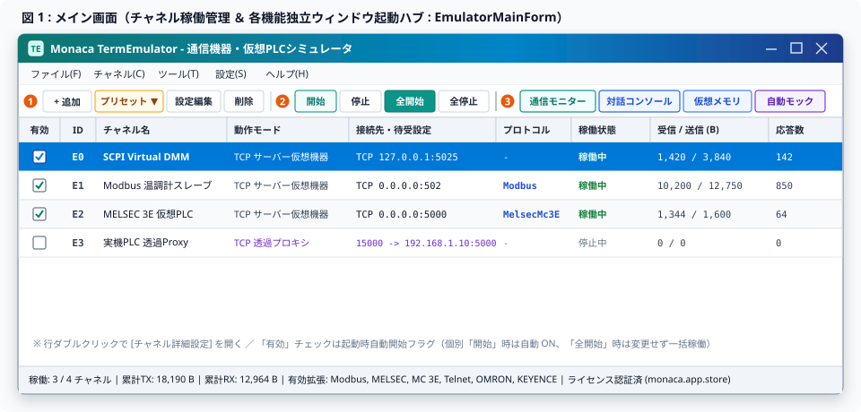
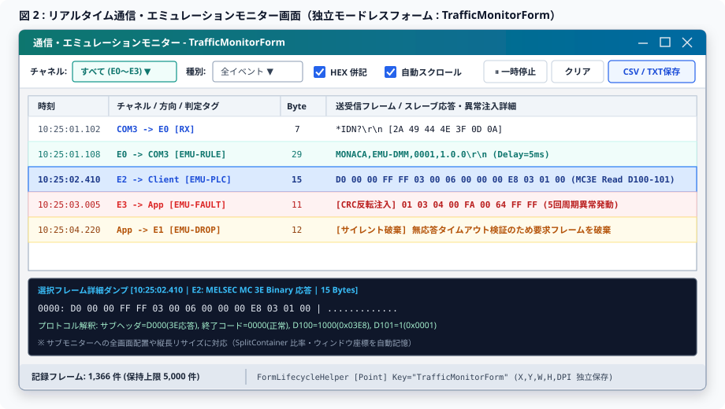
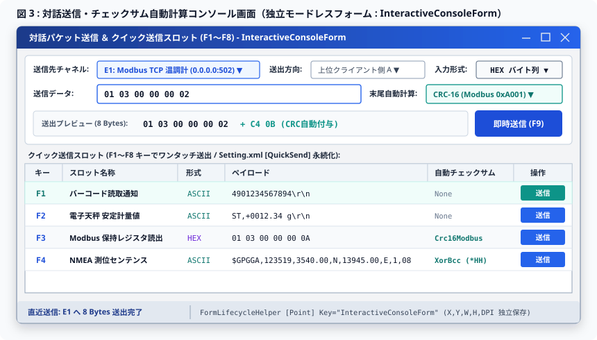
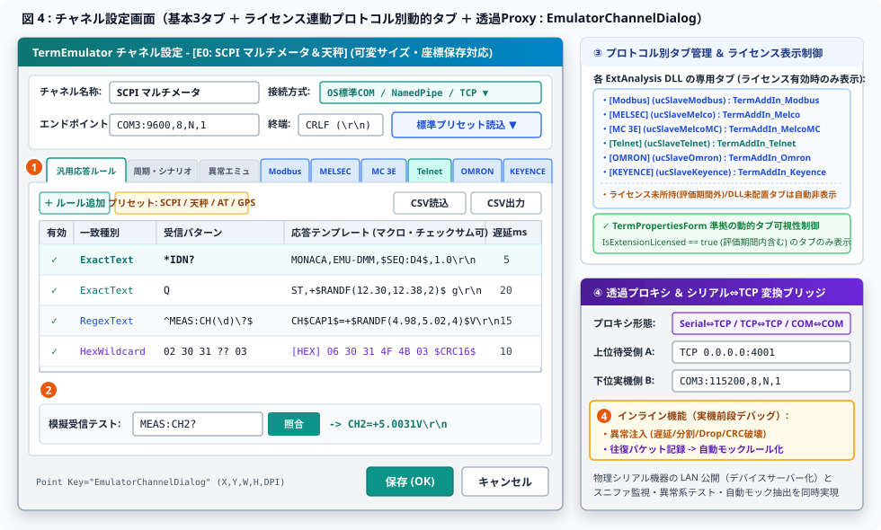
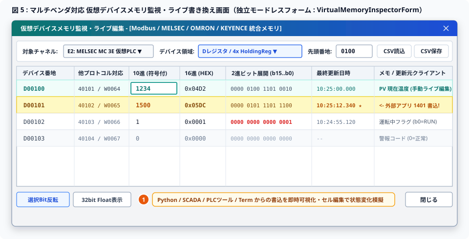
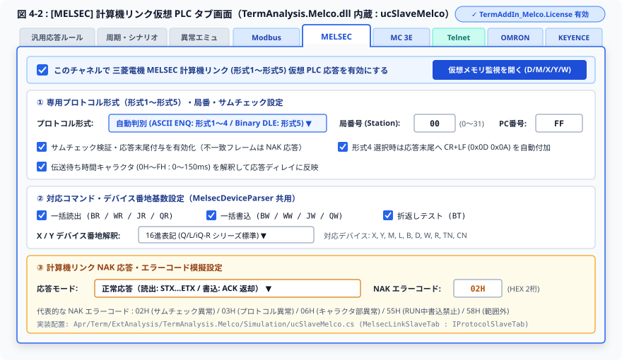
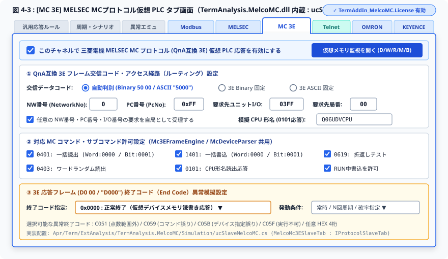

# TermEmulator 操作説明書 (User Operation Manual)

👉 [← TermEmulator 製品トップに戻る](../README.md)  
👉 [← TermAddIn 統合本体に戻る](https://github.com/Monaca-App/TermAddIn)

---

本ドキュメントは、実機の計測器・PLC・組込基板・ネットワーク機器が手元にない環境でも、PC 1 台で **仮想 COM ポート・物理シリアル・TCP / UDP・名前付きパイプの全 10 モード待受＆インラインプロキシ中継** 、 **自動応答ルール・標準 5 プリセット・異常系（遅延・無応答・分割・破損・切断）テスト** 、 **通信ログからの自動モック生成** 、および **産業用 PLC 6 プロトコルの仮想スレーブ＆共有デバイスメモリ監視** を実現する **「Monaca TermEmulator」** の操作説明書です。

---

# 目次

- [1. 概要とライセンスの準備](#1-概要とライセンスの準備)
  - [1.1 本ツールの特長と主な活用シーン](#11-本ツールの特長と主な活用シーン)
  - [1.2 ライセンスの配置と有効化される機能範囲](#12-ライセンスの配置と有効化される機能範囲)
  - [1.3 起動・終了手順とウィンドウ位置のリセット](#13-起動終了手順とウィンドウ位置のリセット)
- [2. 6 つの画面の構成と基本操作](#2-6-つの画面の構成と基本操作)
  - [2.1 ① メイン画面（チャネルダッシュボード＆ランチャー）](#21--メイン画面チャネルダッシュボードランチャー)
  - [2.2 ② リアルタイム通信モニター画面](#22--リアルタイム通信モニター画面)
  - [2.3 ③ 手動対話コンソール画面](#23--手動対話コンソール画面)
  - [2.4 ④ チャネル設定ダイアログ画面](#24--チャネル設定ダイアログ画面)
  - [2.5 ⑤ 共有仮想デバイスメモリ・インスペクタ画面（複数画面同時表示対応）](#25--共有仮想デバイスメモリインスペクタ画面複数画面同時表示対応)
  - [2.6 ⑥ ログ学習・自動モック生成画面](#26--ログ学習自動モック生成画面)
- [3. 通信モード（全 10 モード）と標準プリセット](#3-通信モード全-10-モードと標準プリセット)
  - [3.1 単独仮想デバイス 6 モードとインラインプロキシ 4 モード](#31-単独仮想デバイス-6-モードとインラインプロキシ-4-モード)
  - [3.2 すぐに使える標準デバイスプリセット（全 5 種）](#32-すぐに使える標準デバイスプリセット全-5-種)
  - [3.3 汎用自動応答ルール・動的プレースホルダー・異常系テストの設定](#33-汎用自動応答ルール動的プレースホルダー異常系テストの設定)
- [4. 産業用プロトコル仮想スレーブ（全 6 種）の設定](#4-産業用プロトコル仮想スレーブ全-6-種の設定)
  - [4.1 Modbus（TCP / RTU / ASCII）仮想スレーブ](#41-modbustcp--rtu--ascii仮想スレーブ)
  - [4.2 三菱電機 MELSEC 計算機リンク（1C〜4C / 形式5）仮想スレーブ](#42-三菱電機-melsec-計算機リンク1c4c--形式5仮想スレーブ)
  - [4.3 三菱電機 MELSEC MC プロトコル（3E フレーム）仮想スレーブ](#43-三菱電機-melsec-mc-プロトコル3e-フレーム仮想スレーブ)
  - [4.4 Telnet 仮想サーバー（ログイン認証・プロンプト応答）](#44-telnet-仮想サーバーログイン認証プロンプト応答)
  - [4.5 オムロン FINS / HostLink 仮想スレーブ](#45-オムロン-fins--hostlink-仮想スレーブ)
  - [4.6 キーエンス KV 上位リンク仮想スレーブ](#46-キーエンス-kv-上位リンク仮想スレーブ)
- [5. コマンドライン（CLI）モードの操作リファレンス](#5-コマンドラインcliモードの操作リファレンス)
  - [5.1 CLI サブコマンド・オプション一覧](#51-cli-サブコマンドオプション一覧)
  - [5.2 自動テスト・バッチ処理での実行例](#52-自動テストバッチ処理での実行例)
- [6. 設定ファイルの保存場所とトラブルシューティング（FAQ）](#6-設定ファイルの保存場所とトラブルシューティングfaq)

---

## 1. 概要とライセンスの準備

### 1.1 本ツールの特長と主な活用シーン
**Monaca TermEmulator** は、 **[TermAddIn](https://github.com/Monaca-App/TermAddIn)** や各種上位通信プログラムのシーケンス開発・自動検査・異常系テストを実機レスで完結させるための仮想デバイス・エミュレータです。

1. **実機手配前のプログラム先行開発**:
   仮想 COM ポート（例: `COM20`）やローカル TCP / UDP ポート（例: `127.0.0.1:5020`）に仮想計測器や仮想 PLC を立ち上げ、Excel マクロや制御ソフトの送受信確認を PC 単体で行えます。
2. **実機では再現しづらい異常系・リトライ耐性テスト**:
   指定した確率（`%`）での無応答タイムアウト、応答遅延・ジッタ、パケット細切れ分割送信、チェックサム破損、通信途中の強制切断をワンクリックで再現できます。
3. **実機通信ログからの 1 クリック自動モック再現**:
   現地で **[c2c](https://github.com/Monaca-App/c2c/blob/main/Manual/c2c操作説明書.Md)** や通信モニターを用いて採取した CSV / テキストログを読み込ませるだけで、要求と応答のペアを自動抽出し、社内で同じ応答を返す仮想モック機器を即座に立ち上げられます。
4. **マルチベンダー PLC の共有メモリ連動シミュレーション**:
   Modbus・三菱電機 MELSEC・オムロン FINS・キーエンス KV の各仮想スレーブが同一の **共有デバイスメモリ** を参照できるため、複数の異なる通信プロトコルを跨いだ設備連動テストにも対応します。

### 1.2 ライセンスの配置と有効化される機能範囲
本ツールは **2 段階のライセンス認証方式** を採用しており、必要な機能だけを組み合わせて利用できます。ライセンスファイルは実行ファイル（`TermEmulator.exe`）と同じフォルダ、または共通設定フォルダ（`Documents\Monaca\` 等）へ配置してください。

| 段階 | ライセンスファイル名 | 有効化される機能範囲 |
| :---: | :--- | :--- |
| **第 1 段階（必須）** | **`TermEmulator.License`** | **アプリケーション本体の起動** 、全 10 種の通信／プロキシモード、汎用ルール自動応答、7 種チェックサム自動付与、標準 5 プリセット、周期・シナリオ送信、異常系テスト、通信モニター、手動対話コンソール、ログ学習自動モック生成 |
| **第 2 段階（任意）** | **`TermAddIn_Modbus.License`**<br>**`TermAddIn_Melco.License`**<br>**`TermAddIn_MelcoMC.License`**<br>**`TermAddIn_Telnet.License`**<br>**`TermAddIn_Omron.License`**<br>**`TermAddIn_Keyence.License`** | 保有しているエクステンションに対応する **産業用プロトコル専用仮想スレーブ機能** およびチャネル設定画面内の **プロトコル専用設定タブ** を自動的に解放（※既存の `TermAddIn` 用ライセンスをそのまま共用可能） |

### 1.3 起動・終了手順とウィンドウ位置のリセット
* **通常起動**: **`TermEmulator.exe`** をダブルクリックするとメイン画面が開きます。前回終了時の各ウィンドウの位置・サイズ・モニター倍率に応じたレイアウトが自動的に復元されます。
* **安全な終了**: メイン画面を閉じると、稼働中のすべての待受ポート・仮想 COM ポート・プロキシ接続が安全に停止・解放されます。
* **画面位置の初期化（マルチモニター変更時など）**: モニター構成の変更等でサブウィンドウが画面外へ出た場合は、メイン画面メニューのウィンドウ位置リセット操作、またはコマンドライン引数 **`TermEmulator.exe --window-init`** で起動することで、全画面の配置を初期状態へ戻せます。

---

## 2. 6 つの画面の構成と基本操作

本ツールは 1 画面への過度な詰め込みを避け、用途ごとに独立した **6 つの専用ウィンドウ** で構成されています。必要な画面だけを並べて快適に作業できます。

### 2.1 ① メイン画面（チャネルダッシュボード＆ランチャー）
エミュレータ全体の稼働状況を一目で把握し、各チャネルの開始・停止や各ツール画面の呼び出しを行う中心画面です。



* **上部メニューバー（全 5 分類）**:
  * **`ファイル(F)`** : チャネル構成プロファイル（`.temu.xml`）の読み込み・書き出し、およびアプリケーションの終了を行います。
  * **`チャネル(C)`** : チャネルの新規追加・設定編集・削除、および全チャネルの一括開始・一括停止を行います。
  * **`ツール(T)`** : 「通信トラフィックモニター」「手動対話・割込コンソール」「仮想デバイスメモリ監視・編集（追加ウィンドウ起動対応）」「通信ログ自動モック生成」の各専用ウィンドウを開きます。
  * **`設定(S)`** :
    * **`環境設定(E)...`** : 共通環境設定ダイアログを開き、設定ファイルの保存先確認や **UI 表示言語（日本語 ／ 英語 ／ 自動判別）のリアルタイム切り替え** （開いているサブウィンドウも同時に言語更新）を行います。
    * **`エラー履歴(L)...`** : エラー・監査ログの確認ダイアログを開き、ログ出力先フォルダ・ファイル名・ログレベルの確認と変更を行います。
  * **`ヘルプ(H)`** : **`操作説明書(M)...`** （本マニュアルの表示）、 **`ウィンドウ位置を初期化(W)`** （全ウィンドウの位置・サイズを初期状態へリセット）、および **`バージョン情報(A)...`** （バージョン番号・著作権・動作環境の確認）を備えています。
* **上部ツールバー**:
  * **`全開始` ／ `全停止`** : 有効チェックが ON の全チャネルの待受を一括で開始または停止します。
  * **`＋ 追加` ／ `設定編集` ／ `削除` ／ `開始` ／ `停止`** : 他の稼働中チャネルの通信を止めずに、対象チャネルだけを追加・設定変更・削除・個別発停できます。
  * **`プリセット`** : SCPI 計測器やバーコードリーダなど 5 種の標準仮想機器をワンクリックで追加します。
  * **`専用画面起動ボタン群`** : **「通信モニター」「対話コンソール」「仮想メモリ」「自動モック」** の各独立ウィンドウを開きます。

---

### 2.2 ② リアルタイム通信モニター画面
全チャネル（または特定チャネル）で送受信された電文や異常注入イベントを時系列で監視・解析する専用画面です。



* **絞り込みフィルタ**: 対象チャネル、通信方向（`RX` 受信 / `TX` 送信 / イベント）、および文字列・HEX キーワードでリアルタイムに絞り込めます。
* **上下 2 ペイン詳細表示**: 上段の一覧で行を選択すると、下段に **16 進数（HEX）と可視 ASCII 文字を並列配置した詳細ダンプ** が表示され、バイナリ電文の 1 バイト単位の検証が容易に行えます。
* **一時停止とログ保存**: 画面更新を一時停止して電文を精査したり、記録された通信履歴を CSV ファイルまたはテキストファイルへ書き出したりできます。

---

### 2.3 ③ 手動対話コンソール画面
稼働中の任意のチャネルから、任意のタイミングでデータやイベント通知フレームを手動送信するための画面です。



* **ASCII / HEX 即時送信**: 文字列（`\r`, `\n`, `\x02` 等のエスケープ表記対応）または 16 進バイト列を入力し、改行コードやチェックサムを自動付与して接続中の相手へ即時送信できます。
* **クイック送信 6 スロット**: よく使うトリガ電文や異常通知コマンドを 6 個のワンクリックボタンに登録・保存して素早く連続送信できます。

---

### 2.4 ④ チャネル設定ダイアログ画面
1 つのチャネルの通信方式、自動応答ルール、周期送信、異常系テスト、および産業用プロトコル固有設定を編集するダイアログです。 **`[キャンセル]`** を押した場合は編集前の状態が完全に維持されます。



* **基本 3 タブ**:
  1. **`通信エンドポイント`** : 通信モード（全 10 種）、ポート名／IP・ポート番号、シリアル通信条件、文字コード、および使用するプロトコル種別・共有メモリの有無を設定します。
  2. **`汎用応答・周期送信`** : 受信パターンに対する自動応答ルール一覧（CSV インポート／エクスポート対応）および定周期・ステップシナリオ送信を設定します。
  3. **`異常系テスト`** : 応答遅延・ジッタ、無応答率、フレーム破損率、強制切断率、チャンク分割送信サイズを設定します。
* **産業用プロトコル専用タブ（動的追加）**: ライセンス有効な産業用プロトコル（Modbus、MELSEC 等）を選択すると、4 番目に対象プロトコル専用の設定タブが自動的に表示されます。

---

### 2.5 ⑤ 共有仮想デバイスメモリ・インスペクタ画面（複数画面同時表示対応）
産業用 PLC 仮想スレーブが読み書きする仮想デバイスメモリ（ビット・ワード領域）をリアルタイムで監視・直接書き換えできる画面です。



* **複数ウィンドウ同時オープン対応**: ツールバーから何枚でも同時に開くことができるため、たとえば **「1 枚目で `D0`〜`D99`（ワード値）を表示し、2 枚目で `M0`〜`M99`（ビット状態）を並べて監視する」** といった使い方が可能です（各ウィンドウの位置・サイズは個別に記憶されます）。
* **多彩な表示形式とライブハイライト**: `UInt16`（符号なし 10 進）、`Int16`（符号付き 10 進）、`HEX`（4 桁 16 進）、`Int32`（2 ワード連結整数）、`Float32`（2 ワード連結単精度実数）、`Bit`（ON/OFF）を切り替えて表示でき、外部通信で書き換えられたセルは即座にハイライト強調されます。
* **直接編集・範囲一括フィル・CSV 保存**: グリッド上のセルを直接ダブルクリックして値を書き換えられるほか、指定アドレス範囲への一括値セット、全クリア、CSV スナップショットの保存・読込に対応しています。

---

### 2.6 ⑥ ログ学習・自動モック生成画面
実機との通信ログから要求（TX）と応答（RX）の組を自動抽出し、コードやルールを手書きすることなく仮想モックチャネルを作成する画面です。


1. **ログの読み込み**: **`c2c`** や各種ターミナルソフトで保存した通信ログ（CSV / テキスト）、または現在プロキシ中継中のライブ通信履歴を読み込みます。
2. **抽出ペアの確認・選別**: 自動抽出された「受信要求パターン ⇔ 自動応答データ」の一覧と出現回数・平均応答時間を確認し、モックに含めたい行にチェックを入れます。
3. **1 クリックでモック登録**: 公開したい待受モードとポート（例: 仮想 COM `COM25` や TCP `127.0.0.1:5000`）を指定して作成ボタンを押すと、即座にメイン画面へ新しい仮想デバイスチャネルとして登録されます。

---

## 3. 通信モード（全 10 モード）と標準プリセット

### 3.1 単独仮想デバイス 6 モードとインラインプロキシ 4 モード

| 区分 | モード名 | エンドポイント A（待受・自局側） | エンドポイント B（プロキシ対向側） | 主な用途 |
| :---: | :--- | :--- | :--- | :--- |
| **単独待受** | **ドライバレス仮想 COM ホスト** | 仮想 COM 名（例: `COM20`） | *(不要)* | 同一 PC 内の `TermAddIn` / `Term` から物理シリアルと全く同様に直接オープンできる仮想シリアル機器を公開します（ドライバ導入不要）。 |
| **単独待受** | **物理シリアルデバイス** | 物理 COM 名（例: `COM3`） | *(不要)* | USB-シリアル変換ケーブル等を通じて別 PC や実機コントローラへ仮想機器として応答します。 |
| **単独待受** | **TCP サーバーデバイス** | 待受 IP:Port（例: `127.0.0.1:502`） | *(不要)* | Modbus TCP、MELSEC 3E TCP、Telnet、SCPI ソケット等の複数クライアント同時接続を受け付けます。 |
| **単独待受** | **TCP クライアント発信機器** | 接続先 IP:Port（例: `127.0.0.1:9000`） | *(不要)* | 上位サーバー側へ機器から能動的に接続しに行き、自動再接続しながら応答・周期送信を行います。 |
| **単独待受** | **UDP エンドポイント機器** | 待受 IP:Port（例: `127.0.0.1:9600`） | *(任意: 固定送信先)* | OMRON FINS/UDP や MELSEC 3E UDP 等のデータグラム送受信・応答を行います。 |
| **単独待受** | **名前付きパイプ機器** | パイプ名（例: `MonacaMockPipe1`） | *(不要)* | 同一 PC 内の高速プロセス間ストリーム通信デバイスとして待受します。 |
| **プロキシ** | **シリアル・インラインプロキシ** | 公開仮想 COM（例: `COM21`） | 実機物理 COM（例: `COM4`） | 上位ソフトと物理シリアル実機の間に割り込み、通常は実機へ透過中継しつつ特定コマンドのみ模擬応答や遅延・破損テストを注入します。 |
| **プロキシ** | **TCP インラインプロキシ** | 待受 IP:Port（例: `127.0.0.1:1502`） | 実機 IP:Port（例: `192.168.1.10:502`） | LAN 上の実機 PLC・計測器の前に透過プロキシとして入り、電文採取や特定番地・異常応答の差し替えテストを行います。 |
| **プロキシ** | **UDP インラインプロキシ** | 待受 IP:Port（例: `127.0.0.1:19600`） | 実機 IP:Port（例: `192.168.250.1:9600`） | UDP 機器との往復データグラムを透過中継しながら条件付き応答差し替え・異常注入を行います。 |
| **プロキシ** | **COM ⇔ TCP ブリッジプロキシ** | 公開仮想 COM（例: `COM22`） | 実機 IP:Port（例: `192.168.1.50:4001`） | シリアル専用ソフトからの通信をネットワーク機器へ変換中継しつつ、ルール一致時のみエミュレータが代理応答します。 |

### 3.2 すぐに使える標準デバイスプリセット（全 5 種）
本体ライセンスのみで、以下の 5 種類の代表的な仮想機器プリセットをワンクリックで追加できます。

1. **SCPI 計測器（デジタルマルチメータ等）**: `*IDN?`、`*RST`、`*OPC?`、`MEAS:VOLT:DC?`（ランダム揺らぎ付き測定値応答）、`SYST:ERR?` を内蔵。
2. **汎用バーコード／QR リーダ**: トリガコマンド（`LON` / `READ`）への読取応答に加え、定周期でのバーコード文字列自発送信サンプルを内蔵。
3. **電子天秤・はかり（重量計）**: ゼロ点調整（`Z`）、風袋引き（`T`）、安定重量要求（`Q` / `S`）へのフォーマット済み重量値応答を内蔵。
4. **AT コマンドモデム／無線モジュール**: `AT`、`ATI`、`AT+CSQ`、`ATD...` 等に対する `OK` / `CONNECT` 応答ルールを内蔵。
5. **汎用 STX / ETX ＋ BCC 制御機器**: `\x02`（STX）〜`\x03`（ETX）フレーミングと水平パリティ（8bit XOR BCC）自動計算応答を内蔵。

### 3.3 汎用自動応答ルール・動的プレースホルダー・異常系テストの設定
* **4 種類の受信照合方式**:
  * **`Exact`（完全一致）** / **`Wildcard`（`*`, `?` ワイルドカード）** / **`Regex`（正規表現キャプチャ対応）** / **`HexPattern`（`01 03 ?? ?? 00 02` のような任意バイトマスク対応 HEX 照合）** から選択できます。
* **応答テンプレート内の動的プレースホルダー**:
  * `${1}`, `${2}` … 正規表現のキャプチャグループ文字列を埋め込みます。
  * `${TIME}` … 現在時刻（`HH:mm:ss.fff`）を埋め込みます。
  * `${SEQ}` … 応答ごとにカウントアップする連番を埋め込みます。
  * `${RAND:100:200}` … 指定範囲の乱数値を生成して埋め込みます。
* **7 種類のチェックサム自動付与**:
  * `None`（なし）、`Xor8Bcc`（8bit XOR）、`Sum8`（1Byte 和）、`Sum16AsciiHex`（下位 1Byte 2 桁 HEX）、`LrcAscii`（Modbus ASCII LRC）、`Crc16Modbus`（Modbus RTU CRC-16）、`Crc16Ccitt`（CRC-16 CCITT）、`FcsHostLink`（OMRON HostLink FCS）から選択するだけで応答末尾へ自動計算・付与されます。

---

## 4. 産業用プロトコル仮想スレーブ（全 6 種）の設定

対応する `TermAddIn_*.License` が配置されている環境では、チャネル設定ダイアログに以下の各プロトコル専用設定タブが追加され、フレーム解析・チェックサム検証・共有デバイスメモリ読み書きを自動処理する仮想スレーブとして動作します。

### 4.1 Modbus（TCP / RTU / ASCII）仮想スレーブ


* **対応機能**: TCP（MBAP ヘッダ自動追従）、RTU（CRC-16 検証）、ASCII（`:`〜`CRLF`＋LRC 検証）の全 3 方式に対応し、FC01（コイル読出）、FC02（入力状態読出）、FC03（保持レジスタ読出）、FC04（入力レジスタ読出）、FC05（単一コイル書込）、FC06（単一レジスタ書込）、FC15（複数コイル書込）、FC16（複数レジスタ書込）を共有メモリ上で自動処理します。
* **固有設定**: スレーブ局番（`1`〜`247`）、ブロードキャスト（局番 `0`）書込許可、32bit データのワード順、および異常系検証用の強制 Modbus 例外コード（`01`〜`06`）を指定できます。

### 4.2 三菱電機 MELSEC 計算機リンク（1C〜4C / 形式5）仮想スレーブ


* **対応機能**: 形式 1〜形式 4（ASCII `ENQ` フレーム）および形式 5（バイナリ `DLE STX`〜`DLE ETX` エスケープフレーム）に対応し、ビット・ワード一括読出（`BR`, `WR`）、一括書込（`BW`, `WW`）、および折返しテスト（`TT`）を処理します。
* **固有設定**: 局番（`00`〜`1F`）、PC 番号（既定 `FF`）、プロトコル形式（形式 1〜5）、サムチェック有無、および強制 `NAK` エラーコード応答を設定できます。

### 4.3 三菱電機 MELSEC MC プロトコル（3E フレーム）仮想スレーブ


* **対応機能**: QnA 互換 3E フレームのバイナリコード（要求 `50 00` → 応答 `D0 00`）および ASCII コード（`"5000"` → `"D000"`）に対応し、TCP / UDP 上でワード・ビット一括読出（`0401`）、一括書込（`1401`）、折返しテスト（`0619`）を処理します。
* **固有設定**: フレーム形式（Binary / ASCII）、アクセス経路（ネットワーク番号・PC 番号・要求先ユニット I/O・局番）の厳格照合有無、および強制終了コード（例: `C051` 等の異常応答）を設定できます。

### 4.4 Telnet 仮想サーバー（ログイン認証・プロンプト応答）


* **対応機能**: Telnet オプションネゴシエーション応答、接続時の初期ウェルカムバナー送出、`login:` ／ `Password:` の対話ログイン状態遷移、コマンドプロンプト送出、および内蔵コマンド（`help`, `ver`, `status`, `whoami`, `exit`）＋汎用ルール連携を実行します。
* **固有設定**: 初期バナー文字列、ログイン認証の要否、許可ユーザー名・パスワード、プロンプト記号（`# `, `$ `, `> ` 等）を設定できます。

### 4.5 オムロン FINS / HostLink 仮想スレーブ


* **対応機能**: FINS/UDP（既定ポート 9600）、FINS/TCP（自動ノードアドレス通知ハンドシェイク対応）、およびシリアル上位リンク HostLink（`@00FA...` FINS ラップおよび `RD`/`WD` C モードコマンド、FCS 自動検証）に対応し、`DM`, `CIO`, `WR`, `HR`, `AR`, `EM` 領域を共有メモリ上で読み書きします。
* **固有設定**: 伝送方式、ネットワーク番号（`DNA`）・ノード番号（`DA1`）・ユニット番号（`DA2`）・HostLink 局番、および強制 FINS 終了コード（正常 `0000` ／異常再現コード）を設定できます。

### 4.6 キーエンス KV 上位リンク仮想スレーブ


* **対応機能**: Ethernet TCP / UDP（既定ポート 8501）および RS-232C シリアル上位リンクに対応し、開始／終了（`CR` / `CQ`）、機種・動作モード照会（`?K`, `?M`, `M0`, `M1`）、データ形式サフィックス（`.U`, `.S`, `.H`, `.D`, `.L`）付き連続読書き（`RD`, `RDS`, `WR`, `WRS`）、およびビットセット／リセット（`ST`, `RS`）を共有メモリ上で処理します。
* **固有設定**: 模擬機種コード（`55` KV-8000 等）、シリアル時の `CR` 開始宣言必須チェック有無、初期 RUN / PROGRAM 状態、および強制エラー応答（`E0`〜`E6`）を設定できます。

---

## 5. コマンドライン（CLI）モードの操作リファレンス

### 5.1 CLI サブコマンド・オプション一覧
引数なしで実行すると GUI モードで起動し、以下のサブコマンドを指定するとコンソール（CLI）モードとして動作します。

| サブコマンド・引数 | 説明 |
| :--- | :--- |
| `TermEmulator.exe --window-init` | 保存されている全ウィンドウの表示位置・サイズ情報を初期状態へリセットします。 |
| `TermEmulator.exe list` | 登録済みの全チャネル構成と、現在ライセンス有効な産業用プロトコル一覧を表示します。 |
| `TermEmulator.exe add --name <名称> --mode <モード> --a <エンドポイントA> [--b <エンドポイントB>] [--protocol <プロトコル>]` | 新しい仮想チャネルを追加登録します。 |
| `TermEmulator.exe preset <scpi\|barcode\|scale\|atmodem\|stxetx> [--a <エンドポイントA>]` | 標準プリセットから仮想機器チャネルを作成して追加します。 |
| `TermEmulator.exe automock --log <ログファイルパス> --mode <モード> --a <エンドポイントA> [--name <名称>]` | 通信ログファイルから要求・応答ペアを学習し、自動モックチャネルを追加します。 |
| `TermEmulator.exe import <XMLパス>` ／ `export <チャネルID> <XMLパス>` | チャネル設定プロファイル（`.temu.xml`）のインポート・エクスポートを行います。 |
| `TermEmulator.exe run [--duration <秒数>]` | 画面を表示せずヘッドレスで全有効チャネルを起動します（`--duration` 省略時は `Ctrl+C` まで稼働）。 |
| `TermEmulator.exe test` | 全モジュールの自己診断テストを実行し、結果と終了コード（正常時 `0`）を返します。 |

### 5.2 自動テスト・バッチ処理での実行例
```powershell
# 1. SCPI 計測器プリセットを仮想 COM20 で作成
TermEmulator.exe preset scpi --a COM20

# 2. 実機通信ログから TCP 5000 番ポートの自動モックチャネルを生成
TermEmulator.exe automock --log sample_log.csv --mode TcpServerDevice --a 127.0.0.1:5000 --name AutoPlcMock

# 3. CI や自動検査バッチ向けに 60 秒間ヘッドレス稼働
TermEmulator.exe run --duration 60
```

---

## 6. 設定ファイルの保存場所とトラブルシューティング（FAQ）

* **設定ファイルとプロファイルの保存先**:
  * 共通設定（ウィンドウ位置、チャネル一覧、クイック送信ボタン等）は Monaca 共通設定フォルダ内の **`Setting.xml`** （`TermEmulator` セクション）に自動保存されます。
  * 各チャネルの詳細ルールおよびプロトコル設定は、同フォルダ配下の **`Profiles\ChannelXX.temu.xml`** に個別保存されるため、ファイル単位で別 PC の開発環境へ簡単にコピー・配布できます。

* **Q1. 産業用プロトコル（Modbus や MELSEC 等）の専用タブが表示されません。**
  * **A1.** 対応するエクステンションライセンス（例: `TermAddIn_Modbus.License`）が `TermEmulator.exe` と同じフォルダまたは共通設定フォルダに配置されているか、また `TermAnalysis.*.dll` が同梱されているかを確認してください。なお、ライセンス未配置の環境で別チャネルを編集・保存しても、既存プロファイル内のプロトコル固有設定が消えることはありません。

* **Q2. サブウィンドウがモニター外へ隠れて見えなくなりました。**
  * **A2.** メイン画面上部メニューの **`[ヘルプ(H)]` ➔ `[ウィンドウ位置を初期化(W)]`** をクリックするか、コマンドプロンプトから **`TermEmulator.exe --window-init`** を実行すると、すべてのウィンドウ座標がメインモニターの中央へリセットされます。

* **Q3. 同一 PC 内の `TermAddIn` とシリアル通信させる場合、仮想 COM ケーブルツール（`c2c`）の併用は必要ですか？**
  * **A3.** チャネルのモードを **「Monaca 仮想 COM ホスト（ドライバレス）」** に設定して `COM20` 等を公開すれば、`TermAddIn` 側から直接 `COM20` を開いて通信できます。もし途中に 8 ピン信号線（RTS/CTS 等）の断線テストを挟みたい場合は、 **`c2c`** の仮想 COM ペアと組み合わせて接続することも可能です。
