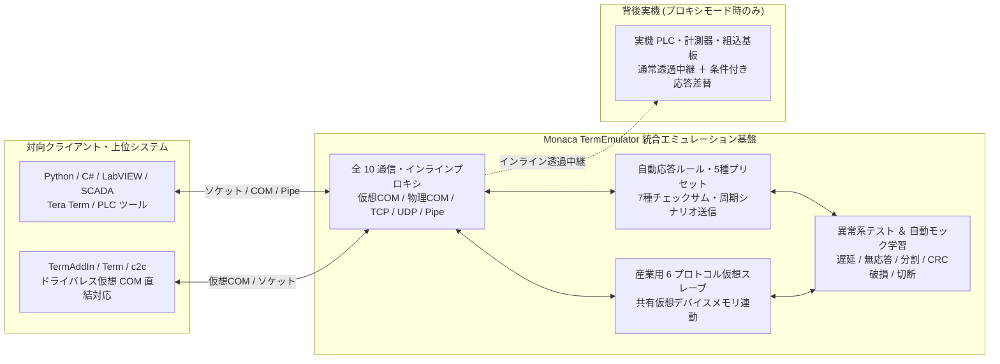



# TermEmulator - 汎用仮想デバイス＆マルチベンダ PLC スレーブ・エミュレータ

👉 [← TermAddIn 統合本体に戻る](https://github.com/Monaca-App/TermAddIn)  
👉 [← Monaca アプリ工房（トップ）に戻る](https://github.com/Monaca-App/store)

---

[](https://www.microsoft.com/)
[](https://github.com/Monaca-App/TermAddIn)
[](https://dotnet.microsoft.com/)
[]()
[]()

## 📖 概要

**TermEmulator** は、高価な計測器・大型装置組み込み済みの PLC・組込基板・ネットワーク機器が手元にない環境でも、PC 1 台で **シリアル・TCP / UDP・名前付きパイプ・ドライバレス仮想 COM の全 10 モード待受＆透過インラインプロキシ** 、 **汎用ルール自動応答＆標準 5 プリセット** 、 **実機では再現困難な通信異常（遅延・無応答・分割・破損・切断）テスト** 、 **実機通信ログからの 1 クリック自動モック生成** 、および **マルチベンダ産業用 PLC 6 プロトコルの仮想スレーブ＆共有デバイスメモリ監視** を実現する独立型の **汎用通信デバッグ・仮想機器／PLC シミュレータ** です。

Excel 通信制御アドイン **[TermAddIn](https://github.com/Monaca-App/TermAddIn)** や姉妹ツール **[c2c](https://github.com/Monaca-App/c2c)** とのシームレス連携はもちろん、Tera Term・PuTTY・Python・C# / C++ プログラム・LabVIEW・Node-RED・SCADA・各種 PLC エンジニアリングツールなど、 **あらゆる外部クライアントおよび実機ハードウェアの対向検証環境** として単体で活用できます。

> [!IMPORTANT]
> ### 💡 本製品最大の設計思想・特長
> **「実機手配待ちゼロ・異常系テスト自在・ログから 1 クリックで仮想機器化 —— 単機能 6 画面分割 UI と 2 段階ライセンスで現場開発を加速」**
> 
> * **1 画面詰め込みを排した単機能 6 画面マルチウィンドウ設計**: ダッシュボード・通信モニター・手動コンソール・チャネル設定・共有デバイスメモリ監視（複数ウィンドウ同時表示対応）・自動モック生成を用途別の独立画面へ分離。各画面の位置・サイズはモニター環境に合わせて自動記憶されます。
> * **無駄のない 2 段階ライセンス ＆ TermAddIn ライセンス完全共用**: 本体ライセンス（`TermEmulator.License`）のみで全 10 通信モード・自動応答・5 種プリセット・異常注入・自動モックがすべて利用でき、さらに既存の **`TermAddIn_*.License` をそのまま配置するだけで追加費用なしに該当 PLC プロトコルの専用仮想スレーブと設定タブが自動解放** されます（無料評価期間中は全機能を制限なしで試用可能）。



---

## ✨ 主な機能・特徴

### 1. あらゆる外部ツール・言語・実機とつながる全 10 種の通信＆プロキシモード
* **単独仮想デバイス（6 モード）**: ドライバレス仮想 COM ホスト、物理シリアルデバイス、TCP サーバーデバイス、TCP クライアント発信機器、UDP エンドポイント機器、OS 標準名前付きパイプ機器を搭載。
* **インライン透過プロキシ（4 モード）**: 上位アプリと実機（物理シリアルまたは LAN 上の TCP / UDP 機器）の間に割り込み、通常通信は実機へ透過中継しつつ **特定のコマンドや番地だけエミュレータ側で応答差し替え・異常注入** を行えます。

### 2. 汎用ルール自動応答・動的トークン展開・7 種チェックサム自動計算
* 完全一致（`Exact`）・ワイルドカード（`Wildcard`）・正規表現キャプチャ（`Regex`）・任意バイトマスク対応 HEX パターン（`HexPattern`）の 4 方式で要求を照合します。
* 応答電文には `${1}`（正規表現グループ）、`${TIME}`（現在時刻）、`${SEQ}`（連番）、`${RAND:min:max}`（乱数値）を動的展開でき、末尾へ **CRC-16（Modbus / CCITT）・LRC・8bit XOR（BCC）・Sum8 / Sum16・HostLink FCS** の全 7 種チェックサムを自動付与できます。
* 本体標準で **5 種の即戦力プリセット（SCPI 計測器、バーコードリーダ、電子天秤、AT モデム、汎用 STX/ETX+BCC 機器）** をワンクリック追加できます。

### 3. マルチベンダ産業用 6 プロトコル仮想スレーブ ＆ 共有デバイスメモリ
* **Modbus（TCP / RTU / ASCII）** 、 **三菱電機 MELSEC 計算機リンク（形式 1〜5）** 、 **MELSEC MC プロトコル（3E Binary / ASCII）** 、 **Telnet 仮想サーバー** 、 **オムロン FINS / HostLink** 、 **キーエンス KV 上位リンク** の全 6 種の公式仮想スレーブに対応します。
* 複数チャネル・異なるメーカの PLC スレーブ間で同一の **共有仮想デバイスメモリ** を参照できるため、「Modbus 側で書き込んだレジスタ値を MELSEC 側やキーエンス KV 側から読み出す」といった設備連動シミュレーションも PC 1 台で完結します。

### 4. 実機では再現できない異常系・回線品質エミュレーション（Fault Injection）
* 応答遅延・ランダムジッタ（ms）、指定確率（`%`）での無応答ドロップ（タイムアウト誘発）、指定バイト単位の細切れチャンク分割送信、チェックサム／ペイロード意図的破損、および応答直後のソケット強制切断を GUI からリアルタイムに注入し、上位ソフトのリトライ・異常復旧ロジックを徹底検証できます。

### 5. 実機通信ログからの 1 クリック「自動モック生成（AutoMock）」
* 現地で **[c2c](https://github.com/Monaca-App/c2c)** や通信モニターを用いて採取した CSV / テキスト通信ログ（またはプロキシ稼働中のライブ履歴）を読み込ませるだけで、要求（TX）と応答（RX）のペアを自動抽出・重複集約し、社内で同じ応答を返す仮想モック機器を即座に立ち上げられます。

### 6. 用途別に独立した 6 画面マルチウィンドウ GUI（複数メモリ画面・位置記憶対応）
* **① メインダッシュボード** 、 **② リアルタイム通信モニター** 、 **③ 手動対話コンソール** 、 **④ チャネル設定ダイアログ** 、 **⑤ 共有仮想デバイスメモリ・インスペクタ** 、 **⑥ 自動モック生成** の 6 画面に機能を整理。
* 仮想メモリ画面は **複数ウィンドウの同時オープン** に対応しており、`D` レジスタ画面と `M` ビット画面を左右に並べてリアルタイム監視・セル直接書き換えを行えます。

### 7. CI・自動回帰テストに最適な CLI モード搭載
* 引数付き実行により、プリセット作成・ログからの自動モック生成・プロファイル XML 入出力・指定秒数のヘッドレス待受稼働（`run --duration`）・全機能自己診断（`test`）をバッチや CI パイプラインから自動実行できます。

---

## 🔀 全 10 種類の通信エンドポイント＆インラインプロキシモード詳細

### 1. 単独仮想デバイス系（全 6 モード）

| モード識別子 | モード名称 | 待受・接続先の指定例 | 主な用途・動作イメージ |
| :--- | :--- | :--- | :--- |
| `MonacaVirtualComHost` | **ドライバレス仮想 COM ホスト** | `COM20` | カーネルドライバ不要で仮想 COM を公開し、同一 PC 内の `TermAddIn` / `Term` から直接シリアル接続します。 |
| `PhysicalSerialDevice` | **物理シリアルデバイス** | `COM3`（`9600,8,N,1` 等） | USB-シリアル変換器等を介して外部 PC や実機 PLC・コントローラへ仮想機器として応答します。 |
| `TcpServerDevice` | **TCP サーバーデバイス** | `127.0.0.1:502`、`0.0.0.0:5000` | Modbus TCP、MELSEC 3E TCP、Telnet、SCPI ソケット等のクライアント接続を複数同時待受します。 |
| `TcpClientInitiator` | **TCP クライアント発信機器** | `192.168.1.100:9000` | 上位サーバー側へ仮想機器から能動的に TCP 接続しに行き、応答および周期データ送信を行います。 |
| `UdpEndpointDevice` | **UDP エンドポイント機器** | `127.0.0.1:9600` | OMRON FINS/UDP、MELSEC 3E UDP、KEYENCE KV UDP 等のデータグラム送受信・応答を行います。 |
| `NamedPipeDevice` | **名前付きパイプ機器** | `MonacaMockPipe1` | 同一 PC 内の自作アプリや VM シリアルポートと高速名前付きパイプで双方向通信します。 |

### 2. インライン透過プロキシ系（全 4 モード）

| モード識別子 | モード名称 | エンドポイント A ⇔ B の指定例 | 主な用途・動作イメージ |
| :--- | :--- | :--- | :--- |
| `SerialInlineProxy` | **シリアル・インラインプロキシ** | `A: COM21` ⇔ `B: COM4` | 仮想 `COM21` と実機物理 `COM4` の間に割り込み、通常は実機透過・一致ルールのみ模擬応答や異常注入を行います。 |
| `TcpInlineProxy` | **TCP インラインプロキシ** | `A: 127.0.0.1:1502` ⇔ `B: 192.168.1.10:502` | 実機 PLC・計測器の前段に透過プロキシとして入り、全往復パケット採取や特定コマンドの差し替え試験を行います。 |
| `UdpInlineProxy` | **UDP インラインプロキシ** | `A: 127.0.0.1:19600` ⇔ `B: 192.168.250.1:9600` | UDP 実機とのデータグラム通信を透過中継しつつ、条件一致時のみ代理応答・遅延・破損を注入します。 |
| `ComToTcpBridgeProxy` | **COM ⇔ TCP ブリッジプロキシ** | `A: COM22` ⇔ `B: 192.168.1.50:4001` | シリアル専用アプリをネットワーク機器へブリッジ接続しつつ、任意コマンドのインターセプト応答を行います。 |

---

## 🏭 産業用プロトコル仮想スレーブ（全 6 種）と 2 段階ライセンス相互共用

各プロトコルに対応する **[TermAddIn エクステンション](https://github.com/Monaca-App/TermAddIn)** のライセンスファイル（または無料評価期間）が有効な環境では、チャネル設定画面に専用設定タブが自動追加され、フレーム切り出し・誤り検出符号の検証・共有メモリ読み書きを完全自動処理します。

| プロトコル区分 | 専用タブ名 | 主な対応コマンド・フレーム仕様 | 共用可能な拡張ライセンス |
| :--- | :---: | :--- | :--- |
| **[Modbus](https://github.com/Monaca-App/TermAddIn_Modbus)** | `[Modbus]` | TCP（MBAP）/ RTU（CRC-16）/ ASCII（LRC）、FC01〜06・FC15・FC16、局番・ブロードキャスト・強制例外コード応答 | `TermAddIn_Modbus.License` |
| **[MELSEC 計算機リンク](https://github.com/Monaca-App/TermAddIn_Melco)** | `[MELSEC]` | 形式 1〜4（ASCII）および形式 5（バイナリ DLE）、`BR` / `WR` / `BW` / `WW` / `TT` 折返し、サムチェック・強制 NAK 応答 | `TermAddIn_Melco.License` |
| **[MELSEC MC 3E](https://github.com/Monaca-App/TermAddIn_MelcoMC)** | `[MC 3E]` | QnA 互換 3E フレーム（Binary / ASCII、TCP / UDP）、一括読出 `0401`・書込 `1401`・折返し `0619`、経路照合・強制終了コード | `TermAddIn_MelcoMC.License` |
| **[Telnet サーバー](https://github.com/Monaca-App/TermAddIn_Telnet)** | `[Telnet]` | RFC 854 IAC ネゴシエーション、初期バナー、`login:` / `Password:` 対話認証状態遷移、プロンプト・シェルコマンド応答 | `TermAddIn_Telnet.License` |
| **[OMRON FINS / HostLink](https://github.com/Monaca-App/TermAddIn_Omron)** | `[OMRON]` | FINS/UDP・FINS/TCP（自動ノード通知ハンドシェイク）・HostLink（FA / C モード FCS）、DM / CIO / WR / HR / AR / EM 読書き | `TermAddIn_Omron.License` |
| **[KEYENCE KV 上位リンク](https://github.com/Monaca-App/TermAddIn_Keyence)** | `[KEYENCE]` | TCP / UDP（8501）＆シリアル、`CR`/`CQ`、`?K`/`?M`、`RD`/`RDS`/`WR`/`WRS`/`ST`/`RS`（`.U/.S/.H/.D/.L` 対応）、`E0`〜`E6` 応答 | `TermAddIn_Keyence.License` |

---

## 🖥️ 6 画面分割 GUI の構成と操作方法

> [!TIP]
> **📘 全 12 枚の GUI 画面・専用タブ図解付き詳細マニュアル**  
> 6 つの各ウィンドウおよび 6 種の産業用プロトコル専用設定タブの画面イメージ付き操作手順については、 **[TermEmulator 操作説明書](./Manual/TermEmulator操作説明書.Md)** をご覧ください。

| 画面番号 | ウィンドウ名称 | 主な役割と操作ポイント |
| :---: | :--- | :--- |
| **画面 ①** | **メイン画面（ダッシュボード）** | 全チャネルの一括開始／停止、非破壊でのチャネル追加・編集・複製・削除、5 種プリセット追加、プロファイル入出力、および画面 ②〜⑥ の呼び出しを行います。 |
| **画面 ②** | **リアルタイム通信モニター** | チャネル別・送受信方向別・キーワード別のリアルタイム絞り込み、一時停止、選択フレームの **HEX ＋ 可視 ASCII 並列詳細ダンプ** 、CSV / テキスト保存を行います。 |
| **画面 ③** | **手動対話コンソール** | 稼働中チャネルへの任意 ASCII / HEX フレーム即時送信（改行・7 種チェックサム自動付与）および **クイック送信 6 スロット** のワンクリック送出を行います。 |
| **画面 ④** | **チャネル設定ダイアログ** | 基本 3 タブ（通信エンドポイント／汎用応答＆周期送信／異常系テスト）と、ライセンス有効時に動的表示される産業用プロトコル専用タブを編集します（キャンセル時は元設定を完全保持）。 |
| **画面 ⑤** | **共有仮想デバイスメモリ・インスペクタ** | 共有メモリまたは個別メモリの 16 列グリッド監視（変更セルのライブハイライト）、表示型切替（`UInt16` / `Int16` / `HEX` / `Int32` / `Float32` / `Bit`）、セル直接書換、範囲一括フィル、CSV 入出力に対応。 **複数画面の同時表示** が可能です。 |
| **画面 ⑥** | **ログ学習・自動モック生成** | 外部ログファイル（CSV / テキスト）または稼働中履歴から抽出した要求・応答ペアを一覧プレビューし、1 クリックで新規仮想モックチャネルとして登録します。 |

---

## ⌨️ コマンドライン（CLI）モードの使い方

バッチスクリプトや自動検査・CI パイプラインから構成追加・自動モック作成・ヘッドレス稼働を行う場合は、`TermEmulator.exe` にサブコマンドを指定して実行します。

| コマンド構文 | 役割・動作内容 |
| :--- | :--- |
| `TermEmulator.exe --window-init` | 保存済みの全ウィンドウ表示位置・サイズを初期状態へリセットします。 |
| `TermEmulator.exe list` | 登録済みチャネル一覧、および現在利用可能な産業用プロトコルスレーブ一覧を表示します。 |
| `TermEmulator.exe add --name <Name> --mode <Mode> --a <EndpointA> [--b <EndpointB>] [--protocol <Key>]` | 新しい仮想チャネルを追加して保存します。 |
| `TermEmulator.exe preset <scpi\|barcode\|scale\|atmodem\|stxetx> [--a <EndpointA>]` | 標準 5 種デバイスプリセットからチャネルを作成・追加します。 |
| `TermEmulator.exe automock --log <FilePath> --mode <Mode> --a <EndpointA> [--name <Name>]` | 通信ログファイルを解析して自動モックチャネルを作成・追加します。 |
| `TermEmulator.exe import <XmlPath>` / `export <ChannelId> <XmlPath>` | チャネル設定プロファイル（`.temu.xml`）のインポート・エクスポートを行います。 |
| `TermEmulator.exe run [--duration <Sec>]` | GUI を表示せずコンソール上で全有効チャネルを起動して待受稼働します（秒数指定で自動終了可）。 |
| `TermEmulator.exe test` | ライセンス・チェックサム・ルール・異常注入・全 6 プラグイン・ライブ通信の全 15 スイート自己診断を実行します。 |

### CLI 実行例（PowerShell / コマンドプロンプト）

```powershell
# 1. SCPI デジタルマルチメータ標準プリセットをドライバレス仮想 COM20 で作成
TermEmulator.exe preset scpi --a COM20

# 2. 現地で採取した通信ログ (CSV) から TCP 5000 番待受の自動モック機器を生成
TermEmulator.exe automock --log field_capture.csv --mode TcpServerDevice --a 127.0.0.1:5000 --name FieldPlcMock

# 3. 自己診断テストの実行と 60 秒間のヘッドレス待受稼働
TermEmulator.exe test
TermEmulator.exe run --duration 60
```

---

## 💻 動作環境・システム要件

| 項目 | システム要件 |
| :--- | :--- |
| **OS** | Windows 10 / Windows 11 (64bit / 32bit) |
| **ランタイム** | .NET Framework 4.8（Windows 10 / 11 標準搭載） |
| **必要権限** | **標準ユーザー権限で動作** （管理者権限不要、カーネルドライバ導入・OS 再起動不要） |
| **対向接続可能ソフト** | ・ **[TermAddIn](https://github.com/Monaca-App/TermAddIn)** （Excel 32bit / 64bit 全 7 ドメイン対応）・ **Term** ・ **[c2c](https://github.com/Monaca-App/c2c)**<br>・Tera Term, PuTTY, Python (`pyserial` / `pymodbus` / `pymcprotocol`), C# / C++, LabVIEW, Node-RED, 各種 SCADA / PLC ツール |
| **ディスプレイ** | 推奨解像度: **Full HD (1920 × 1080) 以上** （Per-Monitor 高 DPI スケーリング完全対応） |

---

## 🚀 セットアップ・起動手順

1. 配布アーカイブを任意のフォルダへ展開（解凍）します（レジストリ変更や専用ドライバのインストールは不要です）。
2. 無料評価期間後に継続利用する場合は、`TermEmulator.License`（および必要に応じて `TermAddIn_*.License`）を実行ファイルと同じフォルダ、または共通設定フォルダ（既定 `%USERPROFILE%\Desktop\Monaca`）へ配置します。
3. フォルダ内の **`TermEmulator.exe`** をダブルクリックして起動します。

### ⚠️ 初回起動時にセキュリティ確認が表示される場合
* **Microsoft Defender SmartScreen（「Windows によって PC が保護されました」）が表示された場合**:
  画面内の **「詳細情報」** をクリックし、右下に表示される **「実行」** ボタンを押して起動してください。
* **ダウンロードした ZIP アーカイブがブロックされている場合**:
  展開前に ZIP ファイルを右クリックして **「プロパティ」** を開き、「全般」タブ下部の **「許可する」** にチェックを入れて **「OK」** を押してから展開してください。

### アンインストール手順
* 稼働中の `TermEmulator.exe` を終了し、展開したプログラムフォルダを削除するだけで完了します（OS のデバイスマネージャーやシステムフォルダにドライバ等は一切残りません）。

---

## 🔰 クイックスタート（実機なしで計測器・PLC 通信を試す 4 ステップ手順）

### ステップ 1: プリセットまたは仮想 PLC チャネルを追加して開始する
1. **`TermEmulator.exe`** を起動します。
2. 計測器を試す場合は上部ツールバーの **「プリセット追加」** から **`SCPI 計測器`** を選択し、PLC 通信を試す場合は **「＋ チャネル追加」** からモード `TCP サーバーデバイス`（例: `127.0.0.1:502`）または `ドライバレス仮想 COM ホスト`（例: `COM20`）と対象プロトコル（`Modbus` / `MELSEC` / `OMRON` / `KEYENCE` 等）を選択して保存します。
3. **「一括開始」** ボタンを押して待受状態にします。

### ステップ 2: 共有仮想メモリ画面を開く（PLC スレーブ利用時）
1. 上部ツールバーの **「仮想メモリ」** ボタンを押し、`4X (Holding)` や `D / DM` エリアを開いてテスト用の初期値（例: アドレス `0` に `1234`）を入力します。

### ステップ 3: TermAddIn または外部プログラムから接続・送受信する
1. **[TermAddIn](https://github.com/Monaca-App/TermAddIn)** や任意の通信ソフトから `COM20` または `127.0.0.1:502` へ接続し、`*IDN?` 送信やレジスタ読出・書込コマンドを実行します。
2. 即座に仮想応答が返り、書込コマンドを実行すると仮想メモリ画面上の該当セルがリアルタイムにハイライト更新されます。

### ステップ 4: 通信モニターと異常系テストで堅牢性を確認する
1. **「通信モニター」** 画面で往復電文の HEX / ASCII ダンプを確認します。
2. チャネル設定の **「異常系テスト」** タブで遅延や無応答率（例: `20%`）を設定し、上位プログラム側のタイムアウト・リトライ処理が意図通り動作するかを確認します。

---

## ⚙️ 設定ファイル・プロファイル管理とライセンス & サポート

### 設定ファイルとプロファイルの保存先
* **共通設定ファイル**: `%USERPROFILE%\Desktop\Monaca\Setting.xml`（既定パス / `<Table_Collection Table="TermEmulator" Comment="--">`）
  * チャネル一覧、手動コンソールのクイック送信スロット、および全 6 画面（複数メモリ画面を含む）のウィンドウ位置・サイズ・DPI 情報が自動保存されます。
* **チャネル別詳細プロファイル**: `%USERPROFILE%\Desktop\Monaca\Profiles\ChannelXX.temu.xml`
  * 各チャネルの応答ルールやプロトコル固有設定が XML 形式で個別保存されます（ライセンス未配置環境で保存し直しても、既存のプロトコル固有設定が消えない非破壊保全設計です）。

### 📄 ライセンス体系・無料評価期間 & サポート
* **無料評価期間**: 公開時に設定される無料評価期間中は、ライセンスファイル未配置のまま本体機能および同梱エクステンションの全仮想スレーブ機能を制限なくお試しいただけます。
* **本体ライセンス（`TermEmulator.License`）**: 評価期間終了後も継続利用する場合に必要となる本体ライセンスです（買い切りプラン／サブスクリプション対応、Stripe オンライン決済後 **`sales@monaca-app-store.com`** より自動配信）。
* **産業用プロトコル拡張ライセンス（`TermAddIn_*.License` 共用）**: すでに **[TermAddIn](https://github.com/Monaca-App/TermAddIn)** 用の各プロトコルライセンスをお持ちの場合は、 **追加購入なしでそのまま同じライセンスファイルを共用** して該当仮想スレーブ機能をご利用いただけます。

* **開発元**: [Monaca アプリ工房 (Monaca App Store)](https://github.com/Monaca-App/store)
* **連携製品・姉妹ツール**: [TermAddIn](https://github.com/Monaca-App/TermAddIn) ／ [c2c（無償仮想ヌルモデム＆通信モニター）](https://github.com/Monaca-App/c2c)
* **Copyright**: Copyright (C) Monaca App Store 2026 All rights reserved.
* **お問い合わせ**: 不具合報告や機能要望は、GitHub の Issue までお気軽にお寄せください。
