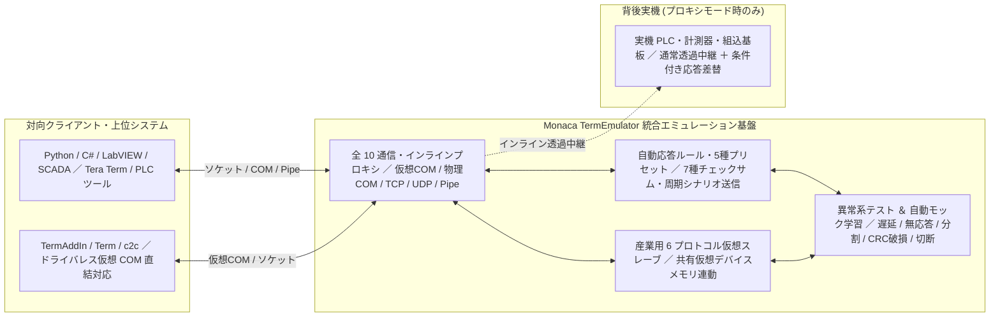



# TermEmulator - 汎用仮想デバイス＆マルチベンダ PLC スレーブ・エミュレータ

👉 [← TermAddIn 統合本体に戻る](https://github.com/Monaca-App/TermAddIn)  
👉 [← Monaca アプリ工房（トップ）に戻る](https://github.com/Monaca-App/store)

---

[](https://www.microsoft.com/)
[](https://github.com/Monaca-App/TermAddIn)
[](https://dotnet.microsoft.com/)
[]()
[]()

## 📖 概要

**TermEmulator** は、高価な計測器・大型装置組み込み済みの PLC・組込基板・ネットワーク機器が手元にない環境でも、PC 1 台で **シリアル・TCP / UDP・名前付きパイプ・ドライバレス仮想 COM の全 10 モード待受＆透過インラインプロキシ** 、 **汎用ルール自動応答＆標準 5 プリセット** 、 **実機では再現困難な通信異常（遅延・無応答・分割・破損・切断）テスト** 、 **実機通信ログからの 1 クリック自動モック生成** 、および **マルチベンダ産業用 PLC 6 プロトコルの仮想スレーブ＆共有デバイスメモリ監視** を実現する独立型の **汎用通信デバッグ・仮想機器／PLC シミュレータ** です。

Excel 通信制御アドイン **[TermAddIn](https://github.com/Monaca-App/TermAddIn)** や姉妹ツール **[c2c](https://github.com/Monaca-App/c2c)** とのシームレス連携はもちろん、Tera Term・PuTTY・Python・C# / C++ プログラム・LabVIEW・Node-RED・SCADA・各種 PLC エンジニアリングツールなど、 **あらゆる外部クライアントおよび実機ハードウェアの対向検証環境** として単体で活用できます。

> [!IMPORTANT]
> ### 💡 本製品最大の設計思想・特長
> **「実機手配待ちゼロ・異常系テスト自在・ログから 1 クリックで仮想機器化 —— 単機能 6 画面分割 UI と 2 段階ライセンスで現場開発を加速」**
> 
> * **1 画面詰め込みを排した単機能 6 画面マルチウィンドウ設計**: ダッシュボード・通信モニター・手動コンソール・チャネル設定・共有デバイスメモリ監視（複数ウィンドウ同時表示対応）・自動モック生成を用途別の独立画面へ分離。各画面の位置・サイズはモニター環境に合わせて自動記憶されます。
> * **無駄のない 2 段階ライセンス ＆ TermAddIn ライセンス完全共用**: 本体ライセンス（`TermEmulator.License`）のみで全 10 通信モード・自動応答・5 種プリセット・異常注入・自動モックがすべて利用でき、さらに既存の **`TermAddIn_*.License` をそのまま配置するだけで追加費用なしに該当 PLC プロトコルの専用仮想スレーブと設定タブが自動解放** されます（ライセンス未配置・無効時は 3 分間の期間限定版として全機能を試用可能）。



---

## ✨ 主な機能・特徴

### 1. あらゆる外部ツール・言語・実機とつながる全 10 種の通信＆プロキシモード
* **単独仮想デバイス（6 モード）**: ドライバレス仮想 COM ホスト、物理シリアルデバイス、TCP サーバーデバイス、TCP クライアント発信機器、UDP エンドポイント機器、OS 標準名前付きパイプ機器を搭載。
* **インライン透過プロキシ（4 モード）**: 上位アプリと実機（物理シリアルまたは LAN 上の TCP / UDP 機器）の間に割り込み、通常通信は実機へ透過中継しつつ **特定のコマンドや番地だけエミュレータ側で応答差し替え・異常注入** を行えます。

### 2. 汎用ルール自動応答・動的トークン展開・7 種チェックサム自動計算
* ASCII 完全一致（`ExactAscii`）・前方一致（`PrefixAscii`）・部分一致（`ContainsAscii`）・正規表現キャプチャ（`RegexAscii`）・任意バイトマスク対応 HEX パターン（`WildcardHex`）・固定バイト長一致（`FixedLength`）の全 6 方式で要求を照合します。
* 応答電文には `$CAP1$`〜`$CAP9$`（正規表現グループ）、`$TIME$` / `$DATE$`（現在日時）、`$SEQ$`（連番）、`$RAND:min,max$` / `$RANDF:min,max$`（乱数）、`$MEM:D100$`（仮想メモリ参照）、`$ECHO$`（受信エコー）を動的展開でき、末尾へ **`Crc16Modbus`・`Crc16Ccitt`・`LrcAscii`・`Sum8AsciiHex`・`Sum8Binary`・`XorBcc`（BCC / HostLink FCS）・`NmeaXor`** の全 7 種チェックサムを自動付与できます（受信時の仮想メモリ書込式 `D100=$CAP1$` 等にも対応）。
* 本体標準で **5 種の即戦力プリセット（SCPI 計測器、電子天秤、2 次元・バーコードリーダ、AT コマンドモデム、NMEA-0183 GPS 受信機）** をワンクリック追加できます。

### 3. マルチベンダ産業用 6 プロトコル仮想スレーブ ＆ 共有デバイスメモリ
* **Modbus（TCP / RTU / ASCII）** 、 **三菱電機 MELSEC 計算機リンク（形式 1〜5）** 、 **MELSEC MC プロトコル（3E Binary / ASCII）** 、 **Telnet 仮想サーバー** 、 **オムロン FINS / HostLink** 、 **キーエンス KV 上位リンク** の全 6 種の公式仮想スレーブに対応します。
* 複数チャネル・異なるメーカの PLC スレーブ間で同一の **共有仮想デバイスメモリ** を参照できるため、「Modbus 側で書き込んだレジスタ値を MELSEC 側やキーエンス KV 側から読み出す」といった設備連動シミュレーションも PC 1 台で完結します。

### 4. 実機では再現できない異常系・回線品質エミュレーション（Fault Injection）
* 応答遅延・ランダムジッタ（ms）、指定確率（`%`）での無応答ドロップ（タイムアウト誘発）、指定バイト単位の細切れチャンク分割送信、チェックサム／ペイロード意図的破損、および応答直後のソケット強制切断を GUI からリアルタイムに注入し、上位ソフトのリトライ・異常復旧ロジックを徹底検証できます。

### 5. 実機通信ログからの 1 クリック「自動モック生成（AutoMock）」
* 現地で **[c2c](https://github.com/Monaca-App/c2c)** や通信モニターを用いて採取した CSV / テキスト通信ログ（またはプロキシ稼働中のライブ履歴）を読み込ませるだけで、要求（TX）と応答（RX）のペアを自動抽出・重複集約し、社内で同じ応答を返す仮想モック機器を即座に立ち上げられます。

### 6. 用途別に独立した 6 画面マルチウィンドウ GUI（複数メモリ画面・位置記憶対応）
* **① メインダッシュボード** 、 **② リアルタイム通信モニター** 、 **③ 手動対話コンソール** 、 **④ チャネル設定ダイアログ** 、 **⑤ 共有仮想デバイスメモリ・インスペクタ** 、 **⑥ 自動モック生成** の 6 画面に機能を整理。
* 仮想メモリ画面は **複数ウィンドウの同時オープン** に対応しており、`D` レジスタ画面と `M` ビット画面を左右に並べてリアルタイム監視・セル直接書き換えを行えます。

### 7. CI・自動回帰テストに最適な CLI モード搭載
* 引数付き実行により、プリセット作成・ログからの自動モックプロファイル生成・プロファイル XML 入出力・指定ミリ秒数のヘッドレス待受稼働（`run --duration-ms`）・全機能自己診断（`test`）をバッチや CI パイプラインから自動実行できます。

---

## 🔀 全 10 種類の通信エンドポイント＆インラインプロキシモード詳細

### 1. 単独仮想デバイス系（全 6 モード）

| モード識別子 | モード名称（UI表示名） | 待受・接続先の指定例 | 主な用途・動作イメージ |
| :--- | :--- | :--- | :--- |
| `MonacaVirtualComHost` | **Monaca 仮想COMホスト (ドライバレス)** | `COM20` | カーネルドライバ不要で新規仮想 COM を公開できる唯一のモードです。同一 PC 内の `TermAddIn` / `Term` から直接シリアル接続します。 |
| `SerialPortDevice` | **シリアルポート仮想機器 (物理/仮想COM)** | `COM3`（`9600,8,N,1` 等） | 既存の物理 COM や `c2c` 仮想 COM を開き、外部 PC や実機 PLC・コントローラへ仮想機器として応答します。 |
| `TcpServerDevice` | **TCP サーバー仮想機器** | `127.0.0.1:502`、`0.0.0.0:5000` | Modbus TCP、MELSEC 3E TCP、Telnet、SCPI ソケット等のクライアント接続を複数同時待受します。 |
| `TcpClientDevice` | **TCP クライアント仮想機器** | `192.168.1.100:9000` | 上位サーバー側へ仮想機器から能動的に TCP 接続しに行き、応答および定周期データ送信を行います。 |
| `UdpEndpointDevice` | **UDP エンドポイント仮想機器** | `9600`（`127.0.0.1:9600`） | OMRON FINS/UDP、KEYENCE KV UDP、NMEA 等のデータグラム送受信・応答を行います。 |
| `NamedPipeDevice` | **名前付きパイプ仮想機器** | `MonacaMockPipe1` | 同一 PC 内の自作アプリや VM シリアルポートと高速名前付きパイプ（`\\.\pipe\...`）で双方向通信します。 |

### 2. インライン透過プロキシ系（全 4 モード）

| モード識別子 | モード名称（UI表示名） | エンドポイント A ⇔ B の指定例 | 主な用途・動作イメージ |
| :--- | :--- | :--- | :--- |
| `SerialInlineProxy` | **シリアル透過プロキシ (COM A <-> COM B)** | `A: COM11` ⇔ `B: COM4` | 実在する 2 つの COM ポート間（上位側をドライバレス仮想 COM にする場合は `c2c` の仮想 COM ペア片側を指定）に割り込み、通常は透過・一致ルールのみ模擬応答や異常注入を行います。 |
| `TcpInlineProxy` | **TCP 透過プロキシ (待受 <-> 実機転送先)** | `A: 1502` ⇔ `B: 192.168.1.10:502` | 実機 PLC・計測器の前段に透過プロキシとして入り、全往復パケット採取や特定コマンドの差し替え試験を行います。 |
| `UdpInlineProxy` | **UDP 透過プロキシ (ローカル <-> 実機転送先)** | `A: 19600` ⇔ `B: 192.168.250.1:9600` | UDP 実機とのデータグラム通信を透過中継しつつ、条件一致時のみ代理応答・遅延・破損を注入します。 |
| `SerialTcpBridgeProxy` | **シリアル <-> TCP 変換プロキシ** | `A: COM11` ⇔ `B: 192.168.1.50:4001` | 実在 COM（または `c2c` 仮想 COM ペア片側）からのシリアル通信をネットワーク機器へ変換中継しつつ、任意コマンドの代理応答を行います。 |

---

## 🏭 産業用プロトコル仮想スレーブ（全 6 種）と 2 段階ライセンス相互共用

各プロトコルに対応する **[TermAddIn エクステンション](https://github.com/Monaca-App/TermAddIn)** のライセンスファイルが有効な環境（または 3 分間の期間限定版動作中）では、チャネル設定画面に専用設定タブが自動追加され、フレーム切り出し・誤り検出符号の検証・共有メモリ読み書きを完全自動処理します。

| プロトコル区分 | 専用タブ名 | 主な対応コマンド・フレーム仕様 | 共用可能な拡張ライセンス |
| :--- | :---: | :--- | :--- |
| **[Modbus](https://github.com/Monaca-App/TermAddIn_Modbus)** | `[Modbus]` | TCP（MBAP）/ RTU（CRC-16）/ ASCII（LRC）、FC01〜06・FC15・FC16、局番・ブロードキャスト・強制例外コード応答 | `TermAddIn_Modbus.License` |
| **[MELSEC 計算機リンク](https://github.com/Monaca-App/TermAddIn_Melco)** | `[MELSEC]` | 形式 1〜4（ASCII）および形式 5（バイナリ DLE）、`BR` / `WR` / `BW` / `WW` / `BT` 折返し、サムチェック・強制 NAK 応答 | `TermAddIn_Melco.License` |
| **[MELSEC MC 3E](https://github.com/Monaca-App/TermAddIn_MelcoMC)** | `[MC 3E]` | QnA 互換 3E フレーム（Binary / ASCII、TCP / UDP）、一括読出 `0401`・書込 `1401`・折返し `0619`、経路照合・強制終了コード | `TermAddIn_MelcoMC.License` |
| **[Telnet サーバー](https://github.com/Monaca-App/TermAddIn_Telnet)** | `[Telnet]` | NVT（IAC 自動応答）/ Raw Shell、初期バナー、`login:` / `Password:` 対話認証、組み込みコマンド（`help`/`ver`/`date`/`status`/`exit`）＋ルール連携 | `TermAddIn_Telnet.License` |
| **[OMRON FINS / HostLink](https://github.com/Monaca-App/TermAddIn_Omron)** | `[OMRON]` | FINS/UDP・FINS/TCP（自動ノード通知ハンドシェイク）・HostLink（FA / C モード FCS）、DM / CIO / WR / HR / AR / EM 読書き | `TermAddIn_Omron.License` |
| **[KEYENCE KV 上位リンク](https://github.com/Monaca-App/TermAddIn_Keyence)** | `[KEYENCE]` | TCP / UDP（8501）＆シリアル、`CR`/`CQ`、`?K`（KV-8000=`57` 等）/`?M`、`RD`/`RDS`/`WR`/`WRS`/`ST`/`RS`（`.U/.S/.H/.D/.L` 対応）、`E0`〜`E6` 応答 | `TermAddIn_Keyence.License` |

---

## 🖥️ 6 画面分割 GUI の構成と操作方法

> [!TIP]
> **📘 全 15 枚の GUI 画面・専用タブ図解付き詳細マニュアル**  
> 6 つの各ウィンドウ、チャネル設定の基本 4 タブ、および 6 種の産業用プロトコル専用設定タブの画面イメージ付き操作手順については、 **[TermEmulator 操作説明書](./Manual/TermEmulator操作説明書.Md)** をご覧ください。

| 画面番号 | ウィンドウ名称 | 主な役割と操作ポイント |
| :---: | :--- | :--- |
| **画面 ①** | **メイン画面（ダッシュボード）** | **`全開始`** （各チャネルの起動時自動開始チェック設定を維持したまま登録済み全チャネルを一括待受開始）／ **`全停止`** 、非破壊でのチャネル **`+ 追加`** ・ **`設定編集`** ・ **`削除`** 、5 種 **`プリセット`** 追加、プロファイル入出力、および画面 ②〜⑥ の呼び出しを行います。 |
| **画面 ②** | **リアルタイム通信モニター** | チャネル別・全 7 区分フィルタ（すべて / `RX` / `TX` / `FWD` / `DROP` / `CORRUPT` / `EMIT`）・キーワード別の絞り込み、一時停止、選択フレームの **HEX ＋ 可視 ASCII 並列詳細ダンプ** 、CSV / テキスト保存を行います。 |
| **画面 ③** | **手動対話コンソール** | 稼働中チャネルへの任意 ASCII / HEX フレーム即時送信（`F9` キー / `Enter`、プロキシ A/B 宛先選択対応）および **クイック送信 8 スロット（`F1`〜`F8`）** のワンクリック送出を行います。 |
| **画面 ④** | **チャネル設定ダイアログ** | 上部ヘッダの **`プロトコル`** コンボ連動による産業用プロトコル有効化・タブ表示切替と、基本 4 タブ（ **`接続・フレーミング`** ／ **`自動応答ルール`** ［`マクロ書式 ▼` 挿入補助付き］／ **`異常注入`** ／ **`定周期`** ）を編集します（キャンセル時は元設定を完全保持）。 |
| **画面 ⑤** | **共有仮想デバイスメモリ・インスペクタ** | 上部 **`プロトコル`** 選択に連動してデバイス領域を動的切替しつつ、全 8 列グリッド監視・単一セル直接編集・ビット領域ダブルクリック反転・全ゼロ初期化・CSV 入出力に対応。ツールバー **`+ 別ウィンドウ`** ボタンやメニューから **複数画面の同時表示** が可能です。 |
| **画面 ⑥** | **ログ学習・自動モック生成** | 外部ログファイル（CSV / テキスト）または稼働中履歴から抽出した要求・応答ペアを一覧プレビューし、ポート番号（または仮想 COM 名）を指定して 1 クリックで新規仮想モックチャネルとして登録します。 |

---

## ⌨️ コマンドライン（CLI）モードの使い方

バッチスクリプトや自動検査・CI パイプラインから構成追加・自動モック作成・ヘッドレス稼働を行う場合は、`TermEmulator.exe` にサブコマンドを指定して実行します。

| コマンド構文 | 役割・動作内容 |
| :--- | :--- |
| `TermEmulator.exe --window-init` | 保存済みの全ウィンドウ表示位置・サイズを初期状態へリセットして起動します。 |
| `TermEmulator.exe list` | 登録済みの全チャネル構成（ID・有効状態・名称・モード・エンドポイント・プロトコル）を表示します。 |
| `TermEmulator.exe add [--name <Name>] [--mode <Mode>] [--port <Port>] [--com <COMx>] [--pipe <Pipe>] [--target <Target>] [--protocol <Key>] [--serial/--tcp/--udp/--preset/--unit/--station/--node/--serial-tcp-proxy/--fault-corrupt-every]` | 新しい仮想チャネルを追加して保存します（ショートハンド・プロトコル識別子・異常注入オプション対応）。 |
| `TermEmulator.exe preset <ScpiDmm\|ElectronicBalance\|BarcodeReader\|AtModem\|NmeaGps> [--port <Port> \| --com <COMx>]` | 標準 5 種デバイスプリセット（短縮名 `Scpi` / `Balance` / `Barcode` / `Modem` / `Gps` も可）からチャネルを作成・追加します。 |
| `TermEmulator.exe automock --input <LogPath> [--output \| --out <Out.temu.xml>] [--max-ms <Ms>]` | 通信ログファイルを解析して自動モックプロファイル（`.temu.xml`）を生成します。 |
| `TermEmulator.exe import <File.temu.xml>` / `export [<E0\|0>] <File.temu.xml>` | チャネル設定プロファイル（`.temu.xml`）のインポート追加、全チャネル一括または単一チャネル指定でのエクスポートを行います。 |
| `TermEmulator.exe run [--profile <File.temu.xml>] [--duration-ms <Ms>]` | GUI を表示せずコンソール上で有効チャネルを起動して待受稼働します（ミリ秒指定で自動終了可）。 |
| `TermEmulator.exe test` （または `--test`） | ライセンス・チェックサム・ルール・異常注入・全 6 プラグイン・ライブ通信の全スイート自己診断を実行します。 |

### CLI 実行例（PowerShell / コマンドプロンプト）

```powershell
# 1. SCPI デジタルマルチメータ標準プリセットをドライバレス仮想 COM20 で作成
TermEmulator.exe preset ScpiDmm --com COM20

# 2. 現地で採取した通信ログ (CSV) から自動モックプロファイルを生成してインポート
TermEmulator.exe automock --input field_capture.csv --output field_plc_mock.temu.xml --max-ms 2000
TermEmulator.exe import field_plc_mock.temu.xml

# 3. 自己診断テストの実行と 60 秒間（60000 ミリ秒）のヘッドレス待受稼働
TermEmulator.exe test
TermEmulator.exe run --duration-ms 60000
```

---

## 💻 動作環境・システム要件

| 項目 | システム要件 |
| :--- | :--- |
| **OS** | Windows 10 / Windows 11 (64bit / 32bit) |
| **ランタイム** | .NET Framework 4.8（Windows 10 / 11 標準搭載） |
| **必要権限** | **標準ユーザー権限で動作** （管理者権限不要、カーネルドライバ導入・OS 再起動不要） |
| **対向接続可能ソフト** | ・ **[TermAddIn](https://github.com/Monaca-App/TermAddIn)** （Excel 32bit / 64bit 全 7 ドメイン対応）・ **Term** ・ **[c2c](https://github.com/Monaca-App/c2c)**<br>・Tera Term, PuTTY, Python (`pyserial` / `pymodbus` / `pymcprotocol`), C# / C++, LabVIEW, Node-RED, 各種 SCADA / PLC ツール |
| **ディスプレイ** | 推奨解像度: **Full HD (1920 × 1080) 以上** （Per-Monitor 高 DPI スケーリング完全対応） |

---

## 🚀 セットアップ・起動手順

<a href="https://github.com/Monaca-App/TermEmulator/raw/main/Setup/TermEmulator_Setup.zip">
  
</a>

> 上記の **「プログラム（入手）」アイコン** をクリックすると、セットアッププログラム一式（[`TermEmulator_Setup.zip`](https://github.com/Monaca-App/TermEmulator/raw/main/Setup/TermEmulator_Setup.zip)）が直接ダウンロードされます。ダウンロードした ZIP ファイルを展開して `TermEmulator\setup.exe`（または `TermEmulator.Setup.msi`）を実行してください。

### 配布アーカイブ（本リポジトリ `Setup/` 配下）

* **アーカイブ**: [`Setup/TermEmulator_Setup.zip`](https://github.com/Monaca-App/TermEmulator/raw/main/Setup/TermEmulator_Setup.zip)（収録内容: `TermEmulator/setup.exe`, `TermEmulator/TermEmulator.Setup.msi`）

### インストール・起動ステップ

1. ダウンロードした **`TermEmulator_Setup.zip`** を展開し、 **`TermEmulator/`** フォルダ内の **`setup.exe`** （または **`TermEmulator.Setup.msi`** ）を実行します。
   * ※ インストール時は管理者権限（UAC 承認）が必要です（専用カーネルドライバの導入や OS 再起動は一切行われません）。
   * ※ 既定のインストール先は `C:\Program Files (x86)\Monacaアプリ工房\Monaca TermEmulator\`（共通ライブラリは `Monaca Common\`）です。デスクトップの `Monaca\Manual` へ操作説明書のショートカットも配置されます。
2. 3 分間の時間制限を解除して継続利用する場合は、`TermEmulator.License`（および必要に応じて `TermAddIn_*.License`）を共通設定フォルダ（既定 `%USERPROFILE%\Desktop\Monaca`）または実行ファイルと同じフォルダへ配置します。
3. スタートメニューまたはインストールフォルダ内の **`TermEmulator.exe`** を起動します（起動・通常運用は標準ユーザー権限で動作します）。

### ⚠️ インストール・初回起動時にセキュリティ確認が表示される場合
* **Microsoft Defender SmartScreen（「Windows によって PC が保護されました」）が表示された場合**:
  画面内の **「詳細情報」** をクリックし、右下に表示される **「実行」** ボタンを押して起動してください。
* **ダウンロードしたファイルがブロックされている場合**:
  実行前にファイル（`setup.exe` / `TermEmulator.Setup.msi` / ZIP 等）を右クリックして **「プロパティ」** を開き、「全般」タブ下部の **「許可する」** （または「ブロックの解除」）にチェックを入れて **「OK」** を押してから実行してください。

### アンインストール手順
* 稼働中の `TermEmulator.exe` を終了した上で、Windows の「設定」>「アプリ」>「インストールされているアプリ」（または「コントロールパネル」の「プログラムと機能」）から **`TermEmulator.Setup`** を選択してアンインストールしてください（OS のデバイスマネージャーやシステムフォルダにドライバ等は一切残りません）。

---

## 🔰 クイックスタート（実機なしで計測器・PLC 通信を試す 4 ステップ手順）

### ステップ 1: プリセットまたは仮想 PLC チャネルを追加して開始する
1. **`TermEmulator.exe`** を起動します。
2. 計測器を試す場合は上部ツールバーの **「プリセット」** から **`SCPI 計測器`** を選択し、PLC 通信を試す場合は **「+ 追加」** から **`接続・フレーミング`** タブでモード `TCP サーバー仮想機器`（例: `127.0.0.1` / `502`）または `Monaca 仮想COMホスト (ドライバレス)`（例: `COM20`）を設定し、上部ヘッダの **`プロトコル`** から対象プロトコル（`Modbus` / `MELSEC` / `MC 3E` / `OMRON` / `KEYENCE` 等）を選択して表示された専用タブで詳細設定を行い保存します。
3. **「全開始」** ボタンを押して待受状態にします。

### ステップ 2: 共有仮想メモリ画面を開く（PLC スレーブ利用時）
1. 上部ツールバーの **「仮想メモリ」** ボタンを押し、上部 **`プロトコル`** で対象プロトコルを選んで `4x` や `D` / `DM` 領域を開き、テスト用の初期値（例: アドレス `0` に `1234`）を入力します（`+ 別ウィンドウ` で別デバイス領域も同時監視できます）。

### ステップ 3: TermAddIn または外部プログラムから接続・送受信する
1. **[TermAddIn](https://github.com/Monaca-App/TermAddIn)** や任意の通信ソフトから `COM20` または `127.0.0.1:502` へ接続し、`*IDN?` 送信やレジスタ読出・書込コマンドを実行します。
2. 即座に仮想応答が返り、書込コマンドを実行すると仮想メモリ画面上の該当セルがリアルタイムにハイライト更新されます。

### ステップ 4: 通信モニターと異常系テストで堅牢性を確認する
1. **「通信モニター」** 画面で往復電文の HEX / ASCII ダンプを確認します。
2. チャネル設定の **「異常注入」** タブで遅延や無応答率（例: `20%`）を設定し、上位プログラム側のタイムアウト・リトライ処理が意図通り動作するかを確認します。

---

## ⚙️ 設定ファイル・プロファイル管理

### 設定ファイルとプロファイルの保存先
* **共通設定ファイル**: `%USERPROFILE%\Desktop\Monaca\Setting.xml`（既定パス / `<Table_Collection Table="TermEmulator" Comment="--">`）
  * チャネル一覧、手動コンソールのクイック送信スロット（`F1`〜`F8`）、および全 6 画面（複数メモリ画面を含む）のウィンドウ位置・サイズ・DPI 情報が自動保存されます。
* **チャネル別詳細プロファイル**: `%USERPROFILE%\Desktop\Monaca\TermEmulator\Profiles\ChannelXX.temu.xml`（既定パス）
  * 各チャネルの応答ルールやプロトコル固有設定が XML 形式で個別保存されます（ライセンス未配置環境で保存し直しても、既存のプロトコル固有設定が消えない非破壊保全設計です）。

---

## 💳 ライセンス・購入プラン（TermEmulator）

> [!NOTE]
> **試用動作（3 分間期間限定版）および 2 段階ライセンス体系について**  
> 日付指定による無料評価期間は廃止しております。ライセンスファイル（`TermEmulator.License`）がない場合、または無効な場合は **3 分間の期間限定版** として動作し、本体機能および全 6 種の産業用プロトコル仮想スレーブを試用できます（3 分経過後に通知を表示して全チャネルの通信を停止・操作をロックします）。

用途や利用期間に合わせて、一括購入（買い切り）またはサブスクリプション（月額・週額）からお選びいただけます。  
メールアドレスの誤入力によるライセンス不着を防ぐため、 **事前のメールアドレス確認** を行った上で、 **Stripe** による安全なオンライン決済へご案内いたします（表記価格はすべて税別です）。

### 1. 本体ライセンス（`TermEmulator.License`）料金プラン

| プラン | 価格（税別） | お支払い・お申込み |
| :--- | :---: | :---: |
| **一括購入（買い切りライセンス）**<br>無期限で永続利用できるライセンスです。 | **¥196,000** | [👉 一括購入手続きへ](https://stripe-license-generator.y-nakai-5a3.workers.dev/?target=emulator) |
| **月額サブスクリプション**<br>月単位で利用できる定期プランです。中長期のプロジェクトにおすすめです。 | **¥17,600** / 月 | [👉 月額プランに申し込む](https://stripe-license-generator.y-nakai-5a3.workers.dev/?target=emulator) |
| **週額サブスクリプション**<br>週単位で手軽に利用できるプランです。短期評価や単発テストにおすすめです。 | **¥6,000** / 週 | [👉 週額プランに申し込む](https://stripe-license-generator.y-nakai-5a3.workers.dev/?target=emulator) |

### 2. 産業用プロトコル仮想スレーブ拡張ライセンス（`TermAddIn` と完全共用）

以下の産業用プロトコル仮想スレーブおよび専用設定タブは、 **[TermAddIn](https://github.com/Monaca-App/TermAddIn)** 用の各エクステンションライセンスを **追加購入なしでそのまま共用** できます。

| 対象プロトコル（エクステンション） | 対応ライセンスファイル | 価格プラン（一括 / 月額 / 週額・税別） | お申込み |
| :--- | :--- | :---: | :---: |
| **[Modbus（TCP / RTU / ASCII）](https://github.com/Monaca-App/TermAddIn_Modbus)** | `TermAddIn_Modbus.License` | **¥49,000** / ¥4,400 / ¥1,500 | [👉 購入手続きへ](https://stripe-license-generator.y-nakai-5a3.workers.dev/?target=modbus) |
| **[MELSEC 計算機リンク（形式 1〜5）](https://github.com/Monaca-App/TermAddIn_Melco)** | `TermAddIn_Melco.License` | **¥32,000** / ¥3,000 / ¥1,000 | [👉 購入手続きへ](https://stripe-license-generator.y-nakai-5a3.workers.dev/?target=melco) |
| **[MELSEC MC プロトコル（3E フレーム）](https://github.com/Monaca-App/TermAddIn_MelcoMC)** | `TermAddIn_MelcoMC.License` | **¥32,000** / ¥3,000 / ¥1,000 | [👉 購入手続きへ](https://stripe-license-generator.y-nakai-5a3.workers.dev/?target=melcomc) |
| **[Telnet 仮想サーバー](https://github.com/Monaca-App/TermAddIn_Telnet)** | `TermAddIn_Telnet.License` | **¥32,000** / ¥3,000 / ¥1,000 | [👉 購入手続きへ](https://stripe-license-generator.y-nakai-5a3.workers.dev/?target=telnet) |
| **[OMRON FINS / HostLink](https://github.com/Monaca-App/TermAddIn_Omron)** | `TermAddIn_Omron.License` | **¥49,000** / ¥4,400 / ¥1,500 | [👉 購入手続きへ](https://stripe-license-generator.y-nakai-5a3.workers.dev/?target=omron) |
| **[KEYENCE KV 上位リンク](https://github.com/Monaca-App/TermAddIn_Keyence)** | `TermAddIn_Keyence.License` | **¥49,000** / ¥4,400 / ¥1,500 | [👉 購入手続きへ](https://stripe-license-generator.y-nakai-5a3.workers.dev/?target=keyence) |

### 📋 ご購入・ライセンス発行の流れ
1. **メールアドレス確認**: お申込みリンクから、ライセンスファイルを受信するメールアドレスを入力して送信します。
2. **決済案内メールの受信**: 入力したアドレス宛てに、送信用メールアドレス **「sales@monaca-app-store.com」** より決済リンクのご案内メールが即時届きます。
3. **Stripe 決済**: 届いたメール内のご希望プランのボタンをクリックし、カード情報とともに、ご利用 PC の **「PC名」** および **「ユーザー名」** を入力して決済を完了します。
4. **ライセンス自動配信**: 決済完了後、暗号署名入りのライセンスファイル（`TermEmulator.License` 等）が即時メール添付配信されます。
5. **ライセンス配置**: 届いたライセンスファイルを設定ファイルと同じフォルダ（`%USERPROFILE%\Desktop\Monaca\`）へ配置して `TermEmulator.exe` を起動することで、3 分間の時間制限が解除されます。

* ※ **【迷惑メールに関するご注意】**: 送信用メールアドレス（`sales@monaca-app-store.com`）からのご案内メールが届かない場合は、迷惑メールフォルダやゴミ箱をご確認いただくか、事前に受信許可（ホワイトリスト登録等）していただくようお願いいたします。
* ※ サブスクリプションプランは自動更新しません。更新時は再度申し込んでください。

### ⚠️ ライセンス形態とご購入時（お支払い画面）の必須入力事項

> [!IMPORTANT]
> **1 ユーザー / 1 PC（ノードロック）ライセンスです**  
> 本製品のライセンスは、購入時に登録された **「PC名（PC_Name）」** および **「ログインユーザー名（User_Name）」** と暗号署名によって厳密に紐づけられます。  
> 決済画面で入力した **`PC_Name` や `User_Name` を間違えると、発行されたライセンスファイルが実際の PC 環境と一致せず認証（アクティベーション）できません** 。必ず実際にご利用になる PC の正確な情報を確認の上、お支払い手続きを行ってください。

#### 🔍 PC_Name および User_Name の確認方法

お支払い画面（Stripe）のカスタムフィールドに入力する `PC_Name` と `User_Name` は、以下の手順でご確認いただけます。 **大文字・小文字やスペルミスを防ぐため、コマンドによる確認を推奨いたします。**

##### 方法1：コマンドプロンプト / PowerShell で確認（推奨・最も確実）
1. キーボードの `Windows キー` を押し、`cmd`（または `powershell`）と入力して起動します。
2. 以下のコマンドを入力して `Enter` キーを押します：
   ```cmd
   whoami
   ```
3. 画面に **`PC名\ユーザー名`** （例: `DESKTOP-ABC1234\taro`）の形式で出力されます：
   * **`\` の手前** ➔ **`PC_Name`** （例: `DESKTOP-ABC1234`）
   * **`\` の後ろ** ➔ **`User_Name`** （例: `taro`）

> [!TIP]
> 個別に確認・コピーしたい場合は、以下のコマンドも利用可能です：
> * PC名のみ確認: `echo %COMPUTERNAME%`（または `hostname`）
> * ユーザー名のみ確認: `echo %USERNAME%`

##### 方法2：Windows の「設定」画面から確認
* **`PC_Name`**: 「スタート」ボタンを右クリック ➔「システム」を選択（または「設定」➔「システム」➔「バージョン情報」）し、画面に表示される **「デバイス名」** をご確認ください。
* **`User_Name`**: 「スタート」メニューを開いたときに表示される現在のアカウント名です。  
  *(※ Microsoft アカウントと連携している場合、表示名と Windows 内部の実際のログインユーザー名が異なる場合があります。そのため方法1の `whoami` による確認を強く推奨します)*

### 🔑 ライセンスファイル（`TermEmulator.License`）の配置・適用手順

ご購入手続き完了後、送信元 **「sales@monaca-app-store.com」** よりライセンスファイル **`TermEmulator.License`** が添付されたメールが届きます。

> [!WARNING]
> **迷惑メールフォルダへの振り分けにご注意ください**  
> メールシステムやセキュリティ対策ソフトの判定により、ライセンス配信メールが「迷惑メール」として分類されたりブロックされたりするケースがございます。  
> 決済完了後すぐにメールが届かない場合は、 **必ず「迷惑メールフォルダ」や「ごみ箱」をご確認ください** 。また、確実な受信のために、あらかじめ **`sales@monaca-app-store.com`** を受信許可アドレス（セーフリスト・ホワイトリスト）に追加いただくようお願いいたします。

届いたライセンスファイルを、本製品の **設定ファイルパス（`Setting.xml` と同じフォルダ）** に配置してください。

1. **ライセンスファイルの配置先**:
   * **配置パス**: `%USERPROFILE%\Desktop\Monaca\TermEmulator.License`  
     （産業用プロトコル仮想スレーブを利用する場合は、対応する `TermAddIn_<Ext>.License` も同じフォルダへ配置します）  
     （エクスプローラーのアドレスバーに `%USERPROFILE%\Desktop\Monaca` と入力して開くか、デスクトップ上の `Monaca` フォルダを開きます）
   * ※ `TermEmulator.exe` と同じフォルダ、または環境設定で変更した設定フォルダへの配置にも対応しています。
2. **ライセンスの有効化（アクティベーション）**:
   * ライセンスファイルを配置後、`TermEmulator.exe` を起動（または再起動）すると、ライセンスが自動的に認識・認証され、下部ステータスバーに `ライセンス認証済` と表示されます。
   * 有効期限内であれば時間制限なくすべての機能をご利用いただけます。

---

## 📄 ライセンス & サポート

* **開発元**: [Monaca アプリ工房 (Monaca App Store)](https://github.com/Monaca-App/store)
* **連携製品・姉妹ツール**: [TermAddIn](https://github.com/Monaca-App/TermAddIn) ／ [c2c（無償仮想ヌルモデム＆通信モニター）](https://github.com/Monaca-App/c2c)
* **Copyright**: Copyright (C) Monaca App Store 2026 All rights reserved.
* **お問い合わせ**: 不具合報告や機能要望は、GitHub の Issue までお気軽にお寄せください。
